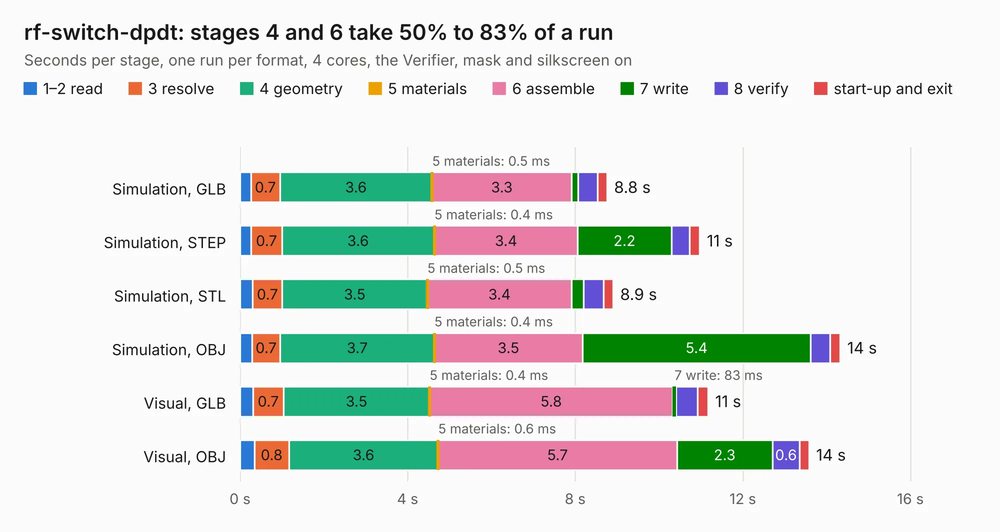

# 1132. rf-switch-dpdt

Board 1,132 of the 3,117 of [Corpus Testing](../Corpus-Testing.md), on [Corpus Page 11](../CorpusTestingPages/Corpus-Testing-11.md#1132-rf-switch-dpdt).

| Mode and format | 1–2 read | 3 resolve | 4 geometry | 5 materials | 6 assemble | 7 write | 8 verify | start-up and exit | Total |
|---|---:|---:|---:|---:|---:|---:|---:|---:|---:|
| Simulation, GLB | 0.3 | 0.7 | 3.6 | 0.5&nbsp;ms | 3.3 | 0.2 | 0.5 | 0.2 | 8.8 |
| Simulation, STEP | 0.3 | 0.7 | 3.6 | 0.4&nbsp;ms | 3.4 | 2.2 | 0.4 | 0.2 | 11.0 |
| Simulation, STL | 0.3 | 0.7 | 3.5 | 0.5&nbsp;ms | 3.4 | 0.3 | 0.5 | 0.2 | 8.9 |
| Simulation, OBJ | 0.3 | 0.7 | 3.7 | 0.4&nbsp;ms | 3.5 | 5.4 | 0.5 | 0.2 | 14.3 |
| Visual, GLB | 0.3 | 0.7 | 3.5 | 0.4&nbsp;ms | 5.8 | 83&nbsp;ms | 0.5 | 0.3 | 11.2 |
| Visual, OBJ | 0.3 | 0.8 | 3.6 | 0.6&nbsp;ms | 5.7 | 2.3 | 0.6 | 0.2 | 13.6 |

<table align="center"><tr><td valign="top">

| Board | Repo: [greatscottgadgets/misc](https://github.com/greatscottgadgets/misc) Board: `rf-switch-dpdt.kicad_pcb` |
|---|---|
| Folder | evaluation-boards / rf-switch-dpdt |
| Complexity | 256&nbsp;/&nbsp;1000 (size&nbsp;156, features&nbsp;100) |
| KESE&nbsp;features | through vias, custom pads, rounded, trapezoid or chamfered pads, filled zones, copper drawings, stack-up, dielectric εr and tanδ |
| Tested | 9th November 2026 |
| Copper&nbsp;layers | 4 |
| File&nbsp;format | KiCad 7 (20221018) |
| Parts,&nbsp;tracks,&nbsp;vias | 29, 120, 24 |
| Triangles,&nbsp;simulation | 1,024,652 in 39 parts |
| Verifier | PASS in all six runs |

</td><td valign="top">

<table>
<tr><th>File type</th><th>File size</th><th>Peak memory used</th></tr>
<tr><th colspan="3" align="left">Simulation</th></tr>
<tr><td>GLB</td><td align="right">35&nbsp;MB</td><td align="right">432&nbsp;MB</td></tr>
<tr><td>STEP</td><td align="right">138&nbsp;MB</td><td align="right">521&nbsp;MB</td></tr>
<tr><td>STL</td><td align="right">51&nbsp;MB</td><td align="right">424&nbsp;MB</td></tr>
<tr><td>OBJ</td><td align="right">102&nbsp;MB</td><td align="right">724&nbsp;MB</td></tr>
<tr><th colspan="3" align="left">Visual</th></tr>
<tr><td>GLB</td><td align="right">16&nbsp;MB</td><td align="right">475&nbsp;MB</td></tr>
<tr><td>OBJ</td><td align="right">47&nbsp;MB</td><td align="right">494&nbsp;MB</td></tr>
</table>

</td></tr></table>

| Previous | Next |
|:---|---:|
| [1131. rf-amps](b1131b_misc_rf-amps.md) | [1133. rf-switch-sp3t](b1133b_misc_rf-switch-sp3t.md) |
