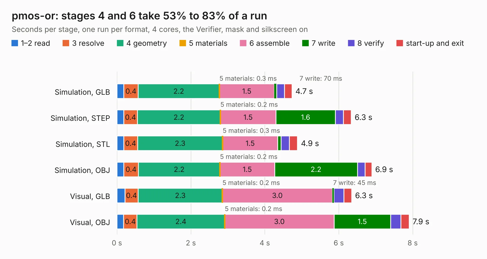

# 1133. pmos-or

Board 1,133 of the 3,125 of [Corpus Testing](../Corpus-Testing.md), on [Corpus Page 11](../CorpusTestingPages/Corpus-Testing-11.md#1133-pmos-or).

| Mode and format | 1–2 read | 3 resolve | 4 geometry | 5 materials | 6 assemble | 7 write | 8 verify | start-up and exit | Total |
|---|---:|---:|---:|---:|---:|---:|---:|---:|---:|
| Simulation, GLB | 0.2 | 0.4 | 2.2 | 0.3&nbsp;ms | 1.5 | 70&nbsp;ms | 0.2 | 0.2 | 4.7 |
| Simulation, STEP | 0.2 | 0.4 | 2.2 | 0.2&nbsp;ms | 1.5 | 1.6 | 0.2 | 0.2 | 6.3 |
| Simulation, STL | 0.2 | 0.4 | 2.3 | 0.3&nbsp;ms | 1.5 | 92&nbsp;ms | 0.2 | 0.2 | 4.9 |
| Simulation, OBJ | 0.2 | 0.4 | 2.2 | 0.2&nbsp;ms | 1.5 | 2.2 | 0.2 | 0.2 | 6.9 |
| Visual, GLB | 0.2 | 0.4 | 2.3 | 0.2&nbsp;ms | 3.0 | 45&nbsp;ms | 0.3 | 0.2 | 6.3 |
| Visual, OBJ | 0.2 | 0.4 | 2.4 | 0.2&nbsp;ms | 3.0 | 1.5 | 0.3 | 0.2 | 7.9 |

<table align="center"><tr><td valign="top">

| Board | Repo: [greatscottgadgets/misc](https://github.com/greatscottgadgets/misc) Board: `pmos-or.kicad_pcb` |
|---|---|
| Folder | evaluation-boards / pmos-or |
| Complexity | 234&nbsp;/&nbsp;1000 (size&nbsp;149, features&nbsp;85) |
| KESE&nbsp;features | through vias, slotted holes, rounded, trapezoid or chamfered pads, filled zones, stack-up, dielectric εr and tanδ |
| Tested | 9th November 2026 |
| Copper&nbsp;layers | 2 |
| File&nbsp;format | KiCad 6 (20211014) |
| Parts,&nbsp;tracks,&nbsp;vias | 42, 193, 24 |
| Triangles,&nbsp;simulation | 441,360 in 48 parts |
| Verifier | PASS in all six runs |

</td><td valign="top">

<table>
<tr><th>File type</th><th>File size</th><th>Peak memory used</th></tr>
<tr><th colspan="3" align="left">Simulation</th></tr>
<tr><td>GLB</td><td align="right">16&nbsp;MB</td><td align="right">287&nbsp;MB</td></tr>
<tr><td>STEP</td><td align="right">83&nbsp;MB</td><td align="right">331&nbsp;MB</td></tr>
<tr><td>STL</td><td align="right">22&nbsp;MB</td><td align="right">281&nbsp;MB</td></tr>
<tr><td>OBJ</td><td align="right">45&nbsp;MB</td><td align="right">340&nbsp;MB</td></tr>
<tr><th colspan="3" align="left">Visual</th></tr>
<tr><td>GLB</td><td align="right">9.8&nbsp;MB</td><td align="right">309&nbsp;MB</td></tr>
<tr><td>OBJ</td><td align="right">29&nbsp;MB</td><td align="right">305&nbsp;MB</td></tr>
</table>

</td></tr></table>

| Previous | Next |
|:---|---:|
| [1132. passives](b1132b_misc_passives.md) | [1134. quad-balun-directional-coupler](b1134b_misc_quad-balun-directional-coupler.md) |
