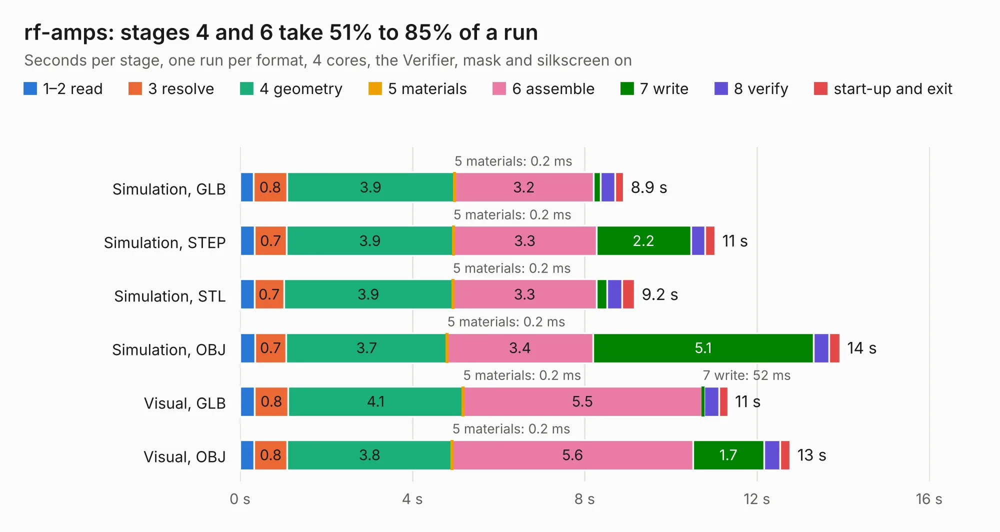

# 1135. rf-amps

Board 1,135 of the 3,123 of [Corpus Testing](../Corpus-Testing.md), on [Corpus Page 11](../CorpusTestingPages/Corpus-Testing-11.md#1135-rf-amps).

| Mode and format | 1–2 read | 3 resolve | 4 geometry | 5 materials | 6 assemble | 7 write | 8 verify | start-up and exit | Total |
|---|---:|---:|---:|---:|---:|---:|---:|---:|---:|
| Simulation, GLB | 0.3 | 0.8 | 3.9 | 0.2&nbsp;ms | 3.2 | 0.2 | 0.3 | 0.2 | 8.9 |
| Simulation, STEP | 0.3 | 0.7 | 3.9 | 0.2&nbsp;ms | 3.3 | 2.2 | 0.3 | 0.2 | 11.0 |
| Simulation, STL | 0.3 | 0.7 | 3.9 | 0.2&nbsp;ms | 3.3 | 0.2 | 0.4 | 0.3 | 9.2 |
| Simulation, OBJ | 0.3 | 0.7 | 3.7 | 0.2&nbsp;ms | 3.4 | 5.1 | 0.4 | 0.3 | 13.9 |
| Visual, GLB | 0.3 | 0.8 | 4.1 | 0.2&nbsp;ms | 5.5 | 52&nbsp;ms | 0.3 | 0.2 | 11.3 |
| Visual, OBJ | 0.3 | 0.8 | 3.8 | 0.2&nbsp;ms | 5.6 | 1.7 | 0.4 | 0.2 | 12.8 |

<table align="center"><tr><td valign="top">

| Board | Repo: [greatscottgadgets/misc](https://github.com/greatscottgadgets/misc) Board: `rf-amps.kicad_pcb` |
|---|---|
| Folder | evaluation-boards / rf-amps |
| Complexity | 231&nbsp;/&nbsp;1000 (size&nbsp;166, features&nbsp;65) |
| KESE&nbsp;features | through vias, rounded, trapezoid or chamfered pads, filled zones, copper text, curved board outline |
| Tested | 9th November 2026 |
| Copper&nbsp;layers | 4 |
| File&nbsp;format | KiCad 9 (20241229) |
| Parts,&nbsp;tracks,&nbsp;vias | 59, 149, 23 |
| Triangles,&nbsp;simulation | 984,660 in 47 parts |
| Verifier | PASS in all six runs |

</td><td valign="top">

<table>
<tr><th>File type</th><th>File size</th><th>Peak memory used</th></tr>
<tr><th colspan="3" align="left">Simulation</th></tr>
<tr><td>GLB</td><td align="right">34&nbsp;MB</td><td align="right">490&nbsp;MB</td></tr>
<tr><td>STEP</td><td align="right">122&nbsp;MB</td><td align="right">526&nbsp;MB</td></tr>
<tr><td>STL</td><td align="right">49&nbsp;MB</td><td align="right">456&nbsp;MB</td></tr>
<tr><td>OBJ</td><td align="right">100&nbsp;MB</td><td align="right">708&nbsp;MB</td></tr>
<tr><th colspan="3" align="left">Visual</th></tr>
<tr><td>GLB</td><td align="right">12&nbsp;MB</td><td align="right">424&nbsp;MB</td></tr>
<tr><td>OBJ</td><td align="right">35&nbsp;MB</td><td align="right">410&nbsp;MB</td></tr>
</table>

</td></tr></table>

| Previous | Next |
|:---|---:|
| [1134. quad-balun-directional-coupler](b1134b_misc_quad-balun-directional-coupler.md) | [1136. rf-switch-dpdt](b1136b_misc_rf-switch-dpdt.md) |
