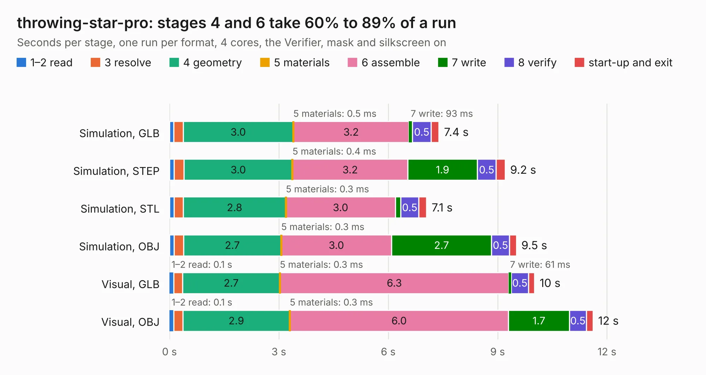

# 1135. throwing-star-pro

Board 1,135 of the 3,101 of [Corpus Testing](../Corpus-Testing.md), on [Corpus Page 11](../CorpusTestingPages/Corpus-Testing-11.md#1135-throwing-star-pro).

| Mode and format | 1–2 read | 3 resolve | 4 geometry | 5 materials | 6 assemble | 7 write | 8 verify | start-up and exit | Total |
|---|---:|---:|---:|---:|---:|---:|---:|---:|---:|
| Simulation, GLB | 0.1 | 0.3 | 3.0 | 0.5&nbsp;ms | 3.2 | 93&nbsp;ms | 0.5 | 0.2 | 7.4 |
| Simulation, STEP | 0.1 | 0.3 | 3.0 | 0.4&nbsp;ms | 3.2 | 1.9 | 0.5 | 0.2 | 9.2 |
| Simulation, STL | 0.1 | 0.3 | 2.8 | 0.3&nbsp;ms | 3.0 | 0.1 | 0.5 | 0.2 | 7.1 |
| Simulation, OBJ | 0.1 | 0.3 | 2.7 | 0.3&nbsp;ms | 3.0 | 2.7 | 0.5 | 0.2 | 9.5 |
| Visual, GLB | 0.1 | 0.2 | 2.7 | 0.3&nbsp;ms | 6.3 | 61&nbsp;ms | 0.5 | 0.2 | 10.0 |
| Visual, OBJ | 0.1 | 0.3 | 2.9 | 0.3&nbsp;ms | 6.0 | 1.7 | 0.5 | 0.2 | 11.6 |

<table align="center"><tr><td valign="top">

| Board | Repo: [greatscottgadgets/throwing-star-lan-tap](https://github.com/greatscottgadgets/throwing-star-lan-tap) Board: `throwing-star-pro.kicad_pcb` |
|---|---|
| Complexity | 152&nbsp;/&nbsp;1000 (size&nbsp;117, features&nbsp;35) |
| KESE&nbsp;features | through vias, filled zones |
| Tested | 9th November 2026 |
| Copper&nbsp;layers | 2 |
| File&nbsp;format | KiCad 5 (20171130) |
| Parts,&nbsp;tracks,&nbsp;vias | 6, 112, 4 |
| Triangles,&nbsp;simulation | 653,240 in 29 parts |
| Verifier | PASS in all six runs |

</td><td valign="top">

<table>
<tr><th>File type</th><th>File size</th><th>Peak memory used</th></tr>
<tr><th colspan="3" align="left">Simulation</th></tr>
<tr><td>GLB</td><td align="right">24&nbsp;MB</td><td align="right">342&nbsp;MB</td></tr>
<tr><td>STEP</td><td align="right">153&nbsp;MB</td><td align="right">432&nbsp;MB</td></tr>
<tr><td>STL</td><td align="right">33&nbsp;MB</td><td align="right">345&nbsp;MB</td></tr>
<tr><td>OBJ</td><td align="right">71&nbsp;MB</td><td align="right">509&nbsp;MB</td></tr>
<tr><th colspan="3" align="left">Visual</th></tr>
<tr><td>GLB</td><td align="right">16&nbsp;MB</td><td align="right">436&nbsp;MB</td></tr>
<tr><td>OBJ</td><td align="right">47&nbsp;MB</td><td align="right">436&nbsp;MB</td></tr>
</table>

</td></tr></table>

| Previous | Next |
|:---|---:|
| [1134. vbus-switch](b1134b_misc_vbus-switch.md) | [1136. throwing-star](b1136b_throwing-star-lan-tap_throwing-star.md) |
