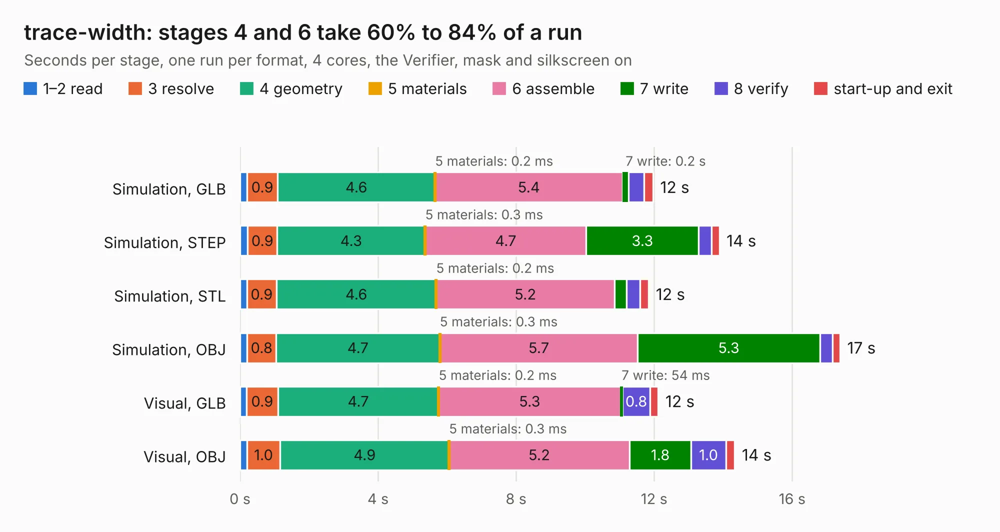

# 1137. trace-width

Board 1,137 of the 3,107 of [Corpus Testing](../Corpus-Testing.md), on [Corpus Page 11](../CorpusTestingPages/Corpus-Testing-11.md#1137-trace-width).

| Mode and format | 1–2 read | 3 resolve | 4 geometry | 5 materials | 6 assemble | 7 write | 8 verify | start-up and exit | Total |
|---|---:|---:|---:|---:|---:|---:|---:|---:|---:|
| Simulation, GLB | 0.2 | 0.9 | 4.6 | 0.2&nbsp;ms | 5.4 | 0.2 | 0.4 | 0.3 | 12.0 |
| Simulation, STEP | 0.2 | 0.9 | 4.3 | 0.3&nbsp;ms | 4.7 | 3.3 | 0.4 | 0.2 | 13.9 |
| Simulation, STL | 0.2 | 0.9 | 4.6 | 0.2&nbsp;ms | 5.2 | 0.3 | 0.4 | 0.2 | 11.8 |
| Simulation, OBJ | 0.2 | 0.8 | 4.7 | 0.3&nbsp;ms | 5.7 | 5.3 | 0.4 | 0.2 | 17.4 |
| Visual, GLB | 0.2 | 0.9 | 4.7 | 0.2&nbsp;ms | 5.3 | 54&nbsp;ms | 0.8 | 0.2 | 12.1 |
| Visual, OBJ | 0.2 | 1.0 | 4.9 | 0.3&nbsp;ms | 5.2 | 1.8 | 1.0 | 0.3 | 14.3 |

<table align="center"><tr><td valign="top">

| Board | Repo: [greatscottgadgets/misc](https://github.com/greatscottgadgets/misc) Board: `trace-width.kicad_pcb` |
|---|---|
| Folder | evaluation-boards / trace-width |
| Complexity | 132&nbsp;/&nbsp;1000 (size&nbsp;112, features&nbsp;20) |
| KESE&nbsp;features | filled zones |
| Tested | 9th November 2026 |
| Copper&nbsp;layers | 4 |
| File&nbsp;format | KiCad 6 (20211014) |
| Parts,&nbsp;tracks,&nbsp;vias | 26, 13, 0 |
| Triangles,&nbsp;simulation | 1,164,700 in 19 parts |
| Verifier | PASS in all six runs |

</td><td valign="top">

<table>
<tr><th>File type</th><th>File size</th><th>Peak memory used</th></tr>
<tr><th colspan="3" align="left">Simulation</th></tr>
<tr><td>GLB</td><td align="right">39&nbsp;MB</td><td align="right">511&nbsp;MB</td></tr>
<tr><td>STEP</td><td align="right">99&nbsp;MB</td><td align="right">672&nbsp;MB</td></tr>
<tr><td>STL</td><td align="right">58&nbsp;MB</td><td align="right">485&nbsp;MB</td></tr>
<tr><td>OBJ</td><td align="right">116&nbsp;MB</td><td align="right">812&nbsp;MB</td></tr>
<tr><th colspan="3" align="left">Visual</th></tr>
<tr><td>GLB</td><td align="right">12&nbsp;MB</td><td align="right">477&nbsp;MB</td></tr>
<tr><td>OBJ</td><td align="right">35&nbsp;MB</td><td align="right">505&nbsp;MB</td></tr>
</table>

</td></tr></table>

| Previous | Next |
|:---|---:|
| [1136. trace-width-sunstone](b1136b_misc_trace-width-sunstone.md) | [1138. ununs](b1138b_misc_ununs.md) |
