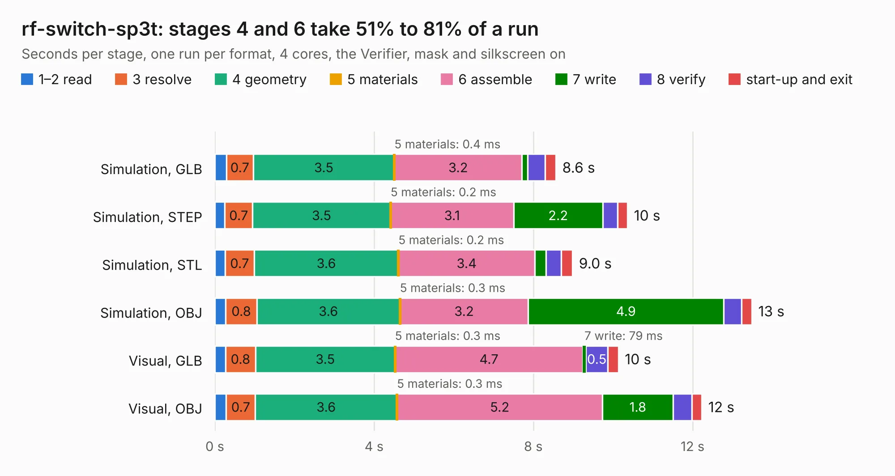

# 1138. rf-switch-sp3t

Board 1,138 of the 3,132 of [Corpus Testing](../Corpus-Testing.md), on [Corpus Page 11](../CorpusTestingPages/Corpus-Testing-11.md#1138-rf-switch-sp3t).

| Mode and format | 1–2 read | 3 resolve | 4 geometry | 5 materials | 6 assemble | 7 write | 8 verify | start-up and exit | Total |
|---|---:|---:|---:|---:|---:|---:|---:|---:|---:|
| Simulation, GLB | 0.3 | 0.7 | 3.5 | 0.4&nbsp;ms | 3.2 | 0.1 | 0.4 | 0.3 | 8.6 |
| Simulation, STEP | 0.3 | 0.7 | 3.5 | 0.2&nbsp;ms | 3.1 | 2.2 | 0.4 | 0.2 | 10.4 |
| Simulation, STL | 0.3 | 0.7 | 3.6 | 0.2&nbsp;ms | 3.4 | 0.3 | 0.4 | 0.3 | 9.0 |
| Simulation, OBJ | 0.3 | 0.8 | 3.6 | 0.3&nbsp;ms | 3.2 | 4.9 | 0.4 | 0.3 | 13.5 |
| Visual, GLB | 0.3 | 0.8 | 3.5 | 0.3&nbsp;ms | 4.7 | 79&nbsp;ms | 0.5 | 0.3 | 10.1 |
| Visual, OBJ | 0.3 | 0.7 | 3.6 | 0.3&nbsp;ms | 5.2 | 1.8 | 0.5 | 0.2 | 12.2 |

<table align="center"><tr><td valign="top">

| Board | Repo: [greatscottgadgets/misc](https://github.com/greatscottgadgets/misc) Board: `rf-switch-sp3t.kicad_pcb` |
|---|---|
| Folder | evaluation-boards / rf-switch-sp3t |
| Complexity | 241&nbsp;/&nbsp;1000 (size&nbsp;166, features&nbsp;75) |
| KESE&nbsp;features | through vias, rounded, trapezoid or chamfered pads, filled zones, stack-up, dielectric εr and tanδ |
| Tested | 9th November 2026 |
| Copper&nbsp;layers | 4 |
| File&nbsp;format | KiCad 8 (20240108) |
| Parts,&nbsp;tracks,&nbsp;vias | 33, 141, 57 |
| Triangles,&nbsp;simulation | 942,708 in 40 parts |
| Verifier | PASS in all six runs |

</td><td valign="top">

<table>
<tr><th>File type</th><th>File size</th><th>Peak memory used</th></tr>
<tr><th colspan="3" align="left">Simulation</th></tr>
<tr><td>GLB</td><td align="right">32&nbsp;MB</td><td align="right">468&nbsp;MB</td></tr>
<tr><td>STEP</td><td align="right">103&nbsp;MB</td><td align="right">532&nbsp;MB</td></tr>
<tr><td>STL</td><td align="right">47&nbsp;MB</td><td align="right">442&nbsp;MB</td></tr>
<tr><td>OBJ</td><td align="right">95&nbsp;MB</td><td align="right">673&nbsp;MB</td></tr>
<tr><th colspan="3" align="left">Visual</th></tr>
<tr><td>GLB</td><td align="right">13&nbsp;MB</td><td align="right">415&nbsp;MB</td></tr>
<tr><td>OBJ</td><td align="right">38&nbsp;MB</td><td align="right">441&nbsp;MB</td></tr>
</table>

</td></tr></table>

| Previous | Next |
|:---|---:|
| [1137. rf-switch-dpdt](b1137b_misc_rf-switch-dpdt.md) | [1139. rf-switch-sp4t](b1139b_misc_rf-switch-sp4t.md) |
