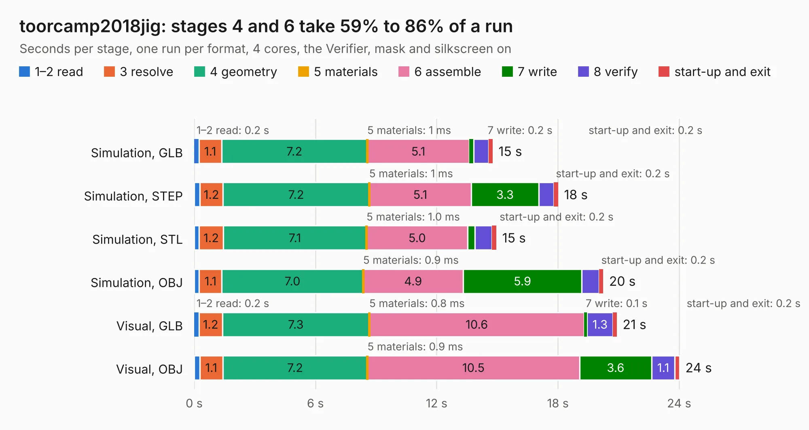

# 1139. toorcamp2018jig

Board 1,139 of the 3,102 of [Corpus Testing](../Corpus-Testing.md), on [Corpus Page 11](../CorpusTestingPages/Corpus-Testing-11.md#1139-toorcamp2018jig).

| Mode and format | 1–2 read | 3 resolve | 4 geometry | 5 materials | 6 assemble | 7 write | 8 verify | start-up and exit | Total |
|---|---:|---:|---:|---:|---:|---:|---:|---:|---:|
| Simulation, GLB | 0.2 | 1.1 | 7.2 | 1&nbsp;ms | 5.1 | 0.2 | 0.7 | 0.2 | 14.8 |
| Simulation, STEP | 0.3 | 1.2 | 7.2 | 1&nbsp;ms | 5.1 | 3.3 | 0.7 | 0.2 | 18.0 |
| Simulation, STL | 0.2 | 1.2 | 7.1 | 1.0&nbsp;ms | 5.0 | 0.3 | 0.8 | 0.2 | 15.0 |
| Simulation, OBJ | 0.2 | 1.1 | 7.0 | 0.9&nbsp;ms | 4.9 | 5.9 | 0.9 | 0.2 | 20.2 |
| Visual, GLB | 0.2 | 1.2 | 7.3 | 0.8&nbsp;ms | 10.6 | 0.1 | 1.3 | 0.2 | 20.9 |
| Visual, OBJ | 0.3 | 1.1 | 7.2 | 0.9&nbsp;ms | 10.5 | 3.6 | 1.1 | 0.2 | 24.0 |

<table align="center"><tr><td valign="top">

| Board | Repo: [greatscottgadgets/toorcamp2018badge](https://github.com/greatscottgadgets/toorcamp2018badge) Board: `toorcamp2018jig.kicad_pcb` |
|---|---|
| Folder | hardware / jig |
| Complexity | 218&nbsp;/&nbsp;1000 (size&nbsp;173, features&nbsp;45) |
| KESE&nbsp;features | through vias, filled zones, curved board outline |
| Tested | 9th November 2026 |
| Copper&nbsp;layers | 2 |
| File&nbsp;format | KiCad 4 (4) |
| Parts,&nbsp;tracks,&nbsp;vias | 75, 705, 26 |
| Triangles,&nbsp;simulation | 1,475,914 in 181 parts |
| Verifier | PASS in all six runs |

</td><td valign="top">

<table>
<tr><th>File type</th><th>File size</th><th>Peak memory used</th></tr>
<tr><th colspan="3" align="left">Simulation</th></tr>
<tr><td>GLB</td><td align="right">51&nbsp;MB</td><td align="right">573&nbsp;MB</td></tr>
<tr><td>STEP</td><td align="right">257&nbsp;MB</td><td align="right">651&nbsp;MB</td></tr>
<tr><td>STL</td><td align="right">74&nbsp;MB</td><td align="right">573&nbsp;MB</td></tr>
<tr><td>OBJ</td><td align="right">156&nbsp;MB</td><td align="right">1.0&nbsp;GB</td></tr>
<tr><th colspan="3" align="left">Visual</th></tr>
<tr><td>GLB</td><td align="right">31&nbsp;MB</td><td align="right">690&nbsp;MB</td></tr>
<tr><td>OBJ</td><td align="right">93&nbsp;MB</td><td align="right">679&nbsp;MB</td></tr>
</table>

</td></tr></table>

| Previous | Next |
|:---|---:|
| [1138. toorcamp2018badge](b1138b_toorcamp2018badge_toorcamp2018badge.md) | [1140. sasserides](b1140b_tycho_sasserides.md) |
