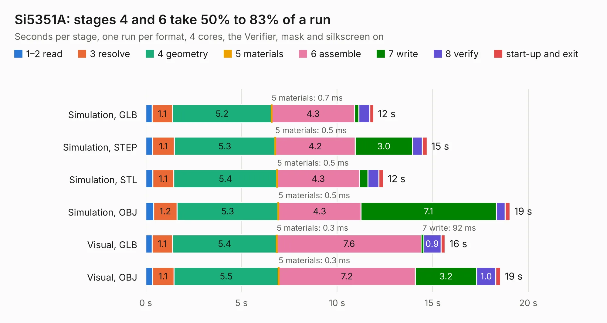

# 1142. Si5351A

Board 1,142 of the 3,139 of [Corpus Testing](../Corpus-Testing.md), on [Corpus Page 11](../CorpusTestingPages/Corpus-Testing-11.md#1142-si5351a).

| Mode and format | 1–2 read | 3 resolve | 4 geometry | 5 materials | 6 assemble | 7 write | 8 verify | start-up and exit | Total |
|---|---:|---:|---:|---:|---:|---:|---:|---:|---:|
| Simulation, GLB | 0.3 | 1.1 | 5.2 | 0.7&nbsp;ms | 4.3 | 0.2 | 0.6 | 0.2 | 11.9 |
| Simulation, STEP | 0.4 | 1.1 | 5.3 | 0.5&nbsp;ms | 4.2 | 3.0 | 0.5 | 0.3 | 14.7 |
| Simulation, STL | 0.4 | 1.1 | 5.4 | 0.5&nbsp;ms | 4.3 | 0.4 | 0.6 | 0.2 | 12.4 |
| Simulation, OBJ | 0.4 | 1.2 | 5.3 | 0.5&nbsp;ms | 4.3 | 7.1 | 0.5 | 0.2 | 19.0 |
| Visual, GLB | 0.3 | 1.1 | 5.4 | 0.3&nbsp;ms | 7.6 | 92&nbsp;ms | 0.9 | 0.2 | 15.6 |
| Visual, OBJ | 0.3 | 1.1 | 5.5 | 0.3&nbsp;ms | 7.2 | 3.2 | 1.0 | 0.2 | 18.5 |

<table align="center"><tr><td valign="top">

| Board | Repo: [greatscottgadgets/misc](https://github.com/greatscottgadgets/misc) Board: `Si5351A.kicad_pcb` |
|---|---|
| Folder | evaluation-boards / Si5351A |
| Complexity | 273&nbsp;/&nbsp;1000 (size&nbsp;188, features&nbsp;85) |
| KESE&nbsp;features | through vias, rounded, trapezoid or chamfered pads, filled zones, curved board outline, stack-up, dielectric εr and tanδ |
| Tested | 9th November 2026 |
| Copper&nbsp;layers | 4 |
| File&nbsp;format | KiCad 6 (20211014) |
| Parts,&nbsp;tracks,&nbsp;vias | 84, 439, 69 |
| Triangles,&nbsp;simulation | 1,313,314 in 62 parts |
| Verifier | PASS in all six runs |

</td><td valign="top">

<table>
<tr><th>File type</th><th>File size</th><th>Peak memory used</th></tr>
<tr><th colspan="3" align="left">Simulation</th></tr>
<tr><td>GLB</td><td align="right">43&nbsp;MB</td><td align="right">578&nbsp;MB</td></tr>
<tr><td>STEP</td><td align="right">152&nbsp;MB</td><td align="right">634&nbsp;MB</td></tr>
<tr><td>STL</td><td align="right">66&nbsp;MB</td><td align="right">566&nbsp;MB</td></tr>
<tr><td>OBJ</td><td align="right">133&nbsp;MB</td><td align="right">899&nbsp;MB</td></tr>
<tr><th colspan="3" align="left">Visual</th></tr>
<tr><td>GLB</td><td align="right">20&nbsp;MB</td><td align="right">627&nbsp;MB</td></tr>
<tr><td>OBJ</td><td align="right">61&nbsp;MB</td><td align="right">588&nbsp;MB</td></tr>
</table>

</td></tr></table>

| Previous | Next |
|:---|---:|
| [1141. rf-switch-spdt](b1141b_misc_rf-switch-spdt.md) | [1143. sky13350](b1143b_misc_sky13350.md) |
