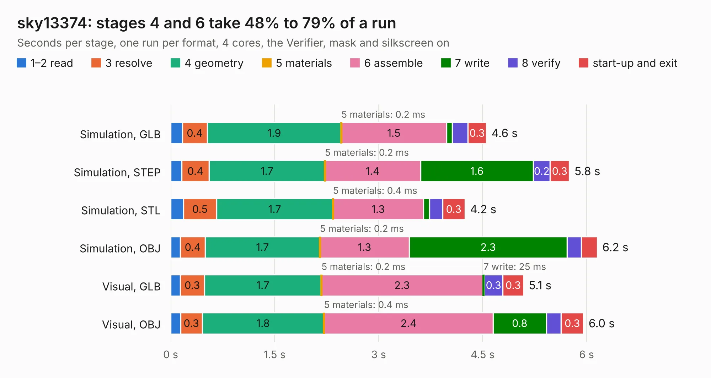

# 1143. sky13374

Board 1,143 of the 3,130 of [Corpus Testing](../Corpus-Testing.md), on [Corpus Page 11](../CorpusTestingPages/Corpus-Testing-11.md#1143-sky13374).

| Mode and format | 1–2 read | 3 resolve | 4 geometry | 5 materials | 6 assemble | 7 write | 8 verify | start-up and exit | Total |
|---|---:|---:|---:|---:|---:|---:|---:|---:|---:|
| Simulation, GLB | 0.2 | 0.4 | 1.9 | 0.2&nbsp;ms | 1.5 | 86&nbsp;ms | 0.2 | 0.3 | 4.6 |
| Simulation, STEP | 0.2 | 0.4 | 1.7 | 0.2&nbsp;ms | 1.4 | 1.6 | 0.2 | 0.3 | 5.8 |
| Simulation, STL | 0.2 | 0.5 | 1.7 | 0.4&nbsp;ms | 1.3 | 88&nbsp;ms | 0.2 | 0.3 | 4.2 |
| Simulation, OBJ | 0.1 | 0.4 | 1.7 | 0.2&nbsp;ms | 1.3 | 2.3 | 0.2 | 0.2 | 6.2 |
| Visual, GLB | 0.1 | 0.3 | 1.7 | 0.2&nbsp;ms | 2.3 | 25&nbsp;ms | 0.3 | 0.3 | 5.1 |
| Visual, OBJ | 0.1 | 0.3 | 1.8 | 0.4&nbsp;ms | 2.4 | 0.8 | 0.2 | 0.3 | 6.0 |

<table align="center"><tr><td valign="top">

| Board | Repo: [greatscottgadgets/misc](https://github.com/greatscottgadgets/misc) Board: `sky13374.kicad_pcb` |
|---|---|
| Folder | evaluation-boards / sky13374 |
| Complexity | 171&nbsp;/&nbsp;1000 (size&nbsp;136, features&nbsp;35) |
| KESE&nbsp;features | through vias, filled zones |
| Tested | 9th November 2026 |
| Copper&nbsp;layers | 4 |
| File&nbsp;format | KiCad 4 (4) |
| Parts,&nbsp;tracks,&nbsp;vias | 17, 45, 10 |
| Triangles,&nbsp;simulation | 299,316 in 23 parts |
| Verifier | PASS in all six runs |

</td><td valign="top">

<table>
<tr><th>File type</th><th>File size</th><th>Peak memory used</th></tr>
<tr><th colspan="3" align="left">Simulation</th></tr>
<tr><td>GLB</td><td align="right">10&nbsp;MB</td><td align="right">225&nbsp;MB</td></tr>
<tr><td>STEP</td><td align="right">40&nbsp;MB</td><td align="right">236&nbsp;MB</td></tr>
<tr><td>STL</td><td align="right">15&nbsp;MB</td><td align="right">226&nbsp;MB</td></tr>
<tr><td>OBJ</td><td align="right">30&nbsp;MB</td><td align="right">234&nbsp;MB</td></tr>
<tr><th colspan="3" align="left">Visual</th></tr>
<tr><td>GLB</td><td align="right">4.6&nbsp;MB</td><td align="right">202&nbsp;MB</td></tr>
<tr><td>OBJ</td><td align="right">13&nbsp;MB</td><td align="right">197&nbsp;MB</td></tr>
</table>

</td></tr></table>

| Previous | Next |
|:---|---:|
| [1142. sky13351](b1142b_misc_sky13351.md) | [1144. sky13411](b1144b_misc_sky13411.md) |
