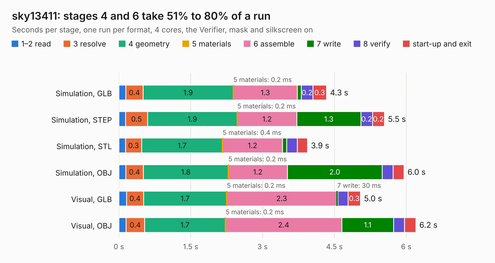

# 1144. sky13411

Board 1,144 of the 3,123 of [Corpus Testing](../Corpus-Testing.md), on [Corpus Page 11](../CorpusTestingPages/Corpus-Testing-11.md#1144-sky13411).

| Mode and format | 1–2 read | 3 resolve | 4 geometry | 5 materials | 6 assemble | 7 write | 8 verify | start-up and exit | Total |
|---|---:|---:|---:|---:|---:|---:|---:|---:|---:|
| Simulation, GLB | 0.1 | 0.4 | 1.9 | 0.2&nbsp;ms | 1.3 | 84&nbsp;ms | 0.2 | 0.3 | 4.3 |
| Simulation, STEP | 0.1 | 0.5 | 1.9 | 0.2&nbsp;ms | 1.2 | 1.3 | 0.2 | 0.2 | 5.5 |
| Simulation, STL | 0.1 | 0.3 | 1.7 | 0.4&nbsp;ms | 1.2 | 88&nbsp;ms | 0.2 | 0.2 | 3.9 |
| Simulation, OBJ | 0.1 | 0.4 | 1.8 | 0.2&nbsp;ms | 1.2 | 2.0 | 0.2 | 0.2 | 6.0 |
| Visual, GLB | 0.2 | 0.4 | 1.7 | 0.2&nbsp;ms | 2.3 | 30&nbsp;ms | 0.2 | 0.3 | 5.0 |
| Visual, OBJ | 0.1 | 0.4 | 1.7 | 0.2&nbsp;ms | 2.4 | 1.1 | 0.2 | 0.2 | 6.2 |

<table align="center"><tr><td valign="top">

| Board | Repo: [greatscottgadgets/misc](https://github.com/greatscottgadgets/misc) Board: `sky13411.kicad_pcb` |
|---|---|
| Folder | evaluation-boards / sky13411 |
| Complexity | 172&nbsp;/&nbsp;1000 (size&nbsp;137, features&nbsp;35) |
| KESE&nbsp;features | through vias, filled zones |
| Tested | 9th November 2026 |
| Copper&nbsp;layers | 4 |
| File&nbsp;format | KiCad 4 (4) |
| Parts,&nbsp;tracks,&nbsp;vias | 26, 53, 3 |
| Triangles,&nbsp;simulation | 355,080 in 30 parts |
| Verifier | PASS in all six runs |

</td><td valign="top">

<table>
<tr><th>File type</th><th>File size</th><th>Peak memory used</th></tr>
<tr><th colspan="3" align="left">Simulation</th></tr>
<tr><td>GLB</td><td align="right">12&nbsp;MB</td><td align="right">240&nbsp;MB</td></tr>
<tr><td>STEP</td><td align="right">48&nbsp;MB</td><td align="right">258&nbsp;MB</td></tr>
<tr><td>STL</td><td align="right">18&nbsp;MB</td><td align="right">244&nbsp;MB</td></tr>
<tr><td>OBJ</td><td align="right">36&nbsp;MB</td><td align="right">288&nbsp;MB</td></tr>
<tr><th colspan="3" align="left">Visual</th></tr>
<tr><td>GLB</td><td align="right">5.3&nbsp;MB</td><td align="right">212&nbsp;MB</td></tr>
<tr><td>OBJ</td><td align="right">15&nbsp;MB</td><td align="right">216&nbsp;MB</td></tr>
</table>

</td></tr></table>

| Previous | Next |
|:---|---:|
| [1143. sky13374](b1143b_misc_sky13374.md) | [1145. sma-jlcpcb](b1145b_misc_sma-jlcpcb.md) |
