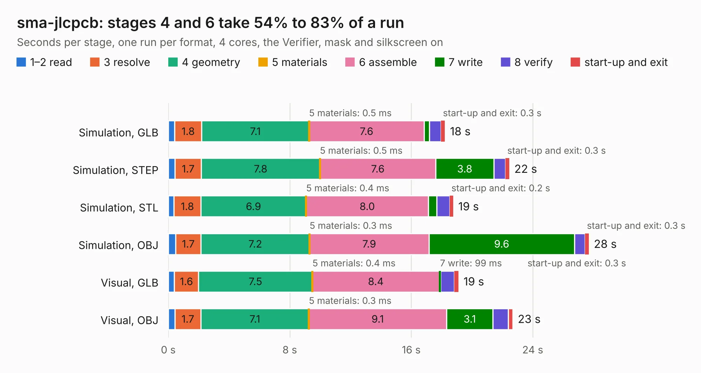

# 1144. sma-jlcpcb

Board 1,144 of the 3,121 of [Corpus Testing](../Corpus-Testing.md), on [Corpus Page 11](../CorpusTestingPages/Corpus-Testing-11.md#1144-sma-jlcpcb).

| Mode and format | 1–2 read | 3 resolve | 4 geometry | 5 materials | 6 assemble | 7 write | 8 verify | start-up and exit | Total |
|---|---:|---:|---:|---:|---:|---:|---:|---:|---:|
| Simulation, GLB | 0.4 | 1.8 | 7.1 | 0.5&nbsp;ms | 7.6 | 0.3 | 0.8 | 0.3 | 18.2 |
| Simulation, STEP | 0.4 | 1.7 | 7.8 | 0.5&nbsp;ms | 7.6 | 3.8 | 0.8 | 0.3 | 22.5 |
| Simulation, STL | 0.4 | 1.8 | 6.9 | 0.4&nbsp;ms | 8.0 | 0.6 | 0.8 | 0.2 | 18.8 |
| Simulation, OBJ | 0.5 | 1.7 | 7.2 | 0.3&nbsp;ms | 7.9 | 9.6 | 0.7 | 0.3 | 27.7 |
| Visual, GLB | 0.4 | 1.6 | 7.5 | 0.4&nbsp;ms | 8.4 | 99&nbsp;ms | 0.9 | 0.3 | 19.1 |
| Visual, OBJ | 0.4 | 1.7 | 7.1 | 0.3&nbsp;ms | 9.1 | 3.1 | 1.0 | 0.3 | 22.7 |

<table align="center"><tr><td valign="top">

| Board | Repo: [greatscottgadgets/misc](https://github.com/greatscottgadgets/misc) Board: `sma-jlcpcb.kicad_pcb` |
|---|---|
| Folder | evaluation-boards / trace-width |
| Complexity | 236&nbsp;/&nbsp;1000 (size&nbsp;171, features&nbsp;65) |
| KESE&nbsp;features | through vias, filled zones, stack-up, dielectric εr and tanδ |
| Tested | 9th November 2026 |
| Copper&nbsp;layers | 6 |
| File&nbsp;format | KiCad 8 (20240108) |
| Parts,&nbsp;tracks,&nbsp;vias | 20, 10, 104 |
| Triangles,&nbsp;simulation | 1,934,558 in 25 parts |
| Verifier | PASS in all six runs |

</td><td valign="top">

<table>
<tr><th>File type</th><th>File size</th><th>Peak memory used</th></tr>
<tr><th colspan="3" align="left">Simulation</th></tr>
<tr><td>GLB</td><td align="right">64&nbsp;MB</td><td align="right">849&nbsp;MB</td></tr>
<tr><td>STEP</td><td align="right">181&nbsp;MB</td><td align="right">902&nbsp;MB</td></tr>
<tr><td>STL</td><td align="right">97&nbsp;MB</td><td align="right">838&nbsp;MB</td></tr>
<tr><td>OBJ</td><td align="right">199&nbsp;MB</td><td align="right">1.3&nbsp;GB</td></tr>
<tr><th colspan="3" align="left">Visual</th></tr>
<tr><td>GLB</td><td align="right">22&nbsp;MB</td><td align="right">662&nbsp;MB</td></tr>
<tr><td>OBJ</td><td align="right">65&nbsp;MB</td><td align="right">630&nbsp;MB</td></tr>
</table>

</td></tr></table>

| Previous | Next |
|:---|---:|
| [1143. sky13411](b1143b_misc_sky13411.md) | [1145. trace-width-jlcpcb](b1145b_misc_trace-width-jlcpcb.md) |
