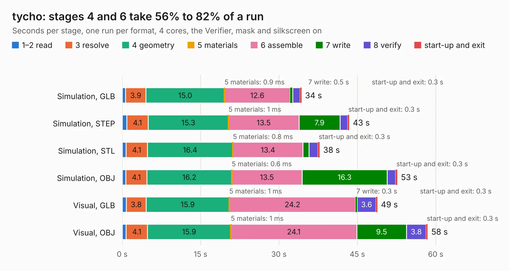

# 1144. tycho

Board 1,144 of the 3,105 of [Corpus Testing](../Corpus-Testing.md), on [Corpus Page 11](../CorpusTestingPages/Corpus-Testing-11.md#1144-tycho).

| Mode and format | 1–2 read | 3 resolve | 4 geometry | 5 materials | 6 assemble | 7 write | 8 verify | start-up and exit | Total |
|---|---:|---:|---:|---:|---:|---:|---:|---:|---:|
| Simulation, GLB | 0.7 | 3.9 | 15.0 | 0.9&nbsp;ms | 12.6 | 0.5 | 1.4 | 0.3 | 34.3 |
| Simulation, STEP | 0.9 | 4.1 | 15.3 | 1&nbsp;ms | 13.5 | 7.9 | 1.5 | 0.3 | 43.4 |
| Simulation, STL | 0.7 | 4.1 | 16.4 | 0.8&nbsp;ms | 13.4 | 1.2 | 1.7 | 0.3 | 37.8 |
| Simulation, OBJ | 0.7 | 4.1 | 16.2 | 0.6&nbsp;ms | 13.5 | 16.3 | 1.6 | 0.3 | 52.6 |
| Visual, GLB | 0.8 | 3.8 | 15.9 | 1&nbsp;ms | 24.2 | 0.3 | 3.6 | 0.3 | 48.8 |
| Visual, OBJ | 0.7 | 4.1 | 15.9 | 1&nbsp;ms | 24.1 | 9.5 | 3.8 | 0.3 | 58.4 |

<table align="center"><tr><td valign="top">

| Board | Repo: [greatscottgadgets/tycho](https://github.com/greatscottgadgets/tycho) Board: `tycho.kicad_pcb` |
|---|---|
| Folder | tycho |
| Complexity | 399&nbsp;/&nbsp;1000 (size&nbsp;259, features&nbsp;140) |
| KESE&nbsp;features | through vias, slotted holes, custom pads, rounded, trapezoid or chamfered pads, filled zones, copper drawings, copper text, stack-up, dielectric εr and tanδ, copper finish, mask and silkscreen colours |
| Tested | 9th November 2026 |
| Copper&nbsp;layers | 4 |
| File&nbsp;format | KiCad 7 (20221018) |
| Parts,&nbsp;tracks,&nbsp;vias | 164, 1,623, 399 |
| Triangles,&nbsp;simulation | 3,419,022 in 267 parts |
| Verifier | PASS in all six runs |

</td><td valign="top">

<table>
<tr><th>File type</th><th>File size</th><th>Peak memory used</th></tr>
<tr><th colspan="3" align="left">Simulation</th></tr>
<tr><td>GLB</td><td align="right">118&nbsp;MB</td><td align="right">1.1&nbsp;GB</td></tr>
<tr><td>STEP</td><td align="right">518&nbsp;MB</td><td align="right">1.3&nbsp;GB</td></tr>
<tr><td>STL</td><td align="right">171&nbsp;MB</td><td align="right">1.1&nbsp;GB</td></tr>
<tr><td>OBJ</td><td align="right">369&nbsp;MB</td><td align="right">2.3&nbsp;GB</td></tr>
<tr><th colspan="3" align="left">Visual</th></tr>
<tr><td>GLB</td><td align="right">67&nbsp;MB</td><td align="right">1.2&nbsp;GB</td></tr>
<tr><td>OBJ</td><td align="right">210&nbsp;MB</td><td align="right">1.5&nbsp;GB</td></tr>
</table>

</td></tr></table>

| Previous | Next |
|:---|---:|
| [1143. sasserides](b1143b_tycho_sasserides.md) | [1145. mainboard](b1145b_urti-mainboard_mainboard.md) |
