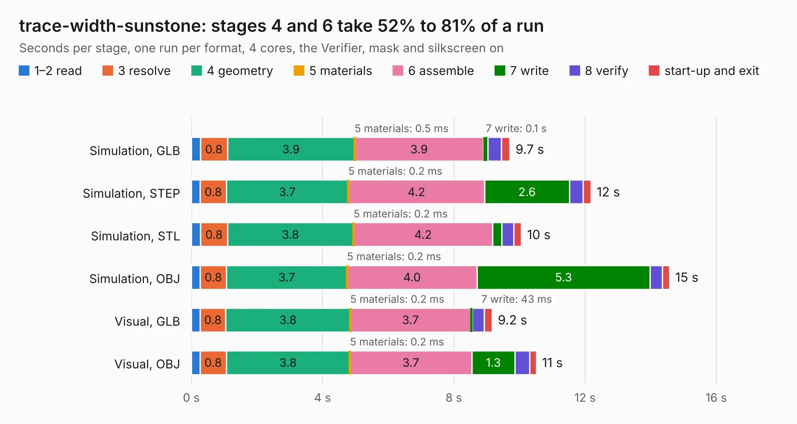

# 1147. trace-width-sunstone

Board 1,147 of the 3,127 of [Corpus Testing](../Corpus-Testing.md), on [Corpus Page 11](../CorpusTestingPages/Corpus-Testing-11.md#1147-trace-width-sunstone).

| Mode and format | 1–2 read | 3 resolve | 4 geometry | 5 materials | 6 assemble | 7 write | 8 verify | start-up and exit | Total |
|---|---:|---:|---:|---:|---:|---:|---:|---:|---:|
| Simulation, GLB | 0.3 | 0.8 | 3.9 | 0.5&nbsp;ms | 3.9 | 0.1 | 0.4 | 0.3 | 9.7 |
| Simulation, STEP | 0.3 | 0.8 | 3.7 | 0.2&nbsp;ms | 4.2 | 2.6 | 0.4 | 0.2 | 12.2 |
| Simulation, STL | 0.3 | 0.8 | 3.8 | 0.2&nbsp;ms | 4.2 | 0.3 | 0.4 | 0.2 | 10.1 |
| Simulation, OBJ | 0.3 | 0.8 | 3.7 | 0.2&nbsp;ms | 4.0 | 5.3 | 0.4 | 0.2 | 14.6 |
| Visual, GLB | 0.3 | 0.8 | 3.8 | 0.2&nbsp;ms | 3.7 | 43&nbsp;ms | 0.4 | 0.2 | 9.2 |
| Visual, OBJ | 0.3 | 0.8 | 3.8 | 0.2&nbsp;ms | 3.7 | 1.3 | 0.4 | 0.2 | 10.5 |

<table align="center"><tr><td valign="top">

| Board | Repo: [greatscottgadgets/misc](https://github.com/greatscottgadgets/misc) Board: `trace-width-sunstone.kicad_pcb` |
|---|---|
| Folder | evaluation-boards / trace-width |
| Complexity | 113&nbsp;/&nbsp;1000 (size&nbsp;93, features&nbsp;20) |
| KESE&nbsp;features | filled zones |
| Tested | 9th November 2026 |
| Copper&nbsp;layers | 4 |
| File&nbsp;format | KiCad 4 (4) |
| Parts,&nbsp;tracks,&nbsp;vias | 12, 6, 0 |
| Triangles,&nbsp;simulation | 933,056 in 19 parts |
| Verifier | PASS in all six runs |

</td><td valign="top">

<table>
<tr><th>File type</th><th>File size</th><th>Peak memory used</th></tr>
<tr><th colspan="3" align="left">Simulation</th></tr>
<tr><td>GLB</td><td align="right">30&nbsp;MB</td><td align="right">488&nbsp;MB</td></tr>
<tr><td>STEP</td><td align="right">93&nbsp;MB</td><td align="right">590&nbsp;MB</td></tr>
<tr><td>STL</td><td align="right">47&nbsp;MB</td><td align="right">472&nbsp;MB</td></tr>
<tr><td>OBJ</td><td align="right">94&nbsp;MB</td><td align="right">681&nbsp;MB</td></tr>
<tr><th colspan="3" align="left">Visual</th></tr>
<tr><td>GLB</td><td align="right">7.2&nbsp;MB</td><td align="right">386&nbsp;MB</td></tr>
<tr><td>OBJ</td><td align="right">22&nbsp;MB</td><td align="right">361&nbsp;MB</td></tr>
</table>

</td></tr></table>

| Previous | Next |
|:---|---:|
| [1146. trace-width-jlcpcb](b1146b_misc_trace-width-jlcpcb.md) | [1148. trace-width](b1148b_misc_trace-width.md) |
