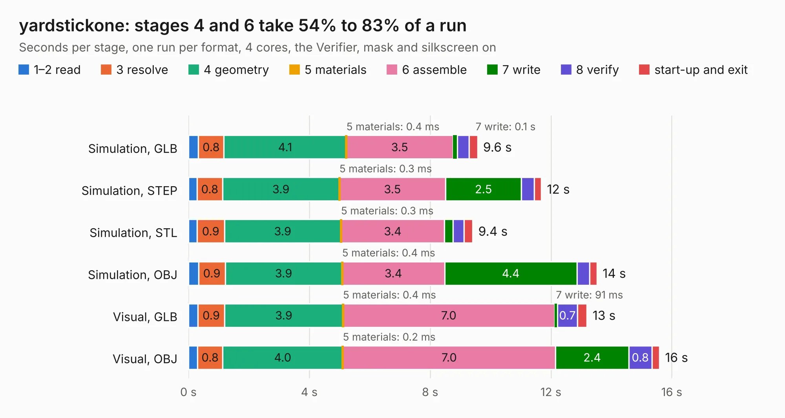

# 1147. yardstickone

Board 1,147 of the 3,109 of [Corpus Testing](../Corpus-Testing.md), on [Corpus Page 11](../CorpusTestingPages/Corpus-Testing-11.md#1147-yardstickone).

| Mode and format | 1–2 read | 3 resolve | 4 geometry | 5 materials | 6 assemble | 7 write | 8 verify | start-up and exit | Total |
|---|---:|---:|---:|---:|---:|---:|---:|---:|---:|
| Simulation, GLB | 0.3 | 0.8 | 4.1 | 0.4&nbsp;ms | 3.5 | 0.1 | 0.4 | 0.3 | 9.6 |
| Simulation, STEP | 0.3 | 0.8 | 3.9 | 0.3&nbsp;ms | 3.5 | 2.5 | 0.4 | 0.2 | 11.7 |
| Simulation, STL | 0.3 | 0.9 | 3.9 | 0.3&nbsp;ms | 3.4 | 0.3 | 0.4 | 0.3 | 9.4 |
| Simulation, OBJ | 0.3 | 0.9 | 3.9 | 0.4&nbsp;ms | 3.4 | 4.4 | 0.4 | 0.2 | 13.5 |
| Visual, GLB | 0.3 | 0.9 | 3.9 | 0.4&nbsp;ms | 7.0 | 91&nbsp;ms | 0.7 | 0.3 | 13.2 |
| Visual, OBJ | 0.3 | 0.8 | 4.0 | 0.2&nbsp;ms | 7.0 | 2.4 | 0.8 | 0.3 | 15.6 |

<table align="center"><tr><td valign="top">

| Board | Repo: [greatscottgadgets/yardstick](https://github.com/greatscottgadgets/yardstick) Board: `yardstickone.kicad_pcb` |
|---|---|
| Folder | yardstickone |
| Complexity | 317&nbsp;/&nbsp;1000 (size&nbsp;232, features&nbsp;85) |
| KESE&nbsp;features | through vias, rounded, trapezoid or chamfered pads, filled zones, copper text, stack-up, dielectric εr and tanδ |
| Tested | 9th November 2026 |
| Copper&nbsp;layers | 4 |
| File&nbsp;format | KiCad 6 (20211014) |
| Parts,&nbsp;tracks,&nbsp;vias | 74, 657, 83 |
| Triangles,&nbsp;simulation | 894,982 in 79 parts |
| Verifier | PASS in all six runs |

</td><td valign="top">

<table>
<tr><th>File type</th><th>File size</th><th>Peak memory used</th></tr>
<tr><th colspan="3" align="left">Simulation</th></tr>
<tr><td>GLB</td><td align="right">31&nbsp;MB</td><td align="right">423&nbsp;MB</td></tr>
<tr><td>STEP</td><td align="right">141&nbsp;MB</td><td align="right">497&nbsp;MB</td></tr>
<tr><td>STL</td><td align="right">45&nbsp;MB</td><td align="right">418&nbsp;MB</td></tr>
<tr><td>OBJ</td><td align="right">92&nbsp;MB</td><td align="right">672&nbsp;MB</td></tr>
<tr><th colspan="3" align="left">Visual</th></tr>
<tr><td>GLB</td><td align="right">18&nbsp;MB</td><td align="right">452&nbsp;MB</td></tr>
<tr><td>OBJ</td><td align="right">53&nbsp;MB</td><td align="right">455&nbsp;MB</td></tr>
</table>

</td></tr></table>

| Previous | Next |
|:---|---:|
| [1146. mainboard](b1146b_urti-mainboard_mainboard.md) | [1148. arm-watch](b1148b_advent-calendar-of-circuits-2020_arm-watch.md) |
