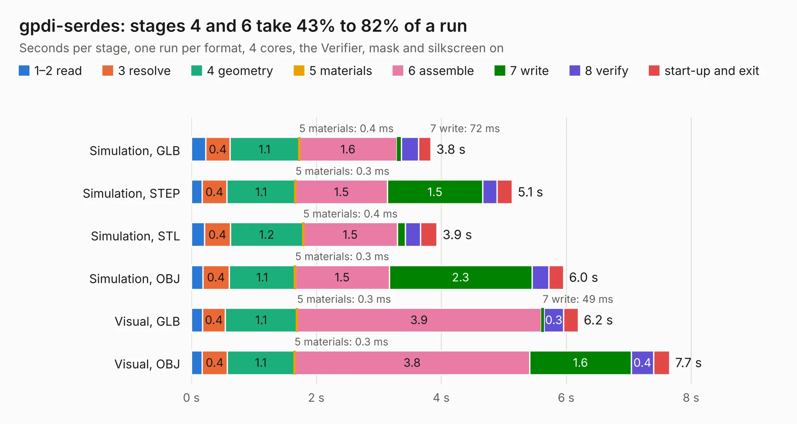

# 1148. gpdi-serdes

Board 1,148 of the 3,101 of [Corpus Testing](../Corpus-Testing.md), on [Corpus Page 11](../CorpusTestingPages/Corpus-Testing-11.md#1148-gpdi-serdes).

| Mode and format | 1–2 read | 3 resolve | 4 geometry | 5 materials | 6 assemble | 7 write | 8 verify | start-up and exit | Total |
|---|---:|---:|---:|---:|---:|---:|---:|---:|---:|
| Simulation, GLB | 0.2 | 0.4 | 1.1 | 0.4&nbsp;ms | 1.6 | 72&nbsp;ms | 0.3 | 0.2 | 3.8 |
| Simulation, STEP | 0.2 | 0.4 | 1.1 | 0.3&nbsp;ms | 1.5 | 1.5 | 0.2 | 0.2 | 5.1 |
| Simulation, STL | 0.2 | 0.4 | 1.2 | 0.4&nbsp;ms | 1.5 | 0.1 | 0.2 | 0.3 | 3.9 |
| Simulation, OBJ | 0.2 | 0.4 | 1.1 | 0.3&nbsp;ms | 1.5 | 2.3 | 0.3 | 0.2 | 6.0 |
| Visual, GLB | 0.2 | 0.4 | 1.1 | 0.3&nbsp;ms | 3.9 | 49&nbsp;ms | 0.3 | 0.2 | 6.2 |
| Visual, OBJ | 0.2 | 0.4 | 1.1 | 0.3&nbsp;ms | 3.8 | 1.6 | 0.4 | 0.3 | 7.7 |

<table align="center"><tr><td valign="top">

| Board | Repo: [gregdavill/advent-calendar-of-circuits-2020](https://github.com/gregdavill/advent-calendar-of-circuits-2020) Board: `gpdi-serdes.kicad_pcb` |
|---|---|
| Folder | gpdi-serdes / kicad-src |
| Complexity | 291&nbsp;/&nbsp;1000 (size&nbsp;166, features&nbsp;125) |
| KESE&nbsp;features | through vias, slotted holes, custom pads, rounded, trapezoid or chamfered pads, filled zones, copper drawings, curved board outline, stack-up, dielectric εr and tanδ, mask and silkscreen colours |
| Tested | 9th November 2026 |
| Copper&nbsp;layers | 4 |
| File&nbsp;format | KiCad 6 (20201116) |
| Parts,&nbsp;tracks,&nbsp;vias | 20, 300, 48 |
| Triangles,&nbsp;simulation | 418,796 in 84 parts |
| Verifier | PASS in all six runs |

</td><td valign="top">

<table>
<tr><th>File type</th><th>File size</th><th>Peak memory used</th></tr>
<tr><th colspan="3" align="left">Simulation</th></tr>
<tr><td>GLB</td><td align="right">14&nbsp;MB</td><td align="right">264&nbsp;MB</td></tr>
<tr><td>STEP</td><td align="right">57&nbsp;MB</td><td align="right">316&nbsp;MB</td></tr>
<tr><td>STL</td><td align="right">21&nbsp;MB</td><td align="right">287&nbsp;MB</td></tr>
<tr><td>OBJ</td><td align="right">41&nbsp;MB</td><td align="right">333&nbsp;MB</td></tr>
<tr><th colspan="3" align="left">Visual</th></tr>
<tr><td>GLB</td><td align="right">9.2&nbsp;MB</td><td align="right">307&nbsp;MB</td></tr>
<tr><td>OBJ</td><td align="right">28&nbsp;MB</td><td align="right">325&nbsp;MB</td></tr>
</table>

</td></tr></table>

| Previous | Next |
|:---|---:|
| [1147. esp32s2-lepton](b1147b_advent-calendar-of-circuits-2020_esp32s2-lepton.md) | [1149. gpdi](b1149b_advent-calendar-of-circuits-2020_gpdi.md) |
