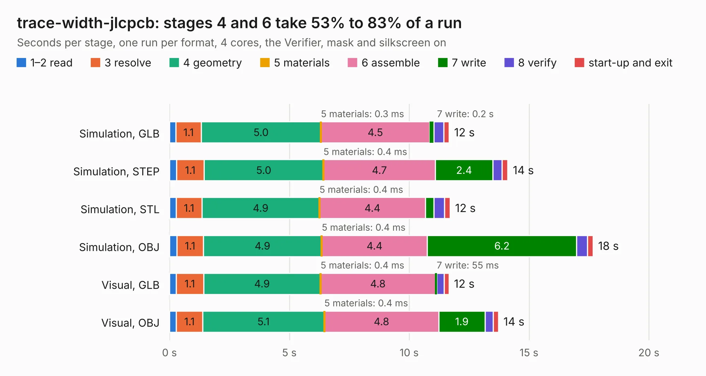

# 1148. trace-width-jlcpcb

Board 1,148 of the 3,139 of [Corpus Testing](../Corpus-Testing.md), on [Corpus Page 11](../CorpusTestingPages/Corpus-Testing-11.md#1148-trace-width-jlcpcb).

| Mode and format | 1–2 read | 3 resolve | 4 geometry | 5 materials | 6 assemble | 7 write | 8 verify | start-up and exit | Total |
|---|---:|---:|---:|---:|---:|---:|---:|---:|---:|
| Simulation, GLB | 0.3 | 1.1 | 5.0 | 0.3&nbsp;ms | 4.5 | 0.2 | 0.4 | 0.2 | 11.7 |
| Simulation, STEP | 0.3 | 1.1 | 5.0 | 0.4&nbsp;ms | 4.7 | 2.4 | 0.4 | 0.2 | 14.1 |
| Simulation, STL | 0.3 | 1.1 | 4.9 | 0.4&nbsp;ms | 4.4 | 0.3 | 0.5 | 0.2 | 11.7 |
| Simulation, OBJ | 0.3 | 1.1 | 4.9 | 0.4&nbsp;ms | 4.4 | 6.2 | 0.4 | 0.2 | 17.7 |
| Visual, GLB | 0.3 | 1.1 | 4.9 | 0.4&nbsp;ms | 4.8 | 55&nbsp;ms | 0.3 | 0.2 | 11.7 |
| Visual, OBJ | 0.3 | 1.1 | 5.1 | 0.4&nbsp;ms | 4.8 | 1.9 | 0.3 | 0.2 | 13.7 |

<table align="center"><tr><td valign="top">

| Board | Repo: [greatscottgadgets/misc](https://github.com/greatscottgadgets/misc) Board: `trace-width-jlcpcb.kicad_pcb` |
|---|---|
| Folder | evaluation-boards / trace-width |
| Complexity | 230&nbsp;/&nbsp;1000 (size&nbsp;165, features&nbsp;65) |
| KESE&nbsp;features | through vias, filled zones, stack-up, dielectric εr and tanδ |
| Tested | 9th November 2026 |
| Copper&nbsp;layers | 6 |
| File&nbsp;format | KiCad 8 (20240108) |
| Parts,&nbsp;tracks,&nbsp;vias | 16, 8, 84 |
| Triangles,&nbsp;simulation | 1,229,520 in 21 parts |
| Verifier | PASS in all six runs |

</td><td valign="top">

<table>
<tr><th>File type</th><th>File size</th><th>Peak memory used</th></tr>
<tr><th colspan="3" align="left">Simulation</th></tr>
<tr><td>GLB</td><td align="right">41&nbsp;MB</td><td align="right">555&nbsp;MB</td></tr>
<tr><td>STEP</td><td align="right">118&nbsp;MB</td><td align="right">668&nbsp;MB</td></tr>
<tr><td>STL</td><td align="right">61&nbsp;MB</td><td align="right">544&nbsp;MB</td></tr>
<tr><td>OBJ</td><td align="right">124&nbsp;MB</td><td align="right">853&nbsp;MB</td></tr>
<tr><th colspan="3" align="left">Visual</th></tr>
<tr><td>GLB</td><td align="right">13&nbsp;MB</td><td align="right">447&nbsp;MB</td></tr>
<tr><td>OBJ</td><td align="right">39&nbsp;MB</td><td align="right">413&nbsp;MB</td></tr>
</table>

</td></tr></table>

| Previous | Next |
|:---|---:|
| [1147. sma-jlcpcb](b1147b_misc_sma-jlcpcb.md) | [1149. trace-width-sunstone](b1149b_misc_trace-width-sunstone.md) |
