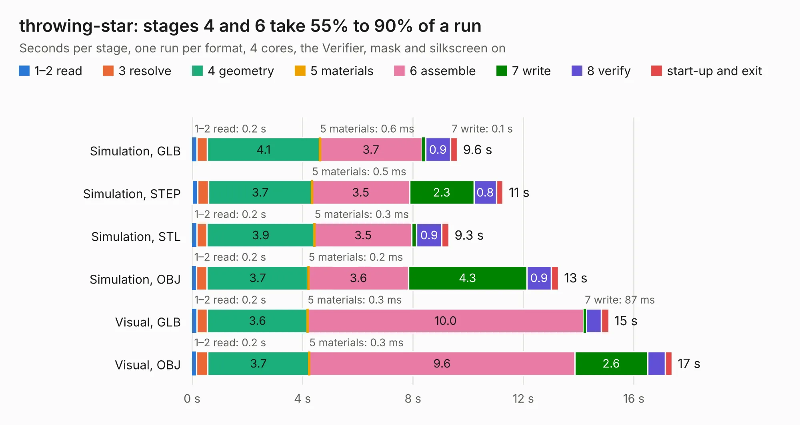

# 1148. throwing-star

Board 1,148 of the 3,117 of [Corpus Testing](../Corpus-Testing.md), on [Corpus Page 11](../CorpusTestingPages/Corpus-Testing-11.md#1148-throwing-star).

| Mode and format | 1–2 read | 3 resolve | 4 geometry | 5 materials | 6 assemble | 7 write | 8 verify | start-up and exit | Total |
|---|---:|---:|---:|---:|---:|---:|---:|---:|---:|
| Simulation, GLB | 0.2 | 0.4 | 4.1 | 0.6&nbsp;ms | 3.7 | 0.1 | 0.9 | 0.2 | 9.6 |
| Simulation, STEP | 0.2 | 0.4 | 3.7 | 0.5&nbsp;ms | 3.5 | 2.3 | 0.8 | 0.2 | 11.3 |
| Simulation, STL | 0.2 | 0.4 | 3.9 | 0.3&nbsp;ms | 3.5 | 0.2 | 0.9 | 0.3 | 9.3 |
| Simulation, OBJ | 0.2 | 0.4 | 3.7 | 0.2&nbsp;ms | 3.6 | 4.3 | 0.9 | 0.3 | 13.3 |
| Visual, GLB | 0.2 | 0.4 | 3.6 | 0.3&nbsp;ms | 10.0 | 87&nbsp;ms | 0.5 | 0.3 | 15.1 |
| Visual, OBJ | 0.2 | 0.4 | 3.7 | 0.3&nbsp;ms | 9.6 | 2.6 | 0.6 | 0.2 | 17.4 |

<table align="center"><tr><td valign="top">

| Board | Repo: [greatscottgadgets/throwing-star-lan-tap](https://github.com/greatscottgadgets/throwing-star-lan-tap) Board: `throwing-star.kicad_pcb` |
|---|---|
| Complexity | 171&nbsp;/&nbsp;1000 (size&nbsp;126, features&nbsp;45) |
| KESE&nbsp;features | through vias, filled zones, curved board outline |
| Tested | 9th November 2026 |
| Copper&nbsp;layers | 2 |
| File&nbsp;format | KiCad 5 (20171130) |
| Parts,&nbsp;tracks,&nbsp;vias | 6, 204, 4 |
| Triangles,&nbsp;simulation | 695,490 in 29 parts |
| Verifier | PASS in all six runs |

</td><td valign="top">

<table>
<tr><th>File type</th><th>File size</th><th>Peak memory used</th></tr>
<tr><th colspan="3" align="left">Simulation</th></tr>
<tr><td>GLB</td><td align="right">26&nbsp;MB</td><td align="right">380&nbsp;MB</td></tr>
<tr><td>STEP</td><td align="right">165&nbsp;MB</td><td align="right">460&nbsp;MB</td></tr>
<tr><td>STL</td><td align="right">35&nbsp;MB</td><td align="right">385&nbsp;MB</td></tr>
<tr><td>OBJ</td><td align="right">76&nbsp;MB</td><td align="right">534&nbsp;MB</td></tr>
<tr><th colspan="3" align="left">Visual</th></tr>
<tr><td>GLB</td><td align="right">17&nbsp;MB</td><td align="right">438&nbsp;MB</td></tr>
<tr><td>OBJ</td><td align="right">50&nbsp;MB</td><td align="right">435&nbsp;MB</td></tr>
</table>

</td></tr></table>

| Previous | Next |
|:---|---:|
| [1147. throwing-star-pro](b1147b_throwing-star-lan-tap_throwing-star-pro.md) | [1149. toorcamp2018badge](b1149b_toorcamp2018badge_toorcamp2018badge.md) |
