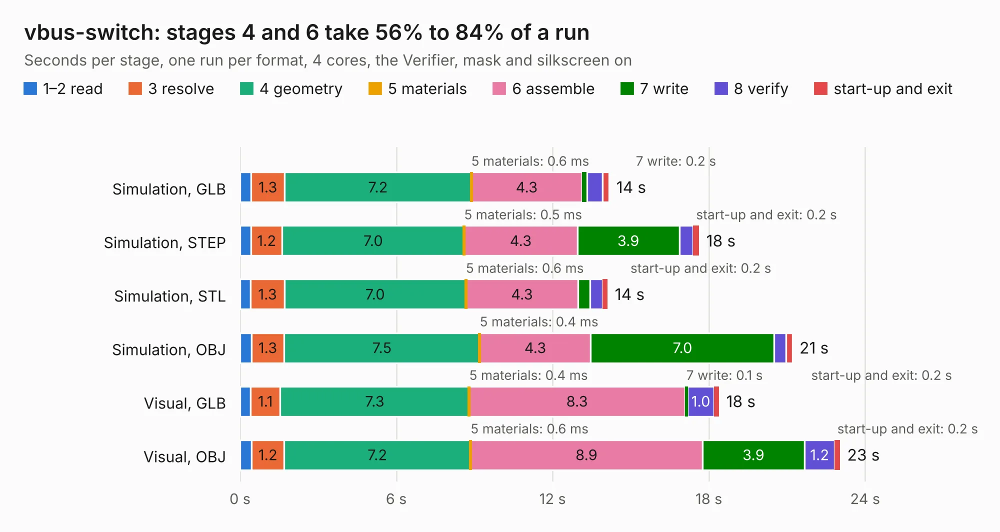

# 1149. vbus-switch

Board 1,149 of the 3,122 of [Corpus Testing](../Corpus-Testing.md), on [Corpus Page 11](../CorpusTestingPages/Corpus-Testing-11.md#1149-vbus-switch).

| Mode and format | 1–2 read | 3 resolve | 4 geometry | 5 materials | 6 assemble | 7 write | 8 verify | start-up and exit | Total |
|---|---:|---:|---:|---:|---:|---:|---:|---:|---:|
| Simulation, GLB | 0.4 | 1.3 | 7.2 | 0.6&nbsp;ms | 4.3 | 0.2 | 0.6 | 0.2 | 14.2 |
| Simulation, STEP | 0.4 | 1.2 | 7.0 | 0.5&nbsp;ms | 4.3 | 3.9 | 0.5 | 0.2 | 17.6 |
| Simulation, STL | 0.4 | 1.3 | 7.0 | 0.6&nbsp;ms | 4.3 | 0.5 | 0.5 | 0.2 | 14.1 |
| Simulation, OBJ | 0.4 | 1.3 | 7.5 | 0.4&nbsp;ms | 4.3 | 7.0 | 0.5 | 0.2 | 21.2 |
| Visual, GLB | 0.4 | 1.1 | 7.3 | 0.4&nbsp;ms | 8.3 | 0.1 | 1.0 | 0.2 | 18.4 |
| Visual, OBJ | 0.4 | 1.2 | 7.2 | 0.6&nbsp;ms | 8.9 | 3.9 | 1.2 | 0.2 | 23.0 |

<table align="center"><tr><td valign="top">

| Board | Repo: [greatscottgadgets/misc](https://github.com/greatscottgadgets/misc) Board: `vbus-switch.kicad_pcb` |
|---|---|
| Folder | evaluation-boards / vbus-switch |
| Complexity | 282&nbsp;/&nbsp;1000 (size&nbsp;197, features&nbsp;85) |
| KESE&nbsp;features | through vias, slotted holes, rounded, trapezoid or chamfered pads, filled zones, stack-up, dielectric εr and tanδ |
| Tested | 9th November 2026 |
| Copper&nbsp;layers | 4 |
| File&nbsp;format | KiCad 6 (20211014) |
| Parts,&nbsp;tracks,&nbsp;vias | 109, 663, 96 |
| Triangles,&nbsp;simulation | 1,340,080 in 102 parts |
| Verifier | PASS in all six runs |

</td><td valign="top">

<table>
<tr><th>File type</th><th>File size</th><th>Peak memory used</th></tr>
<tr><th colspan="3" align="left">Simulation</th></tr>
<tr><td>GLB</td><td align="right">46&nbsp;MB</td><td align="right">557&nbsp;MB</td></tr>
<tr><td>STEP</td><td align="right">220&nbsp;MB</td><td align="right">633&nbsp;MB</td></tr>
<tr><td>STL</td><td align="right">67&nbsp;MB</td><td align="right">532&nbsp;MB</td></tr>
<tr><td>OBJ</td><td align="right">140&nbsp;MB</td><td align="right">930&nbsp;MB</td></tr>
<tr><th colspan="3" align="left">Visual</th></tr>
<tr><td>GLB</td><td align="right">27&nbsp;MB</td><td align="right">658&nbsp;MB</td></tr>
<tr><td>OBJ</td><td align="right">79&nbsp;MB</td><td align="right">631&nbsp;MB</td></tr>
</table>

</td></tr></table>

| Previous | Next |
|:---|---:|
| [1148. ununs](b1148b_misc_ununs.md) | [1150. throwing-star-pro](b1150b_throwing-star-lan-tap_throwing-star-pro.md) |
