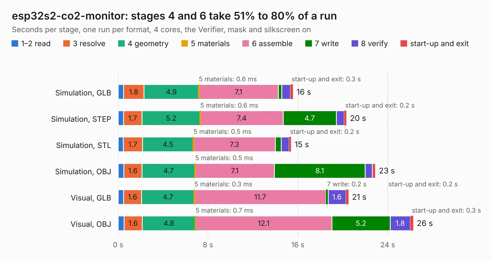

# 1151. esp32s2-co2-monitor

Board 1,151 of the 3,108 of [Corpus Testing](../Corpus-Testing.md), on [Corpus Page 11](../CorpusTestingPages/Corpus-Testing-11.md#1151-esp32s2-co2-monitor).

| Mode and format | 1–2 read | 3 resolve | 4 geometry | 5 materials | 6 assemble | 7 write | 8 verify | start-up and exit | Total |
|---|---:|---:|---:|---:|---:|---:|---:|---:|---:|
| Simulation, GLB | 0.5 | 1.8 | 4.9 | 0.6&nbsp;ms | 7.1 | 0.3 | 0.8 | 0.3 | 15.6 |
| Simulation, STEP | 0.5 | 1.7 | 5.2 | 0.6&nbsp;ms | 7.4 | 4.7 | 0.7 | 0.2 | 20.3 |
| Simulation, STL | 0.5 | 1.7 | 4.5 | 0.5&nbsp;ms | 7.3 | 0.5 | 0.7 | 0.2 | 15.4 |
| Simulation, OBJ | 0.5 | 1.6 | 4.7 | 0.5&nbsp;ms | 7.1 | 8.1 | 0.6 | 0.3 | 22.9 |
| Visual, GLB | 0.5 | 1.6 | 4.7 | 0.3&nbsp;ms | 11.7 | 0.2 | 1.6 | 0.2 | 20.5 |
| Visual, OBJ | 0.5 | 1.6 | 4.8 | 0.7&nbsp;ms | 12.1 | 5.2 | 1.8 | 0.3 | 26.3 |

<table align="center"><tr><td valign="top">

| Board | Repo: [gregdavill/advent-calendar-of-circuits-2020](https://github.com/gregdavill/advent-calendar-of-circuits-2020) Board: `esp32s2-co2-monitor.kicad_pcb` |
|---|---|
| Folder | esp32s2-co2-monitor / kicad-src |
| Complexity | 360&nbsp;/&nbsp;1000 (size&nbsp;245, features&nbsp;115) |
| KESE&nbsp;features | through vias, slotted holes, rounded, trapezoid or chamfered pads, arc tracks, filled zones, curved board outline, stack-up, dielectric εr and tanδ, mask and silkscreen colours |
| Tested | 9th November 2026 |
| Copper&nbsp;layers | 4 |
| File&nbsp;format | KiCad 6 (20201116) |
| Parts,&nbsp;tracks,&nbsp;vias | 67, 1,161, 346 |
| Triangles,&nbsp;simulation | 1,868,242 in 94 parts |
| Verifier | PASS in all six runs |

</td><td valign="top">

<table>
<tr><th>File type</th><th>File size</th><th>Peak memory used</th></tr>
<tr><th colspan="3" align="left">Simulation</th></tr>
<tr><td>GLB</td><td align="right">62&nbsp;MB</td><td align="right">710&nbsp;MB</td></tr>
<tr><td>STEP</td><td align="right">253&nbsp;MB</td><td align="right">871&nbsp;MB</td></tr>
<tr><td>STL</td><td align="right">93&nbsp;MB</td><td align="right">703&nbsp;MB</td></tr>
<tr><td>OBJ</td><td align="right">192&nbsp;MB</td><td align="right">1.2&nbsp;GB</td></tr>
<tr><th colspan="3" align="left">Visual</th></tr>
<tr><td>GLB</td><td align="right">41&nbsp;MB</td><td align="right">833&nbsp;MB</td></tr>
<tr><td>OBJ</td><td align="right">124&nbsp;MB</td><td align="right">873&nbsp;MB</td></tr>
</table>

</td></tr></table>

| Previous | Next |
|:---|---:|
| [1150. esp32s2-breakout](b1150b_advent-calendar-of-circuits-2020_esp32s2-breakout.md) | [1152. esp32s2-lepton](b1152b_advent-calendar-of-circuits-2020_esp32s2-lepton.md) |
