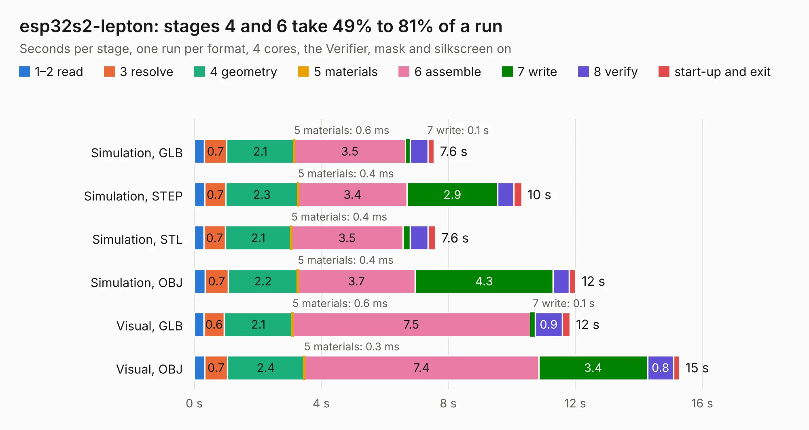

# 1151. esp32s2-lepton

Board 1,151 of the 3,105 of [Corpus Testing](../Corpus-Testing.md), on [Corpus Page 11](../CorpusTestingPages/Corpus-Testing-11.md#1151-esp32s2-lepton).

| Mode and format | 1–2 read | 3 resolve | 4 geometry | 5 materials | 6 assemble | 7 write | 8 verify | start-up and exit | Total |
|---|---:|---:|---:|---:|---:|---:|---:|---:|---:|
| Simulation, GLB | 0.3 | 0.7 | 2.1 | 0.6&nbsp;ms | 3.5 | 0.1 | 0.6 | 0.2 | 7.6 |
| Simulation, STEP | 0.3 | 0.7 | 2.3 | 0.4&nbsp;ms | 3.4 | 2.9 | 0.5 | 0.2 | 10.3 |
| Simulation, STL | 0.3 | 0.7 | 2.1 | 0.4&nbsp;ms | 3.5 | 0.2 | 0.6 | 0.2 | 7.6 |
| Simulation, OBJ | 0.3 | 0.7 | 2.2 | 0.4&nbsp;ms | 3.7 | 4.3 | 0.5 | 0.2 | 12.0 |
| Visual, GLB | 0.3 | 0.6 | 2.1 | 0.6&nbsp;ms | 7.5 | 0.1 | 0.9 | 0.2 | 11.8 |
| Visual, OBJ | 0.3 | 0.7 | 2.4 | 0.3&nbsp;ms | 7.4 | 3.4 | 0.8 | 0.2 | 15.3 |

<table align="center"><tr><td valign="top">

| Board | Repo: [gregdavill/advent-calendar-of-circuits-2020](https://github.com/gregdavill/advent-calendar-of-circuits-2020) Board: `esp32s2-lepton.kicad_pcb` |
|---|---|
| Folder | esp32s2-lepton / kicad-src |
| Complexity | 377&nbsp;/&nbsp;1000 (size&nbsp;237, features&nbsp;140) |
| KESE&nbsp;features | through vias, slotted holes, custom pads, rounded, trapezoid or chamfered pads, arc tracks, filled zones, copper drawings, curved board outline, stack-up, dielectric εr and tanδ, mask and silkscreen colours |
| Tested | 9th November 2026 |
| Copper&nbsp;layers | 4 |
| File&nbsp;format | KiCad 6 (20201220) |
| Parts,&nbsp;tracks,&nbsp;vias | 62, 1,082, 116 |
| Triangles,&nbsp;simulation | 888,094 in 97 parts |
| Verifier | PASS in all six runs |

</td><td valign="top">

<table>
<tr><th>File type</th><th>File size</th><th>Peak memory used</th></tr>
<tr><th colspan="3" align="left">Simulation</th></tr>
<tr><td>GLB</td><td align="right">30&nbsp;MB</td><td align="right">466&nbsp;MB</td></tr>
<tr><td>STEP</td><td align="right">138&nbsp;MB</td><td align="right">512&nbsp;MB</td></tr>
<tr><td>STL</td><td align="right">44&nbsp;MB</td><td align="right">428&nbsp;MB</td></tr>
<tr><td>OBJ</td><td align="right">89&nbsp;MB</td><td align="right">621&nbsp;MB</td></tr>
<tr><th colspan="3" align="left">Visual</th></tr>
<tr><td>GLB</td><td align="right">22&nbsp;MB</td><td align="right">607&nbsp;MB</td></tr>
<tr><td>OBJ</td><td align="right">66&nbsp;MB</td><td align="right">593&nbsp;MB</td></tr>
</table>

</td></tr></table>

| Previous | Next |
|:---|---:|
| [1150. esp32s2-co2-monitor](b1150b_advent-calendar-of-circuits-2020_esp32s2-co2-monitor.md) | [1152. gpdi-serdes](b1152b_advent-calendar-of-circuits-2020_gpdi-serdes.md) |
