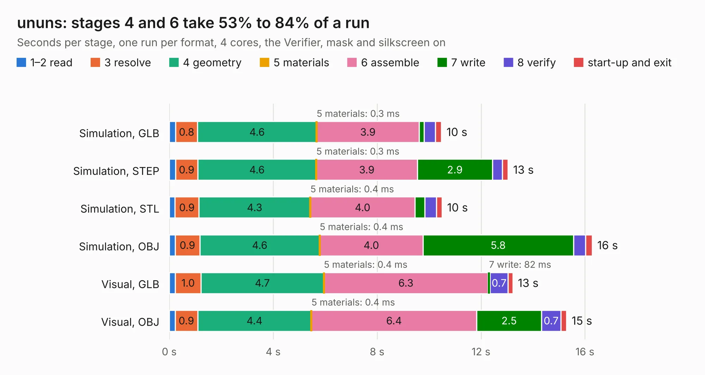

# 1151. ununs

Board 1,151 of the 3,139 of [Corpus Testing](../Corpus-Testing.md), on [Corpus Page 11](../CorpusTestingPages/Corpus-Testing-11.md#1151-ununs).

| Mode and format | 1–2 read | 3 resolve | 4 geometry | 5 materials | 6 assemble | 7 write | 8 verify | start-up and exit | Total |
|---|---:|---:|---:|---:|---:|---:|---:|---:|---:|
| Simulation, GLB | 0.2 | 0.8 | 4.6 | 0.3&nbsp;ms | 3.9 | 0.2 | 0.4 | 0.2 | 10.5 |
| Simulation, STEP | 0.2 | 0.9 | 4.6 | 0.3&nbsp;ms | 3.9 | 2.9 | 0.4 | 0.2 | 13.0 |
| Simulation, STL | 0.2 | 0.9 | 4.3 | 0.4&nbsp;ms | 4.0 | 0.4 | 0.4 | 0.2 | 10.5 |
| Simulation, OBJ | 0.2 | 0.9 | 4.6 | 0.4&nbsp;ms | 4.0 | 5.8 | 0.5 | 0.3 | 16.3 |
| Visual, GLB | 0.2 | 1.0 | 4.7 | 0.4&nbsp;ms | 6.3 | 82&nbsp;ms | 0.7 | 0.2 | 13.2 |
| Visual, OBJ | 0.2 | 0.9 | 4.4 | 0.4&nbsp;ms | 6.4 | 2.5 | 0.7 | 0.2 | 15.3 |

<table align="center"><tr><td valign="top">

| Board | Repo: [greatscottgadgets/misc](https://github.com/greatscottgadgets/misc) Board: `ununs.kicad_pcb` |
|---|---|
| Folder | evaluation-boards / ununs |
| Complexity | 250&nbsp;/&nbsp;1000 (size&nbsp;175, features&nbsp;75) |
| KESE&nbsp;features | through vias, rounded, trapezoid or chamfered pads, filled zones, stack-up, dielectric εr and tanδ |
| Tested | 9th November 2026 |
| Copper&nbsp;layers | 4 |
| File&nbsp;format | KiCad 6 (20211014) |
| Parts,&nbsp;tracks,&nbsp;vias | 77, 196, 43 |
| Triangles,&nbsp;simulation | 1,471,406 in 61 parts |
| Verifier | PASS in all six runs |

</td><td valign="top">

<table>
<tr><th>File type</th><th>File size</th><th>Peak memory used</th></tr>
<tr><th colspan="3" align="left">Simulation</th></tr>
<tr><td>GLB</td><td align="right">48&nbsp;MB</td><td align="right">671&nbsp;MB</td></tr>
<tr><td>STEP</td><td align="right">147&nbsp;MB</td><td align="right">705&nbsp;MB</td></tr>
<tr><td>STL</td><td align="right">74&nbsp;MB</td><td align="right">645&nbsp;MB</td></tr>
<tr><td>OBJ</td><td align="right">148&nbsp;MB</td><td align="right">973&nbsp;MB</td></tr>
<tr><th colspan="3" align="left">Visual</th></tr>
<tr><td>GLB</td><td align="right">20&nbsp;MB</td><td align="right">584&nbsp;MB</td></tr>
<tr><td>OBJ</td><td align="right">62&nbsp;MB</td><td align="right">524&nbsp;MB</td></tr>
</table>

</td></tr></table>

| Previous | Next |
|:---|---:|
| [1150. trace-width](b1150b_misc_trace-width.md) | [1152. vbus-switch](b1152b_misc_vbus-switch.md) |
