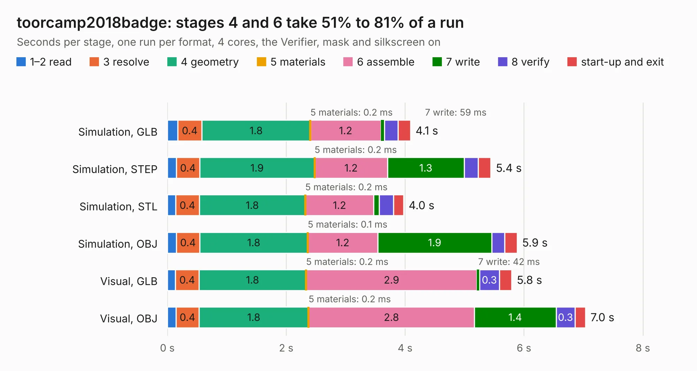

# 1153. toorcamp2018badge

Board 1,153 of the 3,127 of [Corpus Testing](../Corpus-Testing.md), on [Corpus Page 11](../CorpusTestingPages/Corpus-Testing-11.md#1153-toorcamp2018badge).

| Mode and format | 1–2 read | 3 resolve | 4 geometry | 5 materials | 6 assemble | 7 write | 8 verify | start-up and exit | Total |
|---|---:|---:|---:|---:|---:|---:|---:|---:|---:|
| Simulation, GLB | 0.2 | 0.4 | 1.8 | 0.2&nbsp;ms | 1.2 | 59&nbsp;ms | 0.2 | 0.2 | 4.1 |
| Simulation, STEP | 0.2 | 0.4 | 1.9 | 0.2&nbsp;ms | 1.2 | 1.3 | 0.2 | 0.2 | 5.4 |
| Simulation, STL | 0.1 | 0.4 | 1.8 | 0.2&nbsp;ms | 1.2 | 89&nbsp;ms | 0.2 | 0.2 | 4.0 |
| Simulation, OBJ | 0.2 | 0.4 | 1.8 | 0.1&nbsp;ms | 1.2 | 1.9 | 0.2 | 0.2 | 5.9 |
| Visual, GLB | 0.1 | 0.4 | 1.8 | 0.2&nbsp;ms | 2.9 | 42&nbsp;ms | 0.3 | 0.2 | 5.8 |
| Visual, OBJ | 0.1 | 0.4 | 1.8 | 0.2&nbsp;ms | 2.8 | 1.4 | 0.3 | 0.2 | 7.0 |

<table align="center"><tr><td valign="top">

| Board | Repo: [greatscottgadgets/toorcamp2018badge](https://github.com/greatscottgadgets/toorcamp2018badge) Board: `toorcamp2018badge.kicad_pcb` |
|---|---|
| Folder | hardware / badge |
| Complexity | 202&nbsp;/&nbsp;1000 (size&nbsp;147, features&nbsp;55) |
| KESE&nbsp;features | through vias, rounded, trapezoid or chamfered pads, filled zones, curved board outline |
| Tested | 9th November 2026 |
| Copper&nbsp;layers | 2 |
| File&nbsp;format | KiCad 4 (4) |
| Parts,&nbsp;tracks,&nbsp;vias | 30, 264, 8 |
| Triangles,&nbsp;simulation | 380,290 in 32 parts |
| Verifier | PASS in all six runs |

</td><td valign="top">

<table>
<tr><th>File type</th><th>File size</th><th>Peak memory used</th></tr>
<tr><th colspan="3" align="left">Simulation</th></tr>
<tr><td>GLB</td><td align="right">14&nbsp;MB</td><td align="right">265&nbsp;MB</td></tr>
<tr><td>STEP</td><td align="right">70&nbsp;MB</td><td align="right">288&nbsp;MB</td></tr>
<tr><td>STL</td><td align="right">19&nbsp;MB</td><td align="right">260&nbsp;MB</td></tr>
<tr><td>OBJ</td><td align="right">40&nbsp;MB</td><td align="right">302&nbsp;MB</td></tr>
<tr><th colspan="3" align="left">Visual</th></tr>
<tr><td>GLB</td><td align="right">9.8&nbsp;MB</td><td align="right">279&nbsp;MB</td></tr>
<tr><td>OBJ</td><td align="right">29&nbsp;MB</td><td align="right">273&nbsp;MB</td></tr>
</table>

</td></tr></table>

| Previous | Next |
|:---|---:|
| [1152. throwing-star](b1152b_throwing-star-lan-tap_throwing-star.md) | [1154. toorcamp2018jig](b1154b_toorcamp2018badge_toorcamp2018jig.md) |
