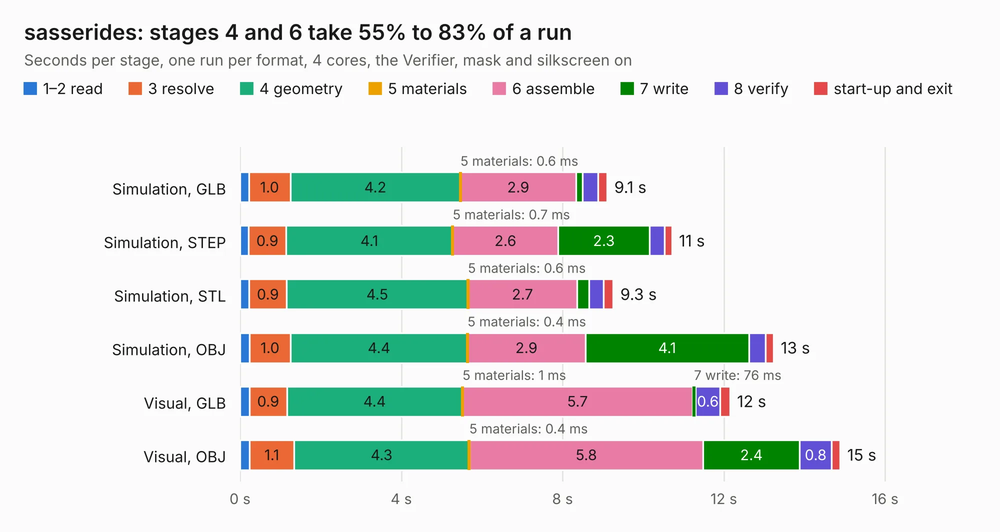

# 1155. sasserides

Board 1,155 of the 3,125 of [Corpus Testing](../Corpus-Testing.md), on [Corpus Page 11](../CorpusTestingPages/Corpus-Testing-11.md#1155-sasserides).

| Mode and format | 1–2 read | 3 resolve | 4 geometry | 5 materials | 6 assemble | 7 write | 8 verify | start-up and exit | Total |
|---|---:|---:|---:|---:|---:|---:|---:|---:|---:|
| Simulation, GLB | 0.2 | 1.0 | 4.2 | 0.6&nbsp;ms | 2.9 | 0.2 | 0.4 | 0.2 | 9.1 |
| Simulation, STEP | 0.2 | 0.9 | 4.1 | 0.7&nbsp;ms | 2.6 | 2.3 | 0.4 | 0.2 | 10.7 |
| Simulation, STL | 0.2 | 0.9 | 4.5 | 0.6&nbsp;ms | 2.7 | 0.3 | 0.4 | 0.2 | 9.3 |
| Simulation, OBJ | 0.2 | 1.0 | 4.4 | 0.4&nbsp;ms | 2.9 | 4.1 | 0.4 | 0.2 | 13.2 |
| Visual, GLB | 0.2 | 0.9 | 4.4 | 1&nbsp;ms | 5.7 | 76&nbsp;ms | 0.6 | 0.2 | 12.1 |
| Visual, OBJ | 0.2 | 1.1 | 4.3 | 0.4&nbsp;ms | 5.8 | 2.4 | 0.8 | 0.2 | 14.9 |

<table align="center"><tr><td valign="top">

| Board | Repo: [greatscottgadgets/tycho](https://github.com/greatscottgadgets/tycho) Board: `sasserides.kicad_pcb` |
|---|---|
| Folder | sasserides |
| Complexity | 230&nbsp;/&nbsp;1000 (size&nbsp;150, features&nbsp;80) |
| KESE&nbsp;features | through vias, rounded, trapezoid or chamfered pads, filled zones, stack-up, dielectric εr and tanδ, mask and silkscreen colours |
| Tested | 9th November 2026 |
| Copper&nbsp;layers | 2 |
| File&nbsp;format | KiCad 7 (20221018) |
| Parts,&nbsp;tracks,&nbsp;vias | 30, 324, 12 |
| Triangles,&nbsp;simulation | 970,818 in 113 parts |
| Verifier | PASS in all six runs |

</td><td valign="top">

<table>
<tr><th>File type</th><th>File size</th><th>Peak memory used</th></tr>
<tr><th colspan="3" align="left">Simulation</th></tr>
<tr><td>GLB</td><td align="right">33&nbsp;MB</td><td align="right">453&nbsp;MB</td></tr>
<tr><td>STEP</td><td align="right">170&nbsp;MB</td><td align="right">519&nbsp;MB</td></tr>
<tr><td>STL</td><td align="right">49&nbsp;MB</td><td align="right">438&nbsp;MB</td></tr>
<tr><td>OBJ</td><td align="right">100&nbsp;MB</td><td align="right">696&nbsp;MB</td></tr>
<tr><th colspan="3" align="left">Visual</th></tr>
<tr><td>GLB</td><td align="right">19&nbsp;MB</td><td align="right">483&nbsp;MB</td></tr>
<tr><td>OBJ</td><td align="right">58&nbsp;MB</td><td align="right">479&nbsp;MB</td></tr>
</table>

</td></tr></table>

| Previous | Next |
|:---|---:|
| [1154. toorcamp2018jig](b1154b_toorcamp2018badge_toorcamp2018jig.md) | [1156. tycho](b1156b_tycho_tycho.md) |
