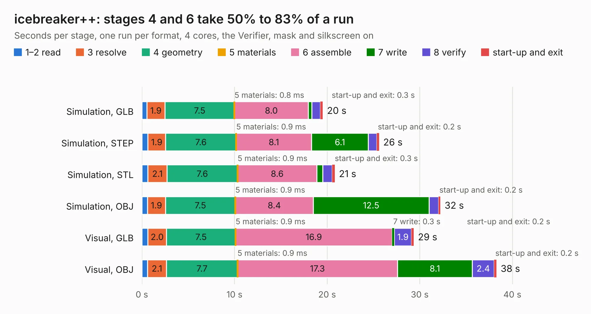

# 1156. icebreaker++

Board 1,156 of the 3,107 of [Corpus Testing](../Corpus-Testing.md), on [Corpus Page 11](../CorpusTestingPages/Corpus-Testing-11.md#1156-icebreaker).

| Mode and format | 1–2 read | 3 resolve | 4 geometry | 5 materials | 6 assemble | 7 write | 8 verify | start-up and exit | Total |
|---|---:|---:|---:|---:|---:|---:|---:|---:|---:|
| Simulation, GLB | 0.5 | 1.9 | 7.5 | 0.8&nbsp;ms | 8.0 | 0.4 | 0.9 | 0.3 | 19.5 |
| Simulation, STEP | 0.6 | 1.9 | 7.6 | 0.9&nbsp;ms | 8.1 | 6.1 | 0.9 | 0.2 | 25.6 |
| Simulation, STL | 0.6 | 2.1 | 7.6 | 0.9&nbsp;ms | 8.6 | 0.6 | 1.0 | 0.3 | 20.8 |
| Simulation, OBJ | 0.6 | 1.9 | 7.5 | 0.9&nbsp;ms | 8.4 | 12.5 | 1.0 | 0.2 | 32.2 |
| Visual, GLB | 0.6 | 2.0 | 7.5 | 0.9&nbsp;ms | 16.9 | 0.3 | 1.9 | 0.2 | 29.4 |
| Visual, OBJ | 0.6 | 2.1 | 7.7 | 0.9&nbsp;ms | 17.3 | 8.1 | 2.4 | 0.2 | 38.3 |

<table align="center"><tr><td valign="top">

| Board | Repo: [gregdavill/advent-calendar-of-circuits-2020](https://github.com/gregdavill/advent-calendar-of-circuits-2020) Board: `icebreaker++.kicad_pcb` |
|---|---|
| Folder | icebreaker++ / kicad-src |
| Complexity | 365&nbsp;/&nbsp;1000 (size&nbsp;265, features&nbsp;100) |
| KESE&nbsp;features | through vias, slotted holes, rounded, trapezoid or chamfered pads, filled zones, curved board outline, stack-up, dielectric εr and tanδ, mask and silkscreen colours |
| Tested | 9th November 2026 |
| Copper&nbsp;layers | 4 |
| File&nbsp;format | KiCad 6 (20201116) |
| Parts,&nbsp;tracks,&nbsp;vias | 92, 1,852, 227 |
| Triangles,&nbsp;simulation | 2,188,308 in 276 parts |
| Verifier | PASS in all six runs |

</td><td valign="top">

<table>
<tr><th>File type</th><th>File size</th><th>Peak memory used</th></tr>
<tr><th colspan="3" align="left">Simulation</th></tr>
<tr><td>GLB</td><td align="right">74&nbsp;MB</td><td align="right">760&nbsp;MB</td></tr>
<tr><td>STEP</td><td align="right">341&nbsp;MB</td><td align="right">979&nbsp;MB</td></tr>
<tr><td>STL</td><td align="right">109&nbsp;MB</td><td align="right">770&nbsp;MB</td></tr>
<tr><td>OBJ</td><td align="right">229&nbsp;MB</td><td align="right">1.4&nbsp;GB</td></tr>
<tr><th colspan="3" align="left">Visual</th></tr>
<tr><td>GLB</td><td align="right">49&nbsp;MB</td><td align="right">945&nbsp;MB</td></tr>
<tr><td>OBJ</td><td align="right">150&nbsp;MB</td><td align="right">1.1&nbsp;GB</td></tr>
</table>

</td></tr></table>

| Previous | Next |
|:---|---:|
| [1155. hdmi-si](b1155b_advent-calendar-of-circuits-2020_hdmi-si.md) | [1157. jtag-programmer](b1157b_advent-calendar-of-circuits-2020_jtag-programmer.md) |
