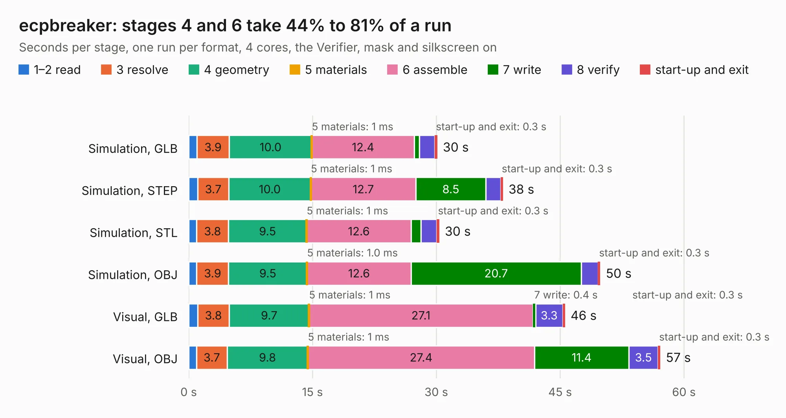

# 1158. ecpbreaker

Board 1,158 of the 3,119 of [Corpus Testing](../Corpus-Testing.md), on [Corpus Page 11](../CorpusTestingPages/Corpus-Testing-11.md#1158-ecpbreaker).

| Mode and format | 1–2 read | 3 resolve | 4 geometry | 5 materials | 6 assemble | 7 write | 8 verify | start-up and exit | Total |
|---|---:|---:|---:|---:|---:|---:|---:|---:|---:|
| Simulation, GLB | 1.0 | 3.9 | 10.0 | 1&nbsp;ms | 12.4 | 0.6 | 1.9 | 0.3 | 30.1 |
| Simulation, STEP | 1.1 | 3.7 | 10.0 | 1&nbsp;ms | 12.7 | 8.5 | 1.8 | 0.3 | 38.1 |
| Simulation, STL | 1.0 | 3.8 | 9.5 | 1&nbsp;ms | 12.6 | 1.2 | 1.9 | 0.3 | 30.4 |
| Simulation, OBJ | 1.0 | 3.9 | 9.5 | 1.0&nbsp;ms | 12.6 | 20.7 | 2.0 | 0.3 | 49.9 |
| Visual, GLB | 1.1 | 3.8 | 9.7 | 1&nbsp;ms | 27.1 | 0.4 | 3.3 | 0.3 | 45.6 |
| Visual, OBJ | 0.9 | 3.7 | 9.8 | 1&nbsp;ms | 27.4 | 11.4 | 3.5 | 0.3 | 57.1 |

<table align="center"><tr><td valign="top">

| Board | Repo: [gregdavill/advent-calendar-of-circuits-2020](https://github.com/gregdavill/advent-calendar-of-circuits-2020) Board: `ecpbreaker.kicad_pcb` |
|---|---|
| Folder | ecpbreaker / kicad-src |
| Complexity | 427&nbsp;/&nbsp;1000 (size&nbsp;287, features&nbsp;140) |
| KESE&nbsp;features | through vias, slotted holes, custom pads, rounded, trapezoid or chamfered pads, arc tracks, filled zones, copper drawings, curved board outline, stack-up, dielectric εr and tanδ, mask and silkscreen colours |
| Tested | 9th November 2026 |
| Copper&nbsp;layers | 6 |
| File&nbsp;format | KiCad 6 (20210126) |
| Parts,&nbsp;tracks,&nbsp;vias | 117, 3,175, 442 |
| Triangles,&nbsp;simulation | 3,875,838 in 294 parts |
| Verifier | PASS in all six runs |

</td><td valign="top">

<table>
<tr><th>File type</th><th>File size</th><th>Peak memory used</th></tr>
<tr><th colspan="3" align="left">Simulation</th></tr>
<tr><td>GLB</td><td align="right">129&nbsp;MB</td><td align="right">1.2&nbsp;GB</td></tr>
<tr><td>STEP</td><td align="right">499&nbsp;MB</td><td align="right">1.4&nbsp;GB</td></tr>
<tr><td>STL</td><td align="right">194&nbsp;MB</td><td align="right">1.3&nbsp;GB</td></tr>
<tr><td>OBJ</td><td align="right">409&nbsp;MB</td><td align="right">2.5&nbsp;GB</td></tr>
<tr><th colspan="3" align="left">Visual</th></tr>
<tr><td>GLB</td><td align="right">71&nbsp;MB</td><td align="right">1.3&nbsp;GB</td></tr>
<tr><td>OBJ</td><td align="right">229&nbsp;MB</td><td align="right">1.6&nbsp;GB</td></tr>
</table>

</td></tr></table>

| Previous | Next |
|:---|---:|
| [1157. arm-watch](b1157b_advent-calendar-of-circuits-2020_arm-watch.md) | [1159. esp32s2-breakout](b1159b_advent-calendar-of-circuits-2020_esp32s2-breakout.md) |
