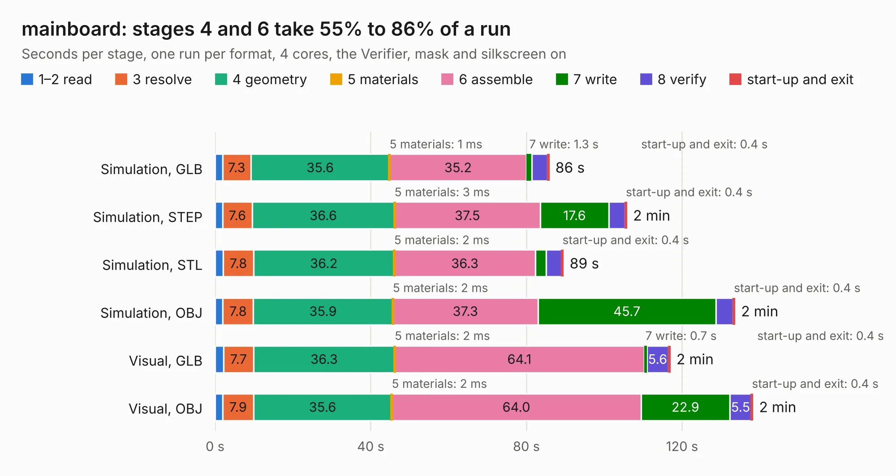

# 1159. mainboard

Board 1,159 of the 3,139 of [Corpus Testing](../Corpus-Testing.md), on [Corpus Page 11](../CorpusTestingPages/Corpus-Testing-11.md#1159-mainboard).

| Mode and format | 1–2 read | 3 resolve | 4 geometry | 5 materials | 6 assemble | 7 write | 8 verify | start-up and exit | Total |
|---|---:|---:|---:|---:|---:|---:|---:|---:|---:|
| Simulation, GLB | 1.9 | 7.3 | 35.6 | 1&nbsp;ms | 35.2 | 1.3 | 4.0 | 0.4 | 85.8 |
| Simulation, STEP | 2.0 | 7.6 | 36.6 | 3&nbsp;ms | 37.5 | 17.6 | 4.2 | 0.4 | 105.8 |
| Simulation, STL | 2.1 | 7.8 | 36.2 | 2&nbsp;ms | 36.3 | 2.7 | 4.0 | 0.4 | 89.5 |
| Simulation, OBJ | 2.0 | 7.8 | 35.9 | 2&nbsp;ms | 37.3 | 45.7 | 4.4 | 0.4 | 133.5 |
| Visual, GLB | 2.2 | 7.7 | 36.3 | 2&nbsp;ms | 64.1 | 0.7 | 5.6 | 0.4 | 116.9 |
| Visual, OBJ | 2.0 | 7.9 | 35.6 | 2&nbsp;ms | 64.0 | 22.9 | 5.5 | 0.4 | 138.1 |

<table align="center"><tr><td valign="top">

| Board | Repo: [greatscottgadgets/urti-mainboard](https://github.com/greatscottgadgets/urti-mainboard) Board: `mainboard.kicad_pcb` |
|---|---|
| Complexity | 465&nbsp;/&nbsp;1000 (size&nbsp;315, features&nbsp;150) |
| KESE&nbsp;features | through vias, slotted holes, custom pads, rounded, trapezoid or chamfered pads, arc tracks, filled zones, copper drawings, copper text, curved board outline, stack-up, dielectric εr and tanδ, mask and silkscreen colours |
| Tested | 9th November 2026 |
| Copper&nbsp;layers | 6 |
| File&nbsp;format | KiCad 7 (20221018) |
| Parts,&nbsp;tracks,&nbsp;vias | 440, 3,761, 899 |
| Triangles,&nbsp;simulation | 7,380,624 in 471 parts |
| Verifier | PASS in all six runs |

</td><td valign="top">

<table>
<tr><th>File type</th><th>File size</th><th>Peak memory used</th></tr>
<tr><th colspan="3" align="left">Simulation</th></tr>
<tr><td>GLB</td><td align="right">251&nbsp;MB</td><td align="right">1.9&nbsp;GB</td></tr>
<tr><td>STEP</td><td align="right">1.0&nbsp;GB</td><td align="right">2.7&nbsp;GB</td></tr>
<tr><td>STL</td><td align="right">369&nbsp;MB</td><td align="right">1.9&nbsp;GB</td></tr>
<tr><td>OBJ</td><td align="right">803&nbsp;MB</td><td align="right">4.7&nbsp;GB</td></tr>
<tr><th colspan="3" align="left">Visual</th></tr>
<tr><td>GLB</td><td align="right">127&nbsp;MB</td><td align="right">2.2&nbsp;GB</td></tr>
<tr><td>OBJ</td><td align="right">411&nbsp;MB</td><td align="right">2.8&nbsp;GB</td></tr>
</table>

</td></tr></table>

| Previous | Next |
|:---|---:|
| [1158. tycho](b1158b_tycho_tycho.md) | [1160. yardstickone](b1160b_yardstick_yardstickone.md) |
