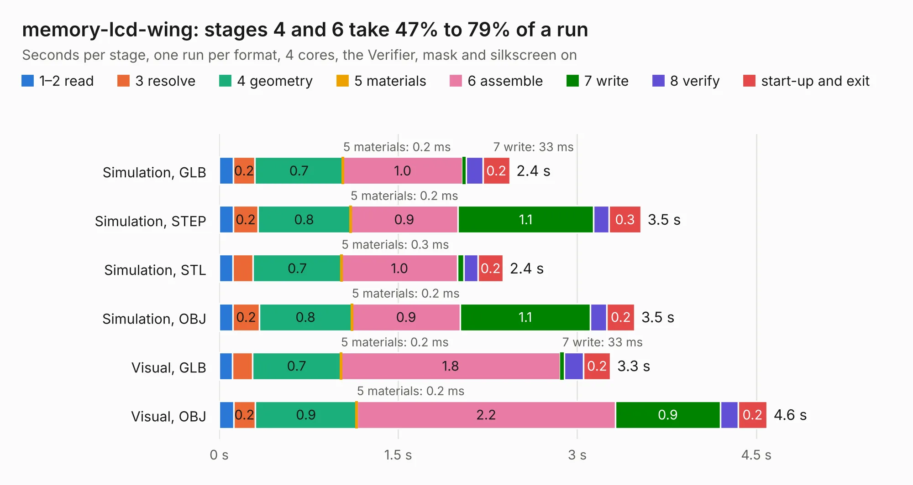

# 1160. memory-lcd-wing

Board 1,160 of the 3,106 of [Corpus Testing](../Corpus-Testing.md), on [Corpus Page 11](../CorpusTestingPages/Corpus-Testing-11.md#1160-memory-lcd-wing).

| Mode and format | 1–2 read | 3 resolve | 4 geometry | 5 materials | 6 assemble | 7 write | 8 verify | start-up and exit | Total |
|---|---:|---:|---:|---:|---:|---:|---:|---:|---:|
| Simulation, GLB | 0.1 | 0.2 | 0.7 | 0.2&nbsp;ms | 1.0 | 33&nbsp;ms | 0.1 | 0.2 | 2.4 |
| Simulation, STEP | 0.1 | 0.2 | 0.8 | 0.2&nbsp;ms | 0.9 | 1.1 | 0.1 | 0.3 | 3.5 |
| Simulation, STL | 0.1 | 0.2 | 0.7 | 0.3&nbsp;ms | 1.0 | 52&nbsp;ms | 0.1 | 0.2 | 2.4 |
| Simulation, OBJ | 0.1 | 0.2 | 0.8 | 0.2&nbsp;ms | 0.9 | 1.1 | 0.1 | 0.2 | 3.5 |
| Visual, GLB | 0.1 | 0.2 | 0.7 | 0.2&nbsp;ms | 1.8 | 33&nbsp;ms | 0.2 | 0.2 | 3.3 |
| Visual, OBJ | 0.1 | 0.2 | 0.9 | 0.2&nbsp;ms | 2.2 | 0.9 | 0.2 | 0.2 | 4.6 |

<table align="center"><tr><td valign="top">

| Board | Repo: [gregdavill/advent-calendar-of-circuits-2020](https://github.com/gregdavill/advent-calendar-of-circuits-2020) Board: `memory-lcd-wing.kicad_pcb` |
|---|---|
| Folder | memory-lcd-wing / kicad-src |
| Complexity | 196&nbsp;/&nbsp;1000 (size&nbsp;106, features&nbsp;90) |
| KESE&nbsp;features | through vias, rounded, trapezoid or chamfered pads, filled zones, curved board outline, stack-up, dielectric εr and tanδ, mask and silkscreen colours |
| Tested | 9th November 2026 |
| Copper&nbsp;layers | 2 |
| File&nbsp;format | KiCad 6 (20201116) |
| Parts,&nbsp;tracks,&nbsp;vias | 4, 68, 3 |
| Triangles,&nbsp;simulation | 192,292 in 39 parts |
| Verifier | PASS in all six runs |

</td><td valign="top">

<table>
<tr><th>File type</th><th>File size</th><th>Peak memory used</th></tr>
<tr><th colspan="3" align="left">Simulation</th></tr>
<tr><td>GLB</td><td align="right">6.2&nbsp;MB</td><td align="right">206&nbsp;MB</td></tr>
<tr><td>STEP</td><td align="right">28&nbsp;MB</td><td align="right">225&nbsp;MB</td></tr>
<tr><td>STL</td><td align="right">9.6&nbsp;MB</td><td align="right">207&nbsp;MB</td></tr>
<tr><td>OBJ</td><td align="right">19&nbsp;MB</td><td align="right">209&nbsp;MB</td></tr>
<tr><th colspan="3" align="left">Visual</th></tr>
<tr><td>GLB</td><td align="right">4.2&nbsp;MB</td><td align="right">188&nbsp;MB</td></tr>
<tr><td>OBJ</td><td align="right">12&nbsp;MB</td><td align="right">191&nbsp;MB</td></tr>
</table>

</td></tr></table>

| Previous | Next |
|:---|---:|
| [1159. meiji-led-ring](b1159b_advent-calendar-of-circuits-2020_meiji-led-ring.md) | [1161. pcie_x1](b1161b_advent-calendar-of-circuits-2020_pcie-x1.md) |
