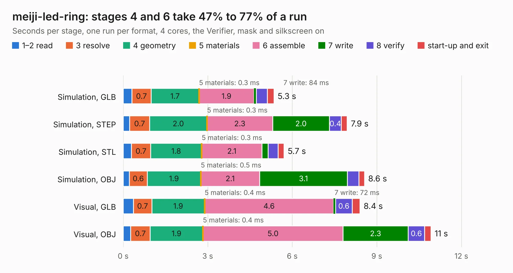

# 1162. meiji-led-ring

Board 1,162 of the 3,112 of [Corpus Testing](../Corpus-Testing.md), on [Corpus Page 11](../CorpusTestingPages/Corpus-Testing-11.md#1162-meiji-led-ring).

| Mode and format | 1–2 read | 3 resolve | 4 geometry | 5 materials | 6 assemble | 7 write | 8 verify | start-up and exit | Total |
|---|---:|---:|---:|---:|---:|---:|---:|---:|---:|
| Simulation, GLB | 0.3 | 0.7 | 1.7 | 0.3&nbsp;ms | 1.9 | 84&nbsp;ms | 0.4 | 0.2 | 5.3 |
| Simulation, STEP | 0.2 | 0.7 | 2.0 | 0.3&nbsp;ms | 2.3 | 2.0 | 0.4 | 0.2 | 7.9 |
| Simulation, STL | 0.3 | 0.7 | 1.8 | 0.3&nbsp;ms | 2.1 | 0.2 | 0.4 | 0.2 | 5.7 |
| Simulation, OBJ | 0.2 | 0.6 | 1.9 | 0.5&nbsp;ms | 2.1 | 3.1 | 0.4 | 0.2 | 8.6 |
| Visual, GLB | 0.4 | 0.7 | 1.9 | 0.4&nbsp;ms | 4.6 | 72&nbsp;ms | 0.6 | 0.3 | 8.4 |
| Visual, OBJ | 0.3 | 0.7 | 1.9 | 0.4&nbsp;ms | 5.0 | 2.3 | 0.6 | 0.2 | 10.9 |

<table align="center"><tr><td valign="top">

| Board | Repo: [gregdavill/advent-calendar-of-circuits-2020](https://github.com/gregdavill/advent-calendar-of-circuits-2020) Board: `meiji-led-ring.kicad_pcb` |
|---|---|
| Folder | meiji-led-ring / kicad-src |
| Complexity | 287&nbsp;/&nbsp;1000 (size&nbsp;187, features&nbsp;100) |
| KESE&nbsp;features | through vias, slotted holes, rounded, trapezoid or chamfered pads, filled zones, curved board outline, stack-up, dielectric εr and tanδ, mask and silkscreen colours |
| Tested | 9th November 2026 |
| Copper&nbsp;layers | 4 |
| File&nbsp;format | KiCad 6 (20210126) |
| Parts,&nbsp;tracks,&nbsp;vias | 61, 592, 59 |
| Triangles,&nbsp;simulation | 709,422 in 75 parts |
| Verifier | PASS in all six runs |

</td><td valign="top">

<table>
<tr><th>File type</th><th>File size</th><th>Peak memory used</th></tr>
<tr><th colspan="3" align="left">Simulation</th></tr>
<tr><td>GLB</td><td align="right">24&nbsp;MB</td><td align="right">399&nbsp;MB</td></tr>
<tr><td>STEP</td><td align="right">110&nbsp;MB</td><td align="right">424&nbsp;MB</td></tr>
<tr><td>STL</td><td align="right">35&nbsp;MB</td><td align="right">393&nbsp;MB</td></tr>
<tr><td>OBJ</td><td align="right">71&nbsp;MB</td><td align="right">510&nbsp;MB</td></tr>
<tr><th colspan="3" align="left">Visual</th></tr>
<tr><td>GLB</td><td align="right">16&nbsp;MB</td><td align="right">431&nbsp;MB</td></tr>
<tr><td>OBJ</td><td align="right">48&nbsp;MB</td><td align="right">434&nbsp;MB</td></tr>
</table>

</td></tr></table>

| Previous | Next |
|:---|---:|
| [1161. led-panel](b1161b_advent-calendar-of-circuits-2020_led-panel.md) | [1163. memory-lcd-wing](b1163b_advent-calendar-of-circuits-2020_memory-lcd-wing.md) |
