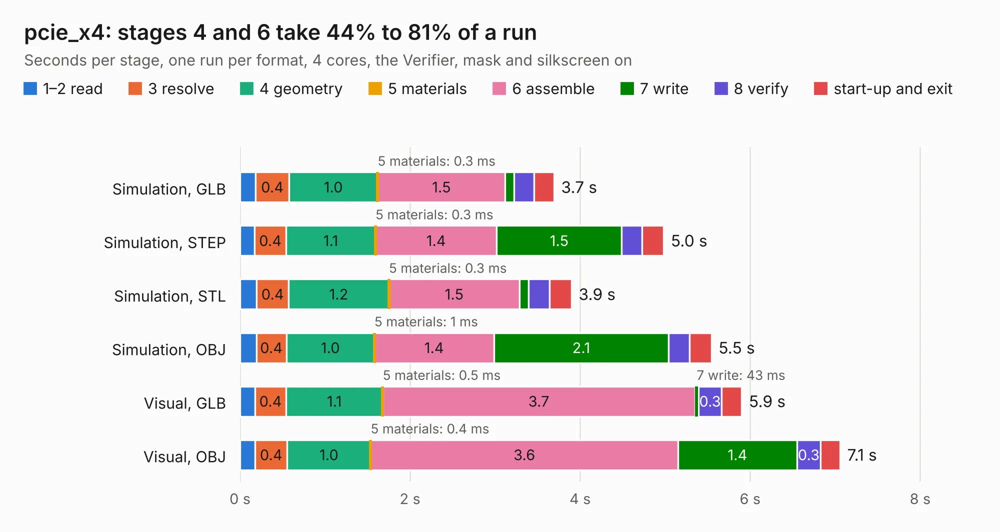

# 1162. pcie_x4

Board 1,162 of the 3,106 of [Corpus Testing](../Corpus-Testing.md), on [Corpus Page 11](../CorpusTestingPages/Corpus-Testing-11.md#1162-pcie_x4).

| Mode and format | 1–2 read | 3 resolve | 4 geometry | 5 materials | 6 assemble | 7 write | 8 verify | start-up and exit | Total |
|---|---:|---:|---:|---:|---:|---:|---:|---:|---:|
| Simulation, GLB | 0.2 | 0.4 | 1.0 | 0.3&nbsp;ms | 1.5 | 0.1 | 0.2 | 0.2 | 3.7 |
| Simulation, STEP | 0.2 | 0.4 | 1.1 | 0.3&nbsp;ms | 1.4 | 1.5 | 0.2 | 0.3 | 5.0 |
| Simulation, STL | 0.2 | 0.4 | 1.2 | 0.3&nbsp;ms | 1.5 | 0.1 | 0.2 | 0.3 | 3.9 |
| Simulation, OBJ | 0.2 | 0.4 | 1.0 | 1&nbsp;ms | 1.4 | 2.1 | 0.2 | 0.3 | 5.5 |
| Visual, GLB | 0.2 | 0.4 | 1.1 | 0.5&nbsp;ms | 3.7 | 43&nbsp;ms | 0.3 | 0.2 | 5.9 |
| Visual, OBJ | 0.2 | 0.4 | 1.0 | 0.4&nbsp;ms | 3.6 | 1.4 | 0.3 | 0.2 | 7.1 |

<table align="center"><tr><td valign="top">

| Board | Repo: [gregdavill/advent-calendar-of-circuits-2020](https://github.com/gregdavill/advent-calendar-of-circuits-2020) Board: `pcie_x4.kicad_pcb` |
|---|---|
| Folder | pcie_x4 / kicad-src |
| Complexity | 282&nbsp;/&nbsp;1000 (size&nbsp;167, features&nbsp;115) |
| KESE&nbsp;features | through vias, custom pads, rounded, trapezoid or chamfered pads, filled zones, copper drawings, curved board outline, stack-up, dielectric εr and tanδ, mask and silkscreen colours |
| Tested | 9th November 2026 |
| Copper&nbsp;layers | 4 |
| File&nbsp;format | KiCad 6 (20201116) |
| Parts,&nbsp;tracks,&nbsp;vias | 16, 374, 53 |
| Triangles,&nbsp;simulation | 370,874 in 94 parts |
| Verifier | PASS in all six runs |

</td><td valign="top">

<table>
<tr><th>File type</th><th>File size</th><th>Peak memory used</th></tr>
<tr><th colspan="3" align="left">Simulation</th></tr>
<tr><td>GLB</td><td align="right">12&nbsp;MB</td><td align="right">275&nbsp;MB</td></tr>
<tr><td>STEP</td><td align="right">52&nbsp;MB</td><td align="right">296&nbsp;MB</td></tr>
<tr><td>STL</td><td align="right">19&nbsp;MB</td><td align="right">273&nbsp;MB</td></tr>
<tr><td>OBJ</td><td align="right">37&nbsp;MB</td><td align="right">285&nbsp;MB</td></tr>
<tr><th colspan="3" align="left">Visual</th></tr>
<tr><td>GLB</td><td align="right">8.3&nbsp;MB</td><td align="right">282&nbsp;MB</td></tr>
<tr><td>OBJ</td><td align="right">25&nbsp;MB</td><td align="right">282&nbsp;MB</td></tr>
</table>

</td></tr></table>

| Previous | Next |
|:---|---:|
| [1161. pcie_x1](b1161b_advent-calendar-of-circuits-2020_pcie-x1.md) | [1163. pmod-gnss](b1163b_advent-calendar-of-circuits-2020_pmod-gnss.md) |
