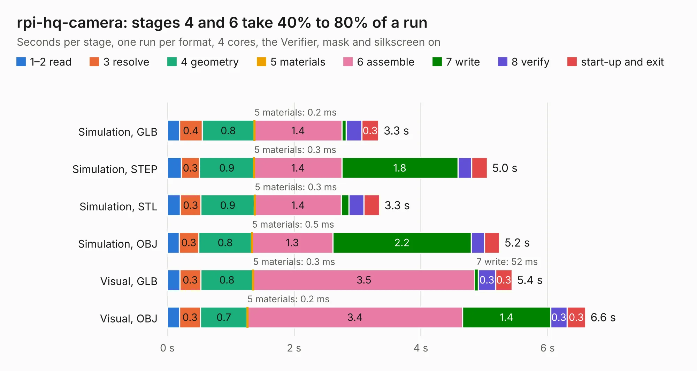

# 1163. rpi-hq-camera

Board 1,163 of the 3,102 of [Corpus Testing](../Corpus-Testing.md), on [Corpus Page 11](../CorpusTestingPages/Corpus-Testing-11.md#1163-rpi-hq-camera).

| Mode and format | 1–2 read | 3 resolve | 4 geometry | 5 materials | 6 assemble | 7 write | 8 verify | start-up and exit | Total |
|---|---:|---:|---:|---:|---:|---:|---:|---:|---:|
| Simulation, GLB | 0.2 | 0.4 | 0.8 | 0.2&nbsp;ms | 1.4 | 68&nbsp;ms | 0.2 | 0.3 | 3.3 |
| Simulation, STEP | 0.2 | 0.3 | 0.9 | 0.3&nbsp;ms | 1.4 | 1.8 | 0.2 | 0.2 | 5.0 |
| Simulation, STL | 0.2 | 0.3 | 0.9 | 0.3&nbsp;ms | 1.4 | 0.1 | 0.2 | 0.2 | 3.3 |
| Simulation, OBJ | 0.2 | 0.3 | 0.8 | 0.5&nbsp;ms | 1.3 | 2.2 | 0.2 | 0.2 | 5.2 |
| Visual, GLB | 0.2 | 0.3 | 0.8 | 0.3&nbsp;ms | 3.5 | 52&nbsp;ms | 0.3 | 0.3 | 5.4 |
| Visual, OBJ | 0.2 | 0.3 | 0.7 | 0.2&nbsp;ms | 3.4 | 1.4 | 0.3 | 0.3 | 6.6 |

<table align="center"><tr><td valign="top">

| Board | Repo: [gregdavill/advent-calendar-of-circuits-2020](https://github.com/gregdavill/advent-calendar-of-circuits-2020) Board: `rpi-hq-camera.kicad_pcb` |
|---|---|
| Folder | rpi-hq-camera / kicad-src |
| Complexity | 274&nbsp;/&nbsp;1000 (size&nbsp;159, features&nbsp;115) |
| KESE&nbsp;features | through vias, custom pads, rounded, trapezoid or chamfered pads, filled zones, copper drawings, curved board outline, stack-up, dielectric εr and tanδ, mask and silkscreen colours |
| Tested | 9th November 2026 |
| Copper&nbsp;layers | 4 |
| File&nbsp;format | KiCad 6 (20201116) |
| Parts,&nbsp;tracks,&nbsp;vias | 7, 453, 31 |
| Triangles,&nbsp;simulation | 341,220 in 70 parts |
| Verifier | PASS in all six runs |

</td><td valign="top">

<table>
<tr><th>File type</th><th>File size</th><th>Peak memory used</th></tr>
<tr><th colspan="3" align="left">Simulation</th></tr>
<tr><td>GLB</td><td align="right">11&nbsp;MB</td><td align="right">279&nbsp;MB</td></tr>
<tr><td>STEP</td><td align="right">57&nbsp;MB</td><td align="right">290&nbsp;MB</td></tr>
<tr><td>STL</td><td align="right">17&nbsp;MB</td><td align="right">262&nbsp;MB</td></tr>
<tr><td>OBJ</td><td align="right">34&nbsp;MB</td><td align="right">286&nbsp;MB</td></tr>
<tr><th colspan="3" align="left">Visual</th></tr>
<tr><td>GLB</td><td align="right">8.1&nbsp;MB</td><td align="right">270&nbsp;MB</td></tr>
<tr><td>OBJ</td><td align="right">24&nbsp;MB</td><td align="right">283&nbsp;MB</td></tr>
</table>

</td></tr></table>

| Previous | Next |
|:---|---:|
| [1162. resonance](b1162b_advent-calendar-of-circuits-2020_resonance.md) | [1164. SCD30-3d-model](b1164b_advent-calendar-of-circuits-2020_SCD30-3d-model.md) |
