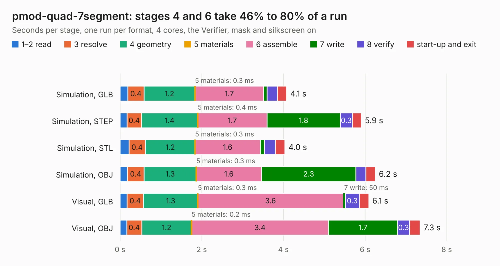

# 1164. pmod-quad-7segment

Board 1,164 of the 3,109 of [Corpus Testing](../Corpus-Testing.md), on [Corpus Page 11](../CorpusTestingPages/Corpus-Testing-11.md#1164-pmod-quad-7segment).

| Mode and format | 1–2 read | 3 resolve | 4 geometry | 5 materials | 6 assemble | 7 write | 8 verify | start-up and exit | Total |
|---|---:|---:|---:|---:|---:|---:|---:|---:|---:|
| Simulation, GLB | 0.2 | 0.4 | 1.2 | 0.3&nbsp;ms | 1.7 | 81&nbsp;ms | 0.3 | 0.2 | 4.1 |
| Simulation, STEP | 0.2 | 0.4 | 1.4 | 0.4&nbsp;ms | 1.7 | 1.8 | 0.3 | 0.2 | 5.9 |
| Simulation, STL | 0.2 | 0.4 | 1.2 | 0.3&nbsp;ms | 1.6 | 99&nbsp;ms | 0.3 | 0.2 | 4.0 |
| Simulation, OBJ | 0.2 | 0.4 | 1.3 | 0.3&nbsp;ms | 1.6 | 2.3 | 0.2 | 0.2 | 6.2 |
| Visual, GLB | 0.2 | 0.4 | 1.3 | 0.3&nbsp;ms | 3.6 | 50&nbsp;ms | 0.3 | 0.2 | 6.1 |
| Visual, OBJ | 0.2 | 0.4 | 1.2 | 0.2&nbsp;ms | 3.4 | 1.7 | 0.3 | 0.3 | 7.3 |

<table align="center"><tr><td valign="top">

| Board | Repo: [gregdavill/advent-calendar-of-circuits-2020](https://github.com/gregdavill/advent-calendar-of-circuits-2020) Board: `pmod-quad-7segment.kicad_pcb` |
|---|---|
| Folder | pmod-quad-7segment / kicad-src |
| Complexity | 244&nbsp;/&nbsp;1000 (size&nbsp;154, features&nbsp;90) |
| KESE&nbsp;features | through vias, rounded, trapezoid or chamfered pads, filled zones, curved board outline, stack-up, dielectric εr and tanδ, mask and silkscreen colours |
| Tested | 9th November 2026 |
| Copper&nbsp;layers | 2 |
| File&nbsp;format | KiCad 6 (20201116) |
| Parts,&nbsp;tracks,&nbsp;vias | 21, 385, 63 |
| Triangles,&nbsp;simulation | 398,938 in 49 parts |
| Verifier | PASS in all six runs |

</td><td valign="top">

<table>
<tr><th>File type</th><th>File size</th><th>Peak memory used</th></tr>
<tr><th colspan="3" align="left">Simulation</th></tr>
<tr><td>GLB</td><td align="right">13&nbsp;MB</td><td align="right">272&nbsp;MB</td></tr>
<tr><td>STEP</td><td align="right">67&nbsp;MB</td><td align="right">312&nbsp;MB</td></tr>
<tr><td>STL</td><td align="right">20&nbsp;MB</td><td align="right">272&nbsp;MB</td></tr>
<tr><td>OBJ</td><td align="right">40&nbsp;MB</td><td align="right">322&nbsp;MB</td></tr>
<tr><th colspan="3" align="left">Visual</th></tr>
<tr><td>GLB</td><td align="right">11&nbsp;MB</td><td align="right">333&nbsp;MB</td></tr>
<tr><td>OBJ</td><td align="right">33&nbsp;MB</td><td align="right">334&nbsp;MB</td></tr>
</table>

</td></tr></table>

| Previous | Next |
|:---|---:|
| [1163. pmod-gnss](b1163b_advent-calendar-of-circuits-2020_pmod-gnss.md) | [1165. sd-dummy](b1165b_advent-calendar-of-circuits-2020_sd-dummy.md) |
