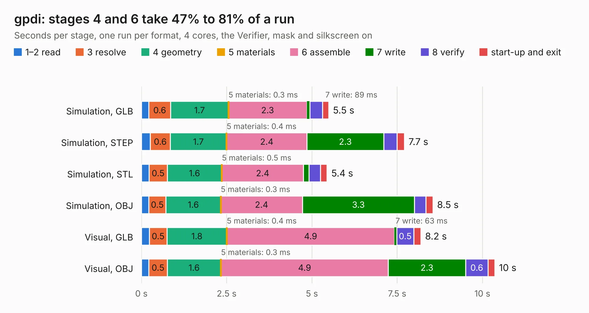

# 1165. gpdi

Board 1,165 of the 3,128 of [Corpus Testing](../Corpus-Testing.md), on [Corpus Page 11](../CorpusTestingPages/Corpus-Testing-11.md#1165-gpdi).

| Mode and format | 1–2 read | 3 resolve | 4 geometry | 5 materials | 6 assemble | 7 write | 8 verify | start-up and exit | Total |
|---|---:|---:|---:|---:|---:|---:|---:|---:|---:|
| Simulation, GLB | 0.2 | 0.6 | 1.7 | 0.3&nbsp;ms | 2.3 | 89&nbsp;ms | 0.4 | 0.2 | 5.5 |
| Simulation, STEP | 0.3 | 0.6 | 1.7 | 0.4&nbsp;ms | 2.4 | 2.3 | 0.4 | 0.2 | 7.7 |
| Simulation, STL | 0.2 | 0.5 | 1.6 | 0.5&nbsp;ms | 2.4 | 0.2 | 0.3 | 0.2 | 5.4 |
| Simulation, OBJ | 0.2 | 0.5 | 1.6 | 0.3&nbsp;ms | 2.4 | 3.3 | 0.3 | 0.2 | 8.5 |
| Visual, GLB | 0.2 | 0.5 | 1.8 | 0.4&nbsp;ms | 4.9 | 63&nbsp;ms | 0.5 | 0.2 | 8.2 |
| Visual, OBJ | 0.2 | 0.5 | 1.6 | 0.3&nbsp;ms | 4.9 | 2.3 | 0.6 | 0.2 | 10.4 |

<table align="center"><tr><td valign="top">

| Board | Repo: [gregdavill/advent-calendar-of-circuits-2020](https://github.com/gregdavill/advent-calendar-of-circuits-2020) Board: `gpdi.kicad_pcb` |
|---|---|
| Folder | gpdi / kicad-src |
| Complexity | 313&nbsp;/&nbsp;1000 (size&nbsp;188, features&nbsp;125) |
| KESE&nbsp;features | through vias, slotted holes, custom pads, rounded, trapezoid or chamfered pads, filled zones, copper drawings, curved board outline, stack-up, dielectric εr and tanδ, mask and silkscreen colours |
| Tested | 9th November 2026 |
| Copper&nbsp;layers | 4 |
| File&nbsp;format | KiCad 6 (20210126) |
| Parts,&nbsp;tracks,&nbsp;vias | 53, 679, 67 |
| Triangles,&nbsp;simulation | 676,432 in 104 parts |
| Verifier | PASS in all six runs |

</td><td valign="top">

<table>
<tr><th>File type</th><th>File size</th><th>Peak memory used</th></tr>
<tr><th colspan="3" align="left">Simulation</th></tr>
<tr><td>GLB</td><td align="right">23&nbsp;MB</td><td align="right">342&nbsp;MB</td></tr>
<tr><td>STEP</td><td align="right">96&nbsp;MB</td><td align="right">414&nbsp;MB</td></tr>
<tr><td>STL</td><td align="right">34&nbsp;MB</td><td align="right">343&nbsp;MB</td></tr>
<tr><td>OBJ</td><td align="right">67&nbsp;MB</td><td align="right">488&nbsp;MB</td></tr>
<tr><th colspan="3" align="left">Visual</th></tr>
<tr><td>GLB</td><td align="right">15&nbsp;MB</td><td align="right">466&nbsp;MB</td></tr>
<tr><td>OBJ</td><td align="right">45&nbsp;MB</td><td align="right">413&nbsp;MB</td></tr>
</table>

</td></tr></table>

| Previous | Next |
|:---|---:|
| [1164. gpdi-serdes](b1164b_advent-calendar-of-circuits-2020_gpdi-serdes.md) | [1166. hdmi-si](b1166b_advent-calendar-of-circuits-2020_hdmi-si.md) |
