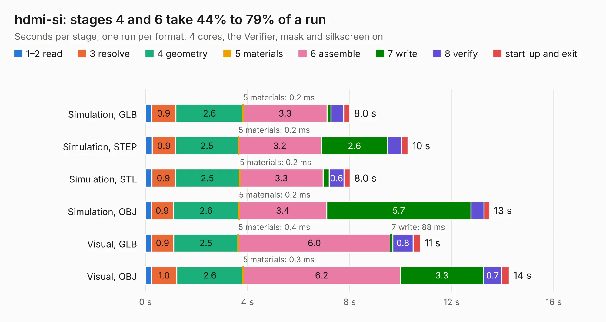

# 1167. hdmi-si

Board 1,167 of the 3,132 of [Corpus Testing](../Corpus-Testing.md), on [Corpus Page 11](../CorpusTestingPages/Corpus-Testing-11.md#1167-hdmi-si).

| Mode and format | 1–2 read | 3 resolve | 4 geometry | 5 materials | 6 assemble | 7 write | 8 verify | start-up and exit | Total |
|---|---:|---:|---:|---:|---:|---:|---:|---:|---:|
| Simulation, GLB | 0.2 | 0.9 | 2.6 | 0.2&nbsp;ms | 3.3 | 0.1 | 0.5 | 0.2 | 8.0 |
| Simulation, STEP | 0.3 | 0.9 | 2.5 | 0.2&nbsp;ms | 3.2 | 2.6 | 0.5 | 0.2 | 10.3 |
| Simulation, STL | 0.2 | 0.9 | 2.5 | 0.2&nbsp;ms | 3.3 | 0.2 | 0.6 | 0.2 | 8.0 |
| Simulation, OBJ | 0.2 | 0.9 | 2.6 | 0.2&nbsp;ms | 3.4 | 5.7 | 0.5 | 0.2 | 13.5 |
| Visual, GLB | 0.2 | 0.9 | 2.5 | 0.4&nbsp;ms | 6.0 | 88&nbsp;ms | 0.8 | 0.3 | 10.8 |
| Visual, OBJ | 0.2 | 1.0 | 2.6 | 0.3&nbsp;ms | 6.2 | 3.3 | 0.7 | 0.3 | 14.2 |

<table align="center"><tr><td valign="top">

| Board | Repo: [gregdavill/advent-calendar-of-circuits-2020](https://github.com/gregdavill/advent-calendar-of-circuits-2020) Board: `hdmi-si.kicad_pcb` |
|---|---|
| Folder | hdmi-si / kicad-src |
| Complexity | 278&nbsp;/&nbsp;1000 (size&nbsp;178, features&nbsp;100) |
| KESE&nbsp;features | through vias, slotted holes, rounded, trapezoid or chamfered pads, filled zones, curved board outline, stack-up, dielectric εr and tanδ, mask and silkscreen colours |
| Tested | 9th November 2026 |
| Copper&nbsp;layers | 4 |
| File&nbsp;format | KiCad 6 (20201116) |
| Parts,&nbsp;tracks,&nbsp;vias | 26, 335, 138 |
| Triangles,&nbsp;simulation | 987,308 in 42 parts |
| Verifier | PASS in all six runs |

</td><td valign="top">

<table>
<tr><th>File type</th><th>File size</th><th>Peak memory used</th></tr>
<tr><th colspan="3" align="left">Simulation</th></tr>
<tr><td>GLB</td><td align="right">32&nbsp;MB</td><td align="right">491&nbsp;MB</td></tr>
<tr><td>STEP</td><td align="right">121&nbsp;MB</td><td align="right">540&nbsp;MB</td></tr>
<tr><td>STL</td><td align="right">49&nbsp;MB</td><td align="right">498&nbsp;MB</td></tr>
<tr><td>OBJ</td><td align="right">98&nbsp;MB</td><td align="right">689&nbsp;MB</td></tr>
<tr><th colspan="3" align="left">Visual</th></tr>
<tr><td>GLB</td><td align="right">19&nbsp;MB</td><td align="right">547&nbsp;MB</td></tr>
<tr><td>OBJ</td><td align="right">59&nbsp;MB</td><td align="right">483&nbsp;MB</td></tr>
</table>

</td></tr></table>

| Previous | Next |
|:---|---:|
| [1166. gpdi](b1166b_advent-calendar-of-circuits-2020_gpdi.md) | [1168. icebreaker++](b1168b_advent-calendar-of-circuits-2020_icebreaker.md) |
