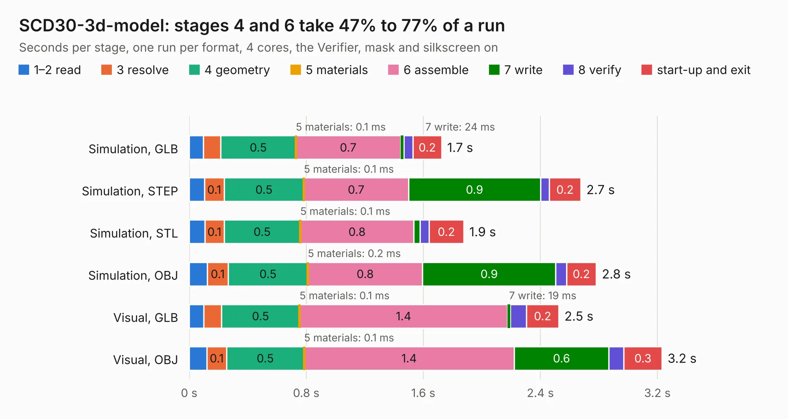

# 1168. SCD30-3d-model

Board 1,168 of the 3,109 of [Corpus Testing](../Corpus-Testing.md), on [Corpus Page 11](../CorpusTestingPages/Corpus-Testing-11.md#1168-scd30-3d-model).

| Mode and format | 1–2 read | 3 resolve | 4 geometry | 5 materials | 6 assemble | 7 write | 8 verify | start-up and exit | Total |
|---|---:|---:|---:|---:|---:|---:|---:|---:|---:|
| Simulation, GLB | 98&nbsp;ms | 0.1 | 0.5 | 0.1&nbsp;ms | 0.7 | 24&nbsp;ms | 61&nbsp;ms | 0.2 | 1.7 |
| Simulation, STEP | 0.1 | 0.1 | 0.5 | 0.1&nbsp;ms | 0.7 | 0.9 | 60&nbsp;ms | 0.2 | 2.7 |
| Simulation, STL | 0.1 | 0.1 | 0.5 | 0.1&nbsp;ms | 0.8 | 41&nbsp;ms | 63&nbsp;ms | 0.2 | 1.9 |
| Simulation, OBJ | 0.1 | 0.1 | 0.5 | 0.2&nbsp;ms | 0.8 | 0.9 | 73&nbsp;ms | 0.2 | 2.8 |
| Visual, GLB | 0.1 | 0.1 | 0.5 | 0.1&nbsp;ms | 1.4 | 19&nbsp;ms | 0.1 | 0.2 | 2.5 |
| Visual, OBJ | 0.1 | 0.1 | 0.5 | 0.1&nbsp;ms | 1.4 | 0.6 | 0.1 | 0.3 | 3.2 |

<table align="center"><tr><td valign="top">

| Board | Repo: [gregdavill/advent-calendar-of-circuits-2020](https://github.com/gregdavill/advent-calendar-of-circuits-2020) Board: `SCD30-3d-model.kicad_pcb` |
|---|---|
| Folder | SCD30-3d-model / kicad-src |
| Complexity | 121&nbsp;/&nbsp;1000 (size&nbsp;66, features&nbsp;55) |
| KESE&nbsp;features | rounded, trapezoid or chamfered pads, curved board outline, stack-up, dielectric εr and tanδ, mask and silkscreen colours |
| Tested | 9th November 2026 |
| Copper&nbsp;layers | 4 |
| File&nbsp;format | KiCad 6 (20201116) |
| Parts,&nbsp;tracks,&nbsp;vias | 19, 0, 0 |
| Triangles,&nbsp;simulation | 138,320 in 13 parts |
| Verifier | PASS in all six runs |

</td><td valign="top">

<table>
<tr><th>File type</th><th>File size</th><th>Peak memory used</th></tr>
<tr><th colspan="3" align="left">Simulation</th></tr>
<tr><td>GLB</td><td align="right">4.7&nbsp;MB</td><td align="right">197&nbsp;MB</td></tr>
<tr><td>STEP</td><td align="right">18&nbsp;MB</td><td align="right">206&nbsp;MB</td></tr>
<tr><td>STL</td><td align="right">6.9&nbsp;MB</td><td align="right">196&nbsp;MB</td></tr>
<tr><td>OBJ</td><td align="right">14&nbsp;MB</td><td align="right">197&nbsp;MB</td></tr>
<tr><th colspan="3" align="left">Visual</th></tr>
<tr><td>GLB</td><td align="right">3.6&nbsp;MB</td><td align="right">173&nbsp;MB</td></tr>
<tr><td>OBJ</td><td align="right">10&nbsp;MB</td><td align="right">171&nbsp;MB</td></tr>
</table>

</td></tr></table>

| Previous | Next |
|:---|---:|
| [1167. rpi-hq-camera](b1167b_advent-calendar-of-circuits-2020_rpi-hq-camera.md) | [1169. syzygy-breakout](b1169b_advent-calendar-of-circuits-2020_syzygy-breakout.md) |
