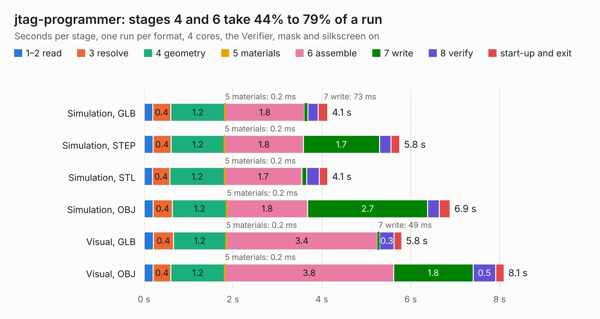

# 1168. jtag-programmer

Board 1,168 of the 3,129 of [Corpus Testing](../Corpus-Testing.md), on [Corpus Page 11](../CorpusTestingPages/Corpus-Testing-11.md#1168-jtag-programmer).

| Mode and format | 1–2 read | 3 resolve | 4 geometry | 5 materials | 6 assemble | 7 write | 8 verify | start-up and exit | Total |
|---|---:|---:|---:|---:|---:|---:|---:|---:|---:|
| Simulation, GLB | 0.2 | 0.4 | 1.2 | 0.2&nbsp;ms | 1.8 | 73&nbsp;ms | 0.2 | 0.2 | 4.1 |
| Simulation, STEP | 0.2 | 0.4 | 1.2 | 0.2&nbsp;ms | 1.8 | 1.7 | 0.3 | 0.2 | 5.8 |
| Simulation, STL | 0.2 | 0.4 | 1.2 | 0.2&nbsp;ms | 1.7 | 0.1 | 0.3 | 0.2 | 4.1 |
| Simulation, OBJ | 0.2 | 0.4 | 1.2 | 0.2&nbsp;ms | 1.8 | 2.7 | 0.3 | 0.2 | 6.9 |
| Visual, GLB | 0.2 | 0.4 | 1.2 | 0.2&nbsp;ms | 3.4 | 49&nbsp;ms | 0.3 | 0.2 | 5.8 |
| Visual, OBJ | 0.2 | 0.4 | 1.2 | 0.2&nbsp;ms | 3.8 | 1.8 | 0.5 | 0.2 | 8.1 |

<table align="center"><tr><td valign="top">

| Board | Repo: [gregdavill/advent-calendar-of-circuits-2020](https://github.com/gregdavill/advent-calendar-of-circuits-2020) Board: `jtag-programmer.kicad_pcb` |
|---|---|
| Folder | jtag-programmer / kicad-src |
| Complexity | 314&nbsp;/&nbsp;1000 (size&nbsp;214, features&nbsp;100) |
| KESE&nbsp;features | through vias, slotted holes, rounded, trapezoid or chamfered pads, filled zones, curved board outline, stack-up, dielectric εr and tanδ, mask and silkscreen colours |
| Tested | 9th November 2026 |
| Copper&nbsp;layers | 4 |
| File&nbsp;format | KiCad 6 (20201116) |
| Parts,&nbsp;tracks,&nbsp;vias | 25, 327, 92 |
| Triangles,&nbsp;simulation | 546,070 in 54 parts |
| Verifier | PASS in all six runs |

</td><td valign="top">

<table>
<tr><th>File type</th><th>File size</th><th>Peak memory used</th></tr>
<tr><th colspan="3" align="left">Simulation</th></tr>
<tr><td>GLB</td><td align="right">18&nbsp;MB</td><td align="right">310&nbsp;MB</td></tr>
<tr><td>STEP</td><td align="right">73&nbsp;MB</td><td align="right">372&nbsp;MB</td></tr>
<tr><td>STL</td><td align="right">27&nbsp;MB</td><td align="right">308&nbsp;MB</td></tr>
<tr><td>OBJ</td><td align="right">54&nbsp;MB</td><td align="right">411&nbsp;MB</td></tr>
<tr><th colspan="3" align="left">Visual</th></tr>
<tr><td>GLB</td><td align="right">12&nbsp;MB</td><td align="right">355&nbsp;MB</td></tr>
<tr><td>OBJ</td><td align="right">36&nbsp;MB</td><td align="right">386&nbsp;MB</td></tr>
</table>

</td></tr></table>

| Previous | Next |
|:---|---:|
| [1167. icebreaker++](b1167b_advent-calendar-of-circuits-2020_icebreaker.md) | [1169. led-panel](b1169b_advent-calendar-of-circuits-2020_led-panel.md) |
