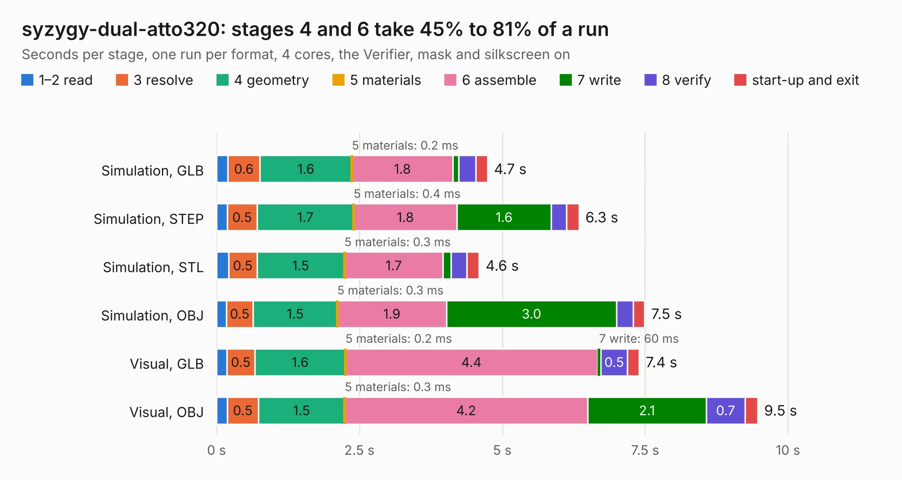

# 1169. syzygy-dual-atto320

Board 1,169 of the 3,105 of [Corpus Testing](../Corpus-Testing.md), on [Corpus Page 11](../CorpusTestingPages/Corpus-Testing-11.md#1169-syzygy-dual-atto320).

| Mode and format | 1–2 read | 3 resolve | 4 geometry | 5 materials | 6 assemble | 7 write | 8 verify | start-up and exit | Total |
|---|---:|---:|---:|---:|---:|---:|---:|---:|---:|
| Simulation, GLB | 0.2 | 0.6 | 1.6 | 0.2&nbsp;ms | 1.8 | 98&nbsp;ms | 0.3 | 0.2 | 4.7 |
| Simulation, STEP | 0.2 | 0.5 | 1.7 | 0.4&nbsp;ms | 1.8 | 1.6 | 0.3 | 0.2 | 6.3 |
| Simulation, STL | 0.2 | 0.5 | 1.5 | 0.3&nbsp;ms | 1.7 | 0.1 | 0.3 | 0.2 | 4.6 |
| Simulation, OBJ | 0.2 | 0.5 | 1.5 | 0.3&nbsp;ms | 1.9 | 3.0 | 0.3 | 0.2 | 7.5 |
| Visual, GLB | 0.2 | 0.5 | 1.6 | 0.2&nbsp;ms | 4.4 | 60&nbsp;ms | 0.5 | 0.2 | 7.4 |
| Visual, OBJ | 0.2 | 0.5 | 1.5 | 0.3&nbsp;ms | 4.2 | 2.1 | 0.7 | 0.2 | 9.5 |

<table align="center"><tr><td valign="top">

| Board | Repo: [gregdavill/advent-calendar-of-circuits-2020](https://github.com/gregdavill/advent-calendar-of-circuits-2020) Board: `syzygy-dual-atto320.kicad_pcb` |
|---|---|
| Folder | syzygy-dual-atto320 / kicad-src |
| Complexity | 275&nbsp;/&nbsp;1000 (size&nbsp;160, features&nbsp;115) |
| KESE&nbsp;features | through vias, custom pads, rounded, trapezoid or chamfered pads, filled zones, copper drawings, curved board outline, stack-up, dielectric εr and tanδ, mask and silkscreen colours |
| Tested | 9th November 2026 |
| Copper&nbsp;layers | 4 |
| File&nbsp;format | KiCad 6 (20201116) |
| Parts,&nbsp;tracks,&nbsp;vias | 8, 323, 73 |
| Triangles,&nbsp;simulation | 559,920 in 70 parts |
| Verifier | PASS in all six runs |

</td><td valign="top">

<table>
<tr><th>File type</th><th>File size</th><th>Peak memory used</th></tr>
<tr><th colspan="3" align="left">Simulation</th></tr>
<tr><td>GLB</td><td align="right">19&nbsp;MB</td><td align="right">324&nbsp;MB</td></tr>
<tr><td>STEP</td><td align="right">89&nbsp;MB</td><td align="right">351&nbsp;MB</td></tr>
<tr><td>STL</td><td align="right">28&nbsp;MB</td><td align="right">317&nbsp;MB</td></tr>
<tr><td>OBJ</td><td align="right">56&nbsp;MB</td><td align="right">402&nbsp;MB</td></tr>
<tr><th colspan="3" align="left">Visual</th></tr>
<tr><td>GLB</td><td align="right">13&nbsp;MB</td><td align="right">368&nbsp;MB</td></tr>
<tr><td>OBJ</td><td align="right">40&nbsp;MB</td><td align="right">361&nbsp;MB</td></tr>
</table>

</td></tr></table>

| Previous | Next |
|:---|---:|
| [1168. syzygy-breakout](b1168b_advent-calendar-of-circuits-2020_syzygy-breakout.md) | [1170. syzygy-epc901](b1170b_advent-calendar-of-circuits-2020_syzygy-epc901.md) |
