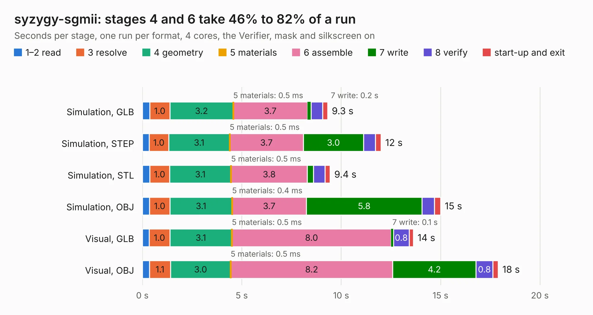

# 1173. syzygy-sgmii

Board 1,173 of the 3,103 of [Corpus Testing](../Corpus-Testing.md), on [Corpus Page 11](../CorpusTestingPages/Corpus-Testing-11.md#1173-syzygy-sgmii).

| Mode and format | 1–2 read | 3 resolve | 4 geometry | 5 materials | 6 assemble | 7 write | 8 verify | start-up and exit | Total |
|---|---:|---:|---:|---:|---:|---:|---:|---:|---:|
| Simulation, GLB | 0.4 | 1.0 | 3.2 | 0.5&nbsp;ms | 3.7 | 0.2 | 0.6 | 0.3 | 9.3 |
| Simulation, STEP | 0.3 | 1.0 | 3.1 | 0.5&nbsp;ms | 3.7 | 3.0 | 0.6 | 0.3 | 12.0 |
| Simulation, STL | 0.4 | 1.0 | 3.1 | 0.5&nbsp;ms | 3.8 | 0.3 | 0.6 | 0.3 | 9.4 |
| Simulation, OBJ | 0.4 | 1.0 | 3.1 | 0.4&nbsp;ms | 3.7 | 5.8 | 0.6 | 0.3 | 15.0 |
| Visual, GLB | 0.3 | 1.0 | 3.1 | 0.5&nbsp;ms | 8.0 | 0.1 | 0.8 | 0.2 | 13.6 |
| Visual, OBJ | 0.4 | 1.1 | 3.0 | 0.5&nbsp;ms | 8.2 | 4.2 | 0.8 | 0.3 | 17.9 |

<table align="center"><tr><td valign="top">

| Board | Repo: [gregdavill/advent-calendar-of-circuits-2020](https://github.com/gregdavill/advent-calendar-of-circuits-2020) Board: `syzygy-sgmii.kicad_pcb` |
|---|---|
| Folder | syzygy-sgmii / kicad-src |
| Complexity | 351&nbsp;/&nbsp;1000 (size&nbsp;236, features&nbsp;115) |
| KESE&nbsp;features | through vias, custom pads, rounded, trapezoid or chamfered pads, filled zones, copper drawings, curved board outline, stack-up, dielectric εr and tanδ, mask and silkscreen colours |
| Tested | 9th November 2026 |
| Copper&nbsp;layers | 4 |
| File&nbsp;format | KiCad 6 (20210126) |
| Parts,&nbsp;tracks,&nbsp;vias | 69, 850, 129 |
| Triangles,&nbsp;simulation | 1,034,760 in 118 parts |
| Verifier | PASS in all six runs |

</td><td valign="top">

<table>
<tr><th>File type</th><th>File size</th><th>Peak memory used</th></tr>
<tr><th colspan="3" align="left">Simulation</th></tr>
<tr><td>GLB</td><td align="right">34&nbsp;MB</td><td align="right">431&nbsp;MB</td></tr>
<tr><td>STEP</td><td align="right">137&nbsp;MB</td><td align="right">533&nbsp;MB</td></tr>
<tr><td>STL</td><td align="right">52&nbsp;MB</td><td align="right">434&nbsp;MB</td></tr>
<tr><td>OBJ</td><td align="right">104&nbsp;MB</td><td align="right">738&nbsp;MB</td></tr>
<tr><th colspan="3" align="left">Visual</th></tr>
<tr><td>GLB</td><td align="right">23&nbsp;MB</td><td align="right">621&nbsp;MB</td></tr>
<tr><td>OBJ</td><td align="right">70&nbsp;MB</td><td align="right">613&nbsp;MB</td></tr>
</table>

</td></tr></table>

| Previous | Next |
|:---|---:|
| [1172. syzygy-rgb888-lcd](b1172b_advent-calendar-of-circuits-2020_syzygy-rgb888-lcd.md) | [1174. syzygy-txr-breakout](b1174b_advent-calendar-of-circuits-2020_syzygy-txr-breakout.md) |
