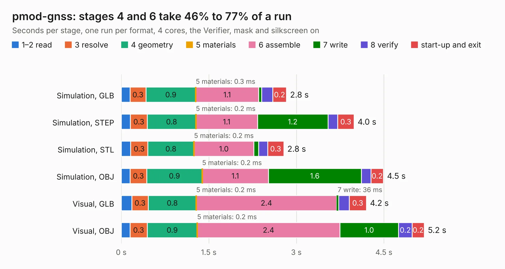

# 1175. pmod-gnss

Board 1,175 of the 3,132 of [Corpus Testing](../Corpus-Testing.md), on [Corpus Page 11](../CorpusTestingPages/Corpus-Testing-11.md#1175-pmod-gnss).

| Mode and format | 1–2 read | 3 resolve | 4 geometry | 5 materials | 6 assemble | 7 write | 8 verify | start-up and exit | Total |
|---|---:|---:|---:|---:|---:|---:|---:|---:|---:|
| Simulation, GLB | 0.2 | 0.3 | 0.9 | 0.3&nbsp;ms | 1.1 | 55&nbsp;ms | 0.2 | 0.2 | 2.8 |
| Simulation, STEP | 0.2 | 0.3 | 0.8 | 0.2&nbsp;ms | 1.1 | 1.2 | 0.2 | 0.3 | 4.0 |
| Simulation, STL | 0.2 | 0.3 | 0.8 | 0.2&nbsp;ms | 1.0 | 84&nbsp;ms | 0.2 | 0.3 | 2.8 |
| Simulation, OBJ | 0.2 | 0.3 | 0.9 | 0.2&nbsp;ms | 1.1 | 1.6 | 0.2 | 0.2 | 4.5 |
| Visual, GLB | 0.2 | 0.3 | 0.8 | 0.2&nbsp;ms | 2.4 | 36&nbsp;ms | 0.2 | 0.3 | 4.2 |
| Visual, OBJ | 0.1 | 0.3 | 0.9 | 0.2&nbsp;ms | 2.4 | 1.0 | 0.2 | 0.2 | 5.2 |

<table align="center"><tr><td valign="top">

| Board | Repo: [gregdavill/advent-calendar-of-circuits-2020](https://github.com/gregdavill/advent-calendar-of-circuits-2020) Board: `pmod-gnss.kicad_pcb` |
|---|---|
| Folder | pmod-gnss / kicad-src |
| Complexity | 261&nbsp;/&nbsp;1000 (size&nbsp;156, features&nbsp;105) |
| KESE&nbsp;features | through vias, rounded, trapezoid or chamfered pads, arc tracks, filled zones, curved board outline, stack-up, dielectric εr and tanδ, mask and silkscreen colours |
| Tested | 9th November 2026 |
| Copper&nbsp;layers | 4 |
| File&nbsp;format | KiCad 6 (20201116) |
| Parts,&nbsp;tracks,&nbsp;vias | 22, 135, 30 |
| Triangles,&nbsp;simulation | 281,488 in 41 parts |
| Verifier | PASS in all six runs |

</td><td valign="top">

<table>
<tr><th>File type</th><th>File size</th><th>Peak memory used</th></tr>
<tr><th colspan="3" align="left">Simulation</th></tr>
<tr><td>GLB</td><td align="right">9.3&nbsp;MB</td><td align="right">234&nbsp;MB</td></tr>
<tr><td>STEP</td><td align="right">34&nbsp;MB</td><td align="right">250&nbsp;MB</td></tr>
<tr><td>STL</td><td align="right">14&nbsp;MB</td><td align="right">234&nbsp;MB</td></tr>
<tr><td>OBJ</td><td align="right">28&nbsp;MB</td><td align="right">237&nbsp;MB</td></tr>
<tr><th colspan="3" align="left">Visual</th></tr>
<tr><td>GLB</td><td align="right">5.8&nbsp;MB</td><td align="right">218&nbsp;MB</td></tr>
<tr><td>OBJ</td><td align="right">17&nbsp;MB</td><td align="right">222&nbsp;MB</td></tr>
</table>

</td></tr></table>

| Previous | Next |
|:---|---:|
| [1174. pcie_x4](b1174b_advent-calendar-of-circuits-2020_pcie-x4.md) | [1176. pmod-quad-7segment](b1176b_advent-calendar-of-circuits-2020_pmod-quad-7segment.md) |
