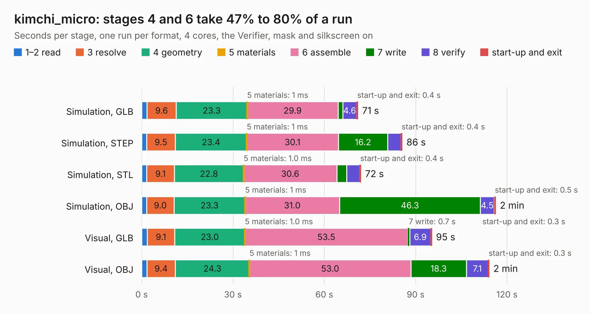

# 1175. kimchi_micro

Board 1,175 of the 3,100 of [Corpus Testing](../Corpus-Testing.md), on [Corpus Page 11](../CorpusTestingPages/Corpus-Testing-11.md#1175-kimchi_micro).

| Mode and format | 1–2 read | 3 resolve | 4 geometry | 5 materials | 6 assemble | 7 write | 8 verify | start-up and exit | Total |
|---|---:|---:|---:|---:|---:|---:|---:|---:|---:|
| Simulation, GLB | 1.7 | 9.6 | 23.3 | 1&nbsp;ms | 29.9 | 1.5 | 4.6 | 0.4 | 71.0 |
| Simulation, STEP | 1.6 | 9.5 | 23.4 | 1&nbsp;ms | 30.1 | 16.2 | 4.4 | 0.4 | 85.6 |
| Simulation, STL | 1.6 | 9.1 | 22.8 | 1.0&nbsp;ms | 30.6 | 3.3 | 4.3 | 0.4 | 72.0 |
| Simulation, OBJ | 1.6 | 9.0 | 23.3 | 1&nbsp;ms | 31.0 | 46.3 | 4.5 | 0.5 | 116.3 |
| Visual, GLB | 1.8 | 9.1 | 23.0 | 1.0&nbsp;ms | 53.5 | 0.7 | 6.9 | 0.3 | 95.3 |
| Visual, OBJ | 1.7 | 9.4 | 24.3 | 1&nbsp;ms | 53.0 | 18.3 | 7.1 | 0.3 | 114.1 |

<table align="center"><tr><td valign="top">

| Board | Repo: [groupgets/kimchi-micro](https://github.com/groupgets/kimchi-micro) Board: `kimchi_micro.kicad_pcb` |
|---|---|
| Folder | hardware_sbc |
| Complexity | 404&nbsp;/&nbsp;1000 (size&nbsp;334, features&nbsp;70) |
| KESE&nbsp;features | through vias, custom pads, rounded, trapezoid or chamfered pads, filled zones, copper drawings |
| Tested | 9th November 2026 |
| Copper&nbsp;layers | 8 |
| File&nbsp;format | KiCad 8 (20240108) |
| Parts,&nbsp;tracks,&nbsp;vias | 289, 10,738, 1,058 |
| Triangles,&nbsp;simulation | 9,560,528 in 411 parts |
| Verifier | PASS in all six runs |

</td><td valign="top">

<table>
<tr><th>File type</th><th>File size</th><th>Peak memory used</th></tr>
<tr><th colspan="3" align="left">Simulation</th></tr>
<tr><td>GLB</td><td align="right">330&nbsp;MB</td><td align="right">2.1&nbsp;GB</td></tr>
<tr><td>STEP</td><td align="right">1.2&nbsp;GB</td><td align="right">2.9&nbsp;GB</td></tr>
<tr><td>STL</td><td align="right">478&nbsp;MB</td><td align="right">2.1&nbsp;GB</td></tr>
<tr><td>OBJ</td><td align="right">1.1&nbsp;GB</td><td align="right">6.1&nbsp;GB</td></tr>
<tr><th colspan="3" align="left">Visual</th></tr>
<tr><td>GLB</td><td align="right">143&nbsp;MB</td><td align="right">2.5&nbsp;GB</td></tr>
<tr><td>OBJ</td><td align="right">480&nbsp;MB</td><td align="right">3.1&nbsp;GB</td></tr>
</table>

</td></tr></table>

| Previous | Next |
|:---|---:|
| [1174. FreshTwinkie_v0.1_panel](b1174b_PD-sniffer_FreshTwinkie-v0-1-panel.md) | [1176. LevelShifter](b1176b_logicanalyzer_LevelShifter.md) |
