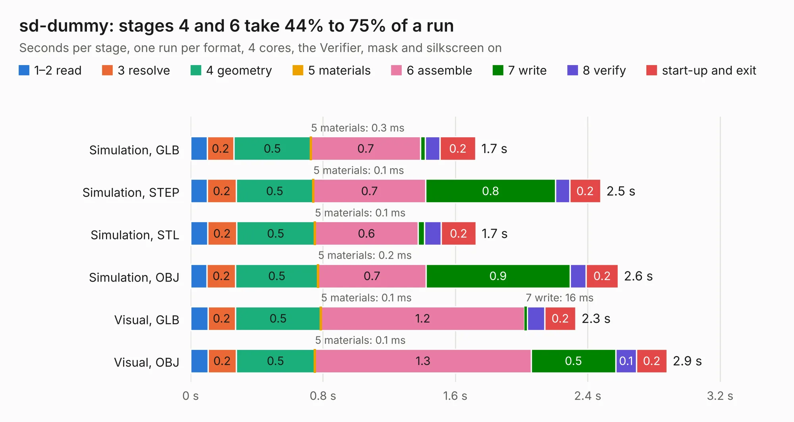

# 1176. sd-dummy

Board 1,176 of the 3,124 of [Corpus Testing](../Corpus-Testing.md), on [Corpus Page 11](../CorpusTestingPages/Corpus-Testing-11.md#1176-sd-dummy).

| Mode and format | 1–2 read | 3 resolve | 4 geometry | 5 materials | 6 assemble | 7 write | 8 verify | start-up and exit | Total |
|---|---:|---:|---:|---:|---:|---:|---:|---:|---:|
| Simulation, GLB | 0.1 | 0.2 | 0.5 | 0.3&nbsp;ms | 0.7 | 29&nbsp;ms | 90&nbsp;ms | 0.2 | 1.7 |
| Simulation, STEP | 0.1 | 0.2 | 0.5 | 0.1&nbsp;ms | 0.7 | 0.8 | 85&nbsp;ms | 0.2 | 2.5 |
| Simulation, STL | 0.1 | 0.2 | 0.5 | 0.1&nbsp;ms | 0.6 | 39&nbsp;ms | 0.1 | 0.2 | 1.7 |
| Simulation, OBJ | 99&nbsp;ms | 0.2 | 0.5 | 0.2&nbsp;ms | 0.7 | 0.9 | 96&nbsp;ms | 0.2 | 2.6 |
| Visual, GLB | 0.1 | 0.2 | 0.5 | 0.1&nbsp;ms | 1.2 | 16&nbsp;ms | 0.1 | 0.2 | 2.3 |
| Visual, OBJ | 0.1 | 0.2 | 0.5 | 0.1&nbsp;ms | 1.3 | 0.5 | 0.1 | 0.2 | 2.9 |

<table align="center"><tr><td valign="top">

| Board | Repo: [gregdavill/advent-calendar-of-circuits-2020](https://github.com/gregdavill/advent-calendar-of-circuits-2020) Board: `sd-dummy.kicad_pcb` |
|---|---|
| Folder | pmod-sd-dummy / kicad-src |
| Complexity | 212&nbsp;/&nbsp;1000 (size&nbsp;122, features&nbsp;90) |
| KESE&nbsp;features | through vias, rounded, trapezoid or chamfered pads, filled zones, curved board outline, stack-up, dielectric εr and tanδ, mask and silkscreen colours |
| Tested | 9th November 2026 |
| Copper&nbsp;layers | 4 |
| File&nbsp;format | KiCad 6 (20201116) |
| Parts,&nbsp;tracks,&nbsp;vias | 4, 57, 7 |
| Triangles,&nbsp;simulation | 165,454 in 23 parts |
| Verifier | PASS in all six runs |

</td><td valign="top">

<table>
<tr><th>File type</th><th>File size</th><th>Peak memory used</th></tr>
<tr><th colspan="3" align="left">Simulation</th></tr>
<tr><td>GLB</td><td align="right">5.6&nbsp;MB</td><td align="right">194&nbsp;MB</td></tr>
<tr><td>STEP</td><td align="right">24&nbsp;MB</td><td align="right">203&nbsp;MB</td></tr>
<tr><td>STL</td><td align="right">8.3&nbsp;MB</td><td align="right">196&nbsp;MB</td></tr>
<tr><td>OBJ</td><td align="right">16&nbsp;MB</td><td align="right">196&nbsp;MB</td></tr>
<tr><th colspan="3" align="left">Visual</th></tr>
<tr><td>GLB</td><td align="right">3.5&nbsp;MB</td><td align="right">165&nbsp;MB</td></tr>
<tr><td>OBJ</td><td align="right">9.9&nbsp;MB</td><td align="right">159&nbsp;MB</td></tr>
</table>

</td></tr></table>

| Previous | Next |
|:---|---:|
| [1175. pmod-quad-7segment](b1175b_advent-calendar-of-circuits-2020_pmod-quad-7segment.md) | [1177. resonance](b1177b_advent-calendar-of-circuits-2020_resonance.md) |
