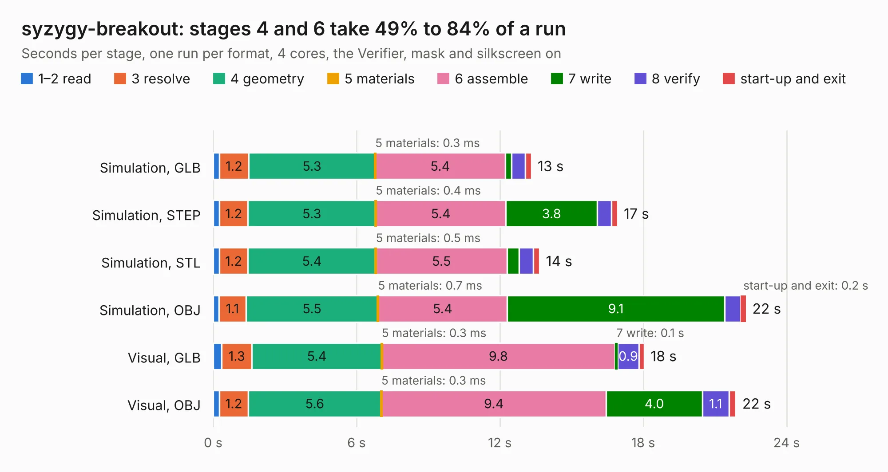

# 1176. syzygy-breakout

Board 1,176 of the 3,117 of [Corpus Testing](../Corpus-Testing.md), on [Corpus Page 11](../CorpusTestingPages/Corpus-Testing-11.md#1176-syzygy-breakout).

| Mode and format | 1–2 read | 3 resolve | 4 geometry | 5 materials | 6 assemble | 7 write | 8 verify | start-up and exit | Total |
|---|---:|---:|---:|---:|---:|---:|---:|---:|---:|
| Simulation, GLB | 0.3 | 1.2 | 5.3 | 0.3&nbsp;ms | 5.4 | 0.3 | 0.6 | 0.3 | 13.3 |
| Simulation, STEP | 0.3 | 1.2 | 5.3 | 0.4&nbsp;ms | 5.4 | 3.8 | 0.6 | 0.2 | 16.9 |
| Simulation, STL | 0.3 | 1.2 | 5.4 | 0.5&nbsp;ms | 5.5 | 0.5 | 0.6 | 0.3 | 13.7 |
| Simulation, OBJ | 0.2 | 1.1 | 5.5 | 0.7&nbsp;ms | 5.4 | 9.1 | 0.7 | 0.2 | 22.3 |
| Visual, GLB | 0.4 | 1.3 | 5.4 | 0.3&nbsp;ms | 9.8 | 0.1 | 0.9 | 0.2 | 18.0 |
| Visual, OBJ | 0.3 | 1.2 | 5.6 | 0.3&nbsp;ms | 9.4 | 4.0 | 1.1 | 0.3 | 21.9 |

<table align="center"><tr><td valign="top">

| Board | Repo: [gregdavill/advent-calendar-of-circuits-2020](https://github.com/gregdavill/advent-calendar-of-circuits-2020) Board: `syzygy-breakout.kicad_pcb` |
|---|---|
| Folder | syzygy-breakout / kicad-src |
| Complexity | 273&nbsp;/&nbsp;1000 (size&nbsp;158, features&nbsp;115) |
| KESE&nbsp;features | through vias, custom pads, rounded, trapezoid or chamfered pads, filled zones, copper drawings, curved board outline, stack-up, dielectric εr and tanδ, mask and silkscreen colours |
| Tested | 9th November 2026 |
| Copper&nbsp;layers | 4 |
| File&nbsp;format | KiCad 6 (20201116) |
| Parts,&nbsp;tracks,&nbsp;vias | 7, 399, 41 |
| Triangles,&nbsp;simulation | 1,777,548 in 70 parts |
| Verifier | PASS in all six runs |

</td><td valign="top">

<table>
<tr><th>File type</th><th>File size</th><th>Peak memory used</th></tr>
<tr><th colspan="3" align="left">Simulation</th></tr>
<tr><td>GLB</td><td align="right">58&nbsp;MB</td><td align="right">694&nbsp;MB</td></tr>
<tr><td>STEP</td><td align="right">216&nbsp;MB</td><td align="right">801&nbsp;MB</td></tr>
<tr><td>STL</td><td align="right">89&nbsp;MB</td><td align="right">673&nbsp;MB</td></tr>
<tr><td>OBJ</td><td align="right">181&nbsp;MB</td><td align="right">1.1&nbsp;GB</td></tr>
<tr><th colspan="3" align="left">Visual</th></tr>
<tr><td>GLB</td><td align="right">28&nbsp;MB</td><td align="right">682&nbsp;MB</td></tr>
<tr><td>OBJ</td><td align="right">85&nbsp;MB</td><td align="right">750&nbsp;MB</td></tr>
</table>

</td></tr></table>

| Previous | Next |
|:---|---:|
| [1175. SCD30-3d-model](b1175b_advent-calendar-of-circuits-2020_SCD30-3d-model.md) | [1177. syzygy-dual-atto320](b1177b_advent-calendar-of-circuits-2020_syzygy-dual-atto320.md) |
