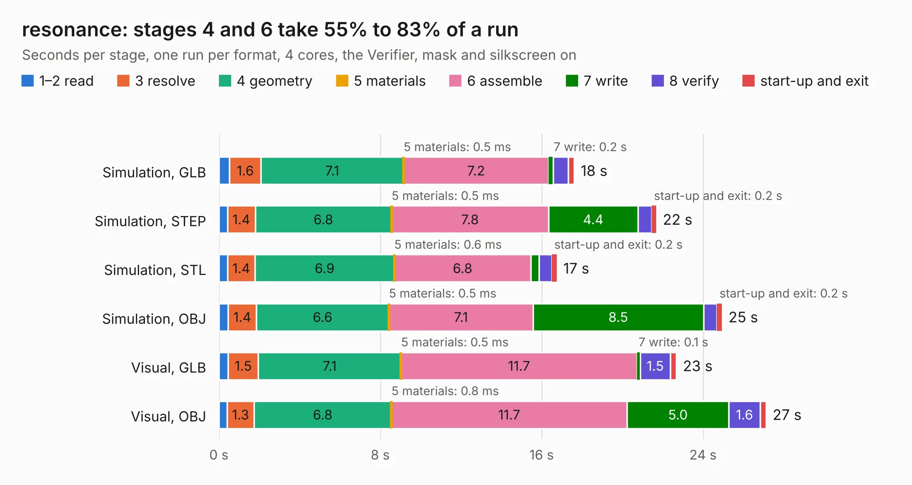

# 1179 resonance

Board 1,179 of the 3,138 of [Corpus Testing](../Corpus-Testing.md), on [Corpus Page 11](../CorpusTestingPages/Corpus-Testing-11.md#1179-resonance).

| Mode and format | 1–2 read | 3 resolve | 4 geometry | 5 materials | 6 assemble | 7 write | 8 verify | start-up and exit | Total |
|---|---:|---:|---:|---:|---:|---:|---:|---:|---:|
| Simulation, GLB | 0.5 | 1.6 | 7.1 | 0.5&nbsp;ms | 7.2 | 0.2 | 0.7 | 0.3 | 17.6 |
| Simulation, STEP | 0.4 | 1.4 | 6.8 | 0.5&nbsp;ms | 7.8 | 4.4 | 0.7 | 0.2 | 21.7 |
| Simulation, STL | 0.4 | 1.4 | 6.9 | 0.6&nbsp;ms | 6.8 | 0.4 | 0.6 | 0.2 | 16.7 |
| Simulation, OBJ | 0.5 | 1.4 | 6.6 | 0.5&nbsp;ms | 7.1 | 8.5 | 0.7 | 0.2 | 24.9 |
| Visual, GLB | 0.5 | 1.5 | 7.1 | 0.5&nbsp;ms | 11.7 | 0.1 | 1.5 | 0.3 | 22.7 |
| Visual, OBJ | 0.4 | 1.3 | 6.8 | 0.8&nbsp;ms | 11.7 | 5.0 | 1.6 | 0.3 | 27.1 |

<table align="center"><tr><td valign="top">

| Board | Repo: [gregdavill/advent-calendar-of-circuits-2020](https://github.com/gregdavill/advent-calendar-of-circuits-2020) Board: `resonance.kicad_pcb` |
|---|---|
| Folder | resonance / kicad-src |
| Complexity | 348&nbsp;/&nbsp;1000 (size&nbsp;248, features&nbsp;100) |
| KESE&nbsp;features | through vias, slotted holes, rounded, trapezoid or chamfered pads, filled zones, curved board outline, stack-up, dielectric εr and tanδ, mask and silkscreen colours |
| Tested | 9th November 2026 |
| Copper&nbsp;layers | 4 |
| File&nbsp;format | KiCad 6 (20201116) |
| Parts,&nbsp;tracks,&nbsp;vias | 64, 858, 149 |
| Triangles,&nbsp;simulation | 1,380,012 in 139 parts |
| Verifier | PASS in all six runs |

</td><td valign="top">

<table>
<tr><th>File type</th><th>File size</th><th>Peak memory used</th></tr>
<tr><th colspan="3" align="left">Simulation</th></tr>
<tr><td>GLB</td><td align="right">46&nbsp;MB</td><td align="right">548&nbsp;MB</td></tr>
<tr><td>STEP</td><td align="right">218&nbsp;MB</td><td align="right">674&nbsp;MB</td></tr>
<tr><td>STL</td><td align="right">69&nbsp;MB</td><td align="right">533&nbsp;MB</td></tr>
<tr><td>OBJ</td><td align="right">147&nbsp;MB</td><td align="right">942&nbsp;MB</td></tr>
<tr><th colspan="3" align="left">Visual</th></tr>
<tr><td>GLB</td><td align="right">28&nbsp;MB</td><td align="right">608&nbsp;MB</td></tr>
<tr><td>OBJ</td><td align="right">90&nbsp;MB</td><td align="right">699&nbsp;MB</td></tr>
</table>

</td></tr></table>

| Previous | Next |
|:---|---:|
| [1178 sd-dummy](b1178b_advent-calendar-of-circuits-2020_sd-dummy.md) | [1180 rpi-hq-camera](b1180b_advent-calendar-of-circuits-2020_rpi-hq-camera.md) |
