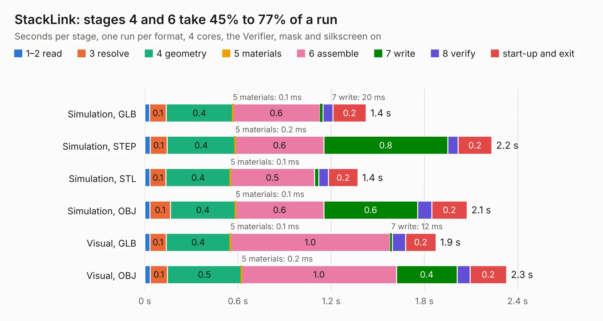

# 1180. StackLink

Board 1,180 of the 3,100 of [Corpus Testing](../Corpus-Testing.md), on [Corpus Page 11](../CorpusTestingPages/Corpus-Testing-11.md#1180-stacklink).

| Mode and format | 1–2 read | 3 resolve | 4 geometry | 5 materials | 6 assemble | 7 write | 8 verify | start-up and exit | Total |
|---|---:|---:|---:|---:|---:|---:|---:|---:|---:|
| Simulation, GLB | 32&nbsp;ms | 0.1 | 0.4 | 0.1&nbsp;ms | 0.6 | 20&nbsp;ms | 65&nbsp;ms | 0.2 | 1.4 |
| Simulation, STEP | 35&nbsp;ms | 0.1 | 0.4 | 0.2&nbsp;ms | 0.6 | 0.8 | 67&nbsp;ms | 0.2 | 2.2 |
| Simulation, STL | 34&nbsp;ms | 0.1 | 0.4 | 0.1&nbsp;ms | 0.5 | 27&nbsp;ms | 63&nbsp;ms | 0.2 | 1.4 |
| Simulation, OBJ | 34&nbsp;ms | 0.1 | 0.4 | 0.1&nbsp;ms | 0.6 | 0.6 | 92&nbsp;ms | 0.2 | 2.1 |
| Visual, GLB | 33&nbsp;ms | 0.1 | 0.4 | 0.1&nbsp;ms | 1.0 | 12&nbsp;ms | 86&nbsp;ms | 0.2 | 1.9 |
| Visual, OBJ | 36&nbsp;ms | 0.1 | 0.5 | 0.2&nbsp;ms | 1.0 | 0.4 | 83&nbsp;ms | 0.2 | 2.3 |

<table align="center"><tr><td valign="top">

| Board | Repo: [gusmanb/logicanalyzer](https://github.com/gusmanb/logicanalyzer) Board: `StackLink.kicad_pcb` |
|---|---|
| Folder | Electronics / LogicAnalyzer / StackLink / StackLink |
| Complexity | 137&nbsp;/&nbsp;1000 (size&nbsp;92, features&nbsp;45) |
| KESE&nbsp;features | through vias, slotted holes, filled zones |
| Tested | 9th November 2026 |
| Copper&nbsp;layers | 2 |
| File&nbsp;format | KiCad 8 (20240108) |
| Parts,&nbsp;tracks,&nbsp;vias | 5, 12, 6 |
| Triangles,&nbsp;simulation | 108,050 in 13 parts |
| Verifier | PASS in all six runs |

</td><td valign="top">

<table>
<tr><th>File type</th><th>File size</th><th>Peak memory used</th></tr>
<tr><th colspan="3" align="left">Simulation</th></tr>
<tr><td>GLB</td><td align="right">3.6&nbsp;MB</td><td align="right">170&nbsp;MB</td></tr>
<tr><td>STEP</td><td align="right">16&nbsp;MB</td><td align="right">170&nbsp;MB</td></tr>
<tr><td>STL</td><td align="right">5.4&nbsp;MB</td><td align="right">162&nbsp;MB</td></tr>
<tr><td>OBJ</td><td align="right">10&nbsp;MB</td><td align="right">169&nbsp;MB</td></tr>
<tr><th colspan="3" align="left">Visual</th></tr>
<tr><td>GLB</td><td align="right">2.4&nbsp;MB</td><td align="right">130&nbsp;MB</td></tr>
<tr><td>OBJ</td><td align="right">6.6&nbsp;MB</td><td align="right">133&nbsp;MB</td></tr>
</table>

</td></tr></table>

| Previous | Next |
|:---|---:|
| [1179. jitx-design](b1179b_logicanalyzer_jitx-design.md) | [1181. sprig_console](b1181b_sprig_hardware-mainboard-PCB-kicad_sprig-console.md) |
