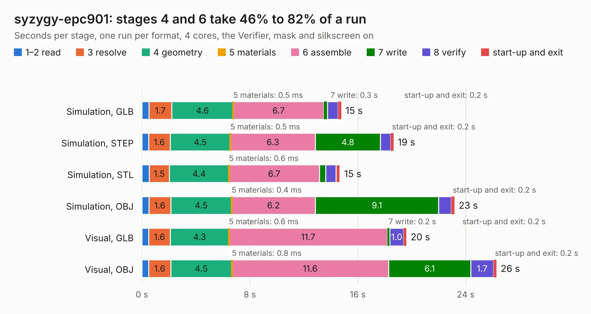

# 1182. syzygy-epc901

Board 1,182 of the 3,127 of [Corpus Testing](../Corpus-Testing.md), on [Corpus Page 11](../CorpusTestingPages/Corpus-Testing-11.md#1182-syzygy-epc901).

| Mode and format | 1–2 read | 3 resolve | 4 geometry | 5 materials | 6 assemble | 7 write | 8 verify | start-up and exit | Total |
|---|---:|---:|---:|---:|---:|---:|---:|---:|---:|
| Simulation, GLB | 0.5 | 1.7 | 4.6 | 0.5&nbsp;ms | 6.7 | 0.3 | 0.8 | 0.2 | 14.8 |
| Simulation, STEP | 0.5 | 1.6 | 4.5 | 0.5&nbsp;ms | 6.3 | 4.8 | 0.8 | 0.2 | 18.7 |
| Simulation, STL | 0.5 | 1.5 | 4.4 | 0.6&nbsp;ms | 6.7 | 0.5 | 0.8 | 0.3 | 14.7 |
| Simulation, OBJ | 0.5 | 1.6 | 4.5 | 0.4&nbsp;ms | 6.2 | 9.1 | 0.9 | 0.2 | 23.2 |
| Visual, GLB | 0.5 | 1.6 | 4.3 | 0.6&nbsp;ms | 11.7 | 0.2 | 1.0 | 0.2 | 19.6 |
| Visual, OBJ | 0.5 | 1.6 | 4.5 | 0.8&nbsp;ms | 11.6 | 6.1 | 1.7 | 0.2 | 26.3 |

<table align="center"><tr><td valign="top">

| Board | Repo: [gregdavill/advent-calendar-of-circuits-2020](https://github.com/gregdavill/advent-calendar-of-circuits-2020) Board: `syzygy-epc901.kicad_pcb` |
|---|---|
| Folder | syzygy-epc901 / kicad-src |
| Complexity | 380&nbsp;/&nbsp;1000 (size&nbsp;250, features&nbsp;130) |
| KESE&nbsp;features | through vias, custom pads, rounded, trapezoid or chamfered pads, arc tracks, filled zones, copper drawings, curved board outline, stack-up, dielectric εr and tanδ, mask and silkscreen colours |
| Tested | 9th November 2026 |
| Copper&nbsp;layers | 4 |
| File&nbsp;format | KiCad 6 (20210126) |
| Parts,&nbsp;tracks,&nbsp;vias | 97, 1,339, 308 |
| Triangles,&nbsp;simulation | 1,768,478 in 129 parts |
| Verifier | PASS in all six runs |

</td><td valign="top">

<table>
<tr><th>File type</th><th>File size</th><th>Peak memory used</th></tr>
<tr><th colspan="3" align="left">Simulation</th></tr>
<tr><td>GLB</td><td align="right">59&nbsp;MB</td><td align="right">645&nbsp;MB</td></tr>
<tr><td>STEP</td><td align="right">233&nbsp;MB</td><td align="right">869&nbsp;MB</td></tr>
<tr><td>STL</td><td align="right">88&nbsp;MB</td><td align="right">656&nbsp;MB</td></tr>
<tr><td>OBJ</td><td align="right">181&nbsp;MB</td><td align="right">1.2&nbsp;GB</td></tr>
<tr><th colspan="3" align="left">Visual</th></tr>
<tr><td>GLB</td><td align="right">39&nbsp;MB</td><td align="right">833&nbsp;MB</td></tr>
<tr><td>OBJ</td><td align="right">121&nbsp;MB</td><td align="right">895&nbsp;MB</td></tr>
</table>

</td></tr></table>

| Previous | Next |
|:---|---:|
| [1181. syzygy-dual-atto320](b1181b_advent-calendar-of-circuits-2020_syzygy-dual-atto320.md) | [1183. syzygy-flir-boson](b1183b_advent-calendar-of-circuits-2020_syzygy-flir-boson.md) |
