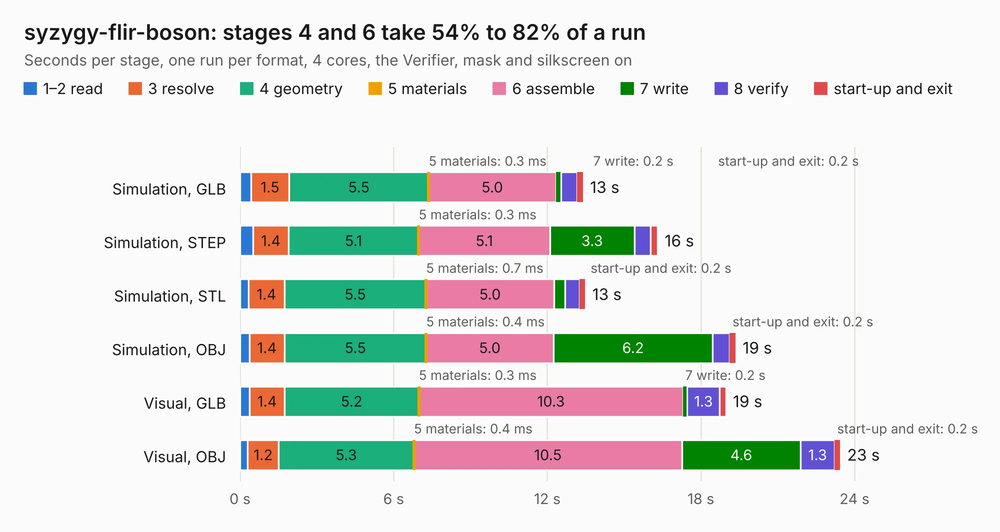

# 1184. syzygy-flir-boson

Board 1,184 of the 3,131 of [Corpus Testing](../Corpus-Testing.md), on [Corpus Page 11](../CorpusTestingPages/Corpus-Testing-11.md#1184-syzygy-flir-boson).

| Mode and format | 1–2 read | 3 resolve | 4 geometry | 5 materials | 6 assemble | 7 write | 8 verify | start-up and exit | Total |
|---|---:|---:|---:|---:|---:|---:|---:|---:|---:|
| Simulation, GLB | 0.4 | 1.5 | 5.5 | 0.3&nbsp;ms | 5.0 | 0.2 | 0.6 | 0.2 | 13.4 |
| Simulation, STEP | 0.5 | 1.4 | 5.1 | 0.3&nbsp;ms | 5.1 | 3.3 | 0.6 | 0.3 | 16.3 |
| Simulation, STL | 0.3 | 1.4 | 5.5 | 0.7&nbsp;ms | 5.0 | 0.4 | 0.6 | 0.2 | 13.5 |
| Simulation, OBJ | 0.4 | 1.4 | 5.5 | 0.4&nbsp;ms | 5.0 | 6.2 | 0.7 | 0.2 | 19.4 |
| Visual, GLB | 0.4 | 1.4 | 5.2 | 0.3&nbsp;ms | 10.3 | 0.2 | 1.3 | 0.2 | 19.0 |
| Visual, OBJ | 0.3 | 1.2 | 5.3 | 0.4&nbsp;ms | 10.5 | 4.6 | 1.3 | 0.2 | 23.4 |

<table align="center"><tr><td valign="top">

| Board | Repo: [gregdavill/advent-calendar-of-circuits-2020](https://github.com/gregdavill/advent-calendar-of-circuits-2020) Board: `syzygy-flir-boson.kicad_pcb` |
|---|---|
| Folder | syzygy-flir-boson / kicad-src |
| Complexity | 312&nbsp;/&nbsp;1000 (size&nbsp;197, features&nbsp;115) |
| KESE&nbsp;features | through vias, custom pads, rounded, trapezoid or chamfered pads, filled zones, copper drawings, curved board outline, stack-up, dielectric εr and tanδ, mask and silkscreen colours |
| Tested | 9th November 2026 |
| Copper&nbsp;layers | 4 |
| File&nbsp;format | KiCad 6 (20210126) |
| Parts,&nbsp;tracks,&nbsp;vias | 35, 906, 375 |
| Triangles,&nbsp;simulation | 1,359,476 in 105 parts |
| Verifier | PASS in all six runs |

</td><td valign="top">

<table>
<tr><th>File type</th><th>File size</th><th>Peak memory used</th></tr>
<tr><th colspan="3" align="left">Simulation</th></tr>
<tr><td>GLB</td><td align="right">45&nbsp;MB</td><td align="right">599&nbsp;MB</td></tr>
<tr><td>STEP</td><td align="right">179&nbsp;MB</td><td align="right">701&nbsp;MB</td></tr>
<tr><td>STL</td><td align="right">68&nbsp;MB</td><td align="right">606&nbsp;MB</td></tr>
<tr><td>OBJ</td><td align="right">137&nbsp;MB</td><td align="right">919&nbsp;MB</td></tr>
<tr><th colspan="3" align="left">Visual</th></tr>
<tr><td>GLB</td><td align="right">32&nbsp;MB</td><td align="right">758&nbsp;MB</td></tr>
<tr><td>OBJ</td><td align="right">98&nbsp;MB</td><td align="right">812&nbsp;MB</td></tr>
</table>

</td></tr></table>

| Previous | Next |
|:---|---:|
| [1183. syzygy-epc901](b1183b_advent-calendar-of-circuits-2020_syzygy-epc901.md) | [1185. syzygy-flir-tau2](b1185b_advent-calendar-of-circuits-2020_syzygy-flir-tau2.md) |
