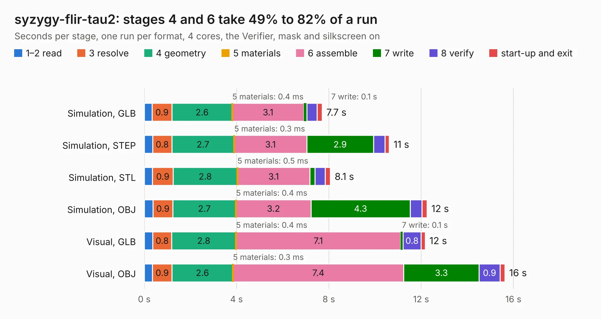

# 1184. syzygy-flir-tau2

Board 1,184 of the 3,123 of [Corpus Testing](../Corpus-Testing.md), on [Corpus Page 11](../CorpusTestingPages/Corpus-Testing-11.md#1184-syzygy-flir-tau2).

| Mode and format | 1–2 read | 3 resolve | 4 geometry | 5 materials | 6 assemble | 7 write | 8 verify | start-up and exit | Total |
|---|---:|---:|---:|---:|---:|---:|---:|---:|---:|
| Simulation, GLB | 0.3 | 0.9 | 2.6 | 0.4&nbsp;ms | 3.1 | 0.1 | 0.4 | 0.2 | 7.7 |
| Simulation, STEP | 0.4 | 0.8 | 2.7 | 0.3&nbsp;ms | 3.1 | 2.9 | 0.5 | 0.2 | 10.6 |
| Simulation, STL | 0.4 | 0.9 | 2.8 | 0.5&nbsp;ms | 3.1 | 0.2 | 0.5 | 0.2 | 8.1 |
| Simulation, OBJ | 0.4 | 0.9 | 2.7 | 0.4&nbsp;ms | 3.2 | 4.3 | 0.5 | 0.2 | 12.3 |
| Visual, GLB | 0.4 | 0.8 | 2.8 | 0.4&nbsp;ms | 7.1 | 0.1 | 0.8 | 0.2 | 12.2 |
| Visual, OBJ | 0.4 | 0.9 | 2.6 | 0.3&nbsp;ms | 7.4 | 3.3 | 0.9 | 0.2 | 15.6 |

<table align="center"><tr><td valign="top">

| Board | Repo: [gregdavill/advent-calendar-of-circuits-2020](https://github.com/gregdavill/advent-calendar-of-circuits-2020) Board: `syzygy-flir-tau2.kicad_pcb` |
|---|---|
| Folder | syzygy-flir-tau2 / kicad-src |
| Complexity | 310&nbsp;/&nbsp;1000 (size&nbsp;195, features&nbsp;115) |
| KESE&nbsp;features | through vias, custom pads, rounded, trapezoid or chamfered pads, filled zones, copper drawings, curved board outline, stack-up, dielectric εr and tanδ, mask and silkscreen colours |
| Tested | 9th November 2026 |
| Copper&nbsp;layers | 4 |
| File&nbsp;format | KiCad 6 (20201116) |
| Parts,&nbsp;tracks,&nbsp;vias | 32, 1,446, 138 |
| Triangles,&nbsp;simulation | 1,050,638 in 82 parts |
| Verifier | PASS in all six runs |

</td><td valign="top">

<table>
<tr><th>File type</th><th>File size</th><th>Peak memory used</th></tr>
<tr><th colspan="3" align="left">Simulation</th></tr>
<tr><td>GLB</td><td align="right">36&nbsp;MB</td><td align="right">541&nbsp;MB</td></tr>
<tr><td>STEP</td><td align="right">182&nbsp;MB</td><td align="right">589&nbsp;MB</td></tr>
<tr><td>STL</td><td align="right">53&nbsp;MB</td><td align="right">508&nbsp;MB</td></tr>
<tr><td>OBJ</td><td align="right">106&nbsp;MB</td><td align="right">737&nbsp;MB</td></tr>
<tr><th colspan="3" align="left">Visual</th></tr>
<tr><td>GLB</td><td align="right">26&nbsp;MB</td><td align="right">673&nbsp;MB</td></tr>
<tr><td>OBJ</td><td align="right">80&nbsp;MB</td><td align="right">676&nbsp;MB</td></tr>
</table>

</td></tr></table>

| Previous | Next |
|:---|---:|
| [1183. syzygy-flir-boson](b1183b_advent-calendar-of-circuits-2020_syzygy-flir-boson.md) | [1185. syzygy-pmod](b1185b_advent-calendar-of-circuits-2020_syzygy-pmod.md) |
