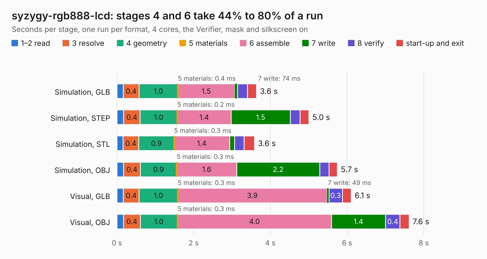

# 1186. syzygy-rgb888-lcd

Board 1,186 of the 3,126 of [Corpus Testing](../Corpus-Testing.md), on [Corpus Page 11](../CorpusTestingPages/Corpus-Testing-11.md#1186-syzygy-rgb888-lcd).

| Mode and format | 1–2 read | 3 resolve | 4 geometry | 5 materials | 6 assemble | 7 write | 8 verify | start-up and exit | Total |
|---|---:|---:|---:|---:|---:|---:|---:|---:|---:|
| Simulation, GLB | 0.2 | 0.4 | 1.0 | 0.4&nbsp;ms | 1.5 | 74&nbsp;ms | 0.3 | 0.2 | 3.6 |
| Simulation, STEP | 0.2 | 0.4 | 1.0 | 0.2&nbsp;ms | 1.4 | 1.5 | 0.3 | 0.2 | 5.0 |
| Simulation, STL | 0.2 | 0.4 | 0.9 | 0.3&nbsp;ms | 1.4 | 0.1 | 0.2 | 0.3 | 3.6 |
| Simulation, OBJ | 0.2 | 0.4 | 0.9 | 0.3&nbsp;ms | 1.6 | 2.2 | 0.2 | 0.2 | 5.7 |
| Visual, GLB | 0.2 | 0.4 | 1.0 | 0.3&nbsp;ms | 3.9 | 49&nbsp;ms | 0.3 | 0.2 | 6.1 |
| Visual, OBJ | 0.2 | 0.4 | 1.0 | 0.3&nbsp;ms | 4.0 | 1.4 | 0.4 | 0.2 | 7.6 |

<table align="center"><tr><td valign="top">

| Board | Repo: [gregdavill/advent-calendar-of-circuits-2020](https://github.com/gregdavill/advent-calendar-of-circuits-2020) Board: `syzygy-rgb888-lcd.kicad_pcb` |
|---|---|
| Folder | syzygy-rgb888-lcd / kicad-src |
| Complexity | 282&nbsp;/&nbsp;1000 (size&nbsp;167, features&nbsp;115) |
| KESE&nbsp;features | through vias, custom pads, rounded, trapezoid or chamfered pads, filled zones, copper drawings, curved board outline, stack-up, dielectric εr and tanδ, mask and silkscreen colours |
| Tested | 9th November 2026 |
| Copper&nbsp;layers | 4 |
| File&nbsp;format | KiCad 6 (20201116) |
| Parts,&nbsp;tracks,&nbsp;vias | 15, 359, 65 |
| Triangles,&nbsp;simulation | 448,792 in 79 parts |
| Verifier | PASS in all six runs |

</td><td valign="top">

<table>
<tr><th>File type</th><th>File size</th><th>Peak memory used</th></tr>
<tr><th colspan="3" align="left">Simulation</th></tr>
<tr><td>GLB</td><td align="right">15&nbsp;MB</td><td align="right">305&nbsp;MB</td></tr>
<tr><td>STEP</td><td align="right">62&nbsp;MB</td><td align="right">317&nbsp;MB</td></tr>
<tr><td>STL</td><td align="right">22&nbsp;MB</td><td align="right">299&nbsp;MB</td></tr>
<tr><td>OBJ</td><td align="right">45&nbsp;MB</td><td align="right">348&nbsp;MB</td></tr>
<tr><th colspan="3" align="left">Visual</th></tr>
<tr><td>GLB</td><td align="right">9.8&nbsp;MB</td><td align="right">317&nbsp;MB</td></tr>
<tr><td>OBJ</td><td align="right">30&nbsp;MB</td><td align="right">321&nbsp;MB</td></tr>
</table>

</td></tr></table>

| Previous | Next |
|:---|---:|
| [1185. syzygy-pmod](b1185b_advent-calendar-of-circuits-2020_syzygy-pmod.md) | [1187. syzygy-sgmii](b1187b_advent-calendar-of-circuits-2020_syzygy-sgmii.md) |
