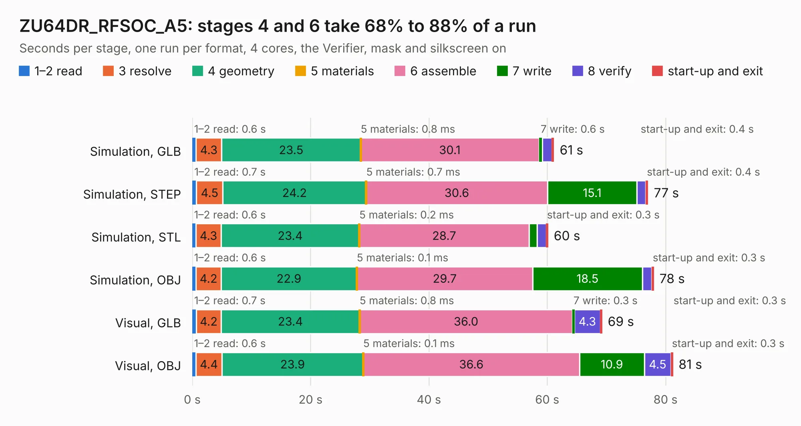

# 1187. ZU64DR_RFSOC_A5

Board 1,187 of the 3,103 of [Corpus Testing](../Corpus-Testing.md), on [Corpus Page 11](../CorpusTestingPages/Corpus-Testing-11.md#1187-zu64dr_rfsoc_a5).

| Mode and format | 1–2 read | 3 resolve | 4 geometry | 5 materials | 6 assemble | 7 write | 8 verify | start-up and exit | Total |
|---|---:|---:|---:|---:|---:|---:|---:|---:|---:|
| Simulation, GLB | 0.6 | 4.3 | 23.5 | 0.8&nbsp;ms | 30.1 | 0.6 | 1.6 | 0.4 | 61.1 |
| Simulation, STEP | 0.7 | 4.5 | 24.2 | 0.7&nbsp;ms | 30.6 | 15.1 | 1.5 | 0.4 | 77.1 |
| Simulation, STL | 0.6 | 4.3 | 23.4 | 0.2&nbsp;ms | 28.7 | 1.4 | 1.5 | 0.3 | 60.1 |
| Simulation, OBJ | 0.6 | 4.2 | 22.9 | 0.1&nbsp;ms | 29.7 | 18.5 | 1.6 | 0.3 | 78.0 |
| Visual, GLB | 0.7 | 4.2 | 23.4 | 0.8&nbsp;ms | 36.0 | 0.3 | 4.3 | 0.3 | 69.3 |
| Visual, OBJ | 0.6 | 4.4 | 23.9 | 0.1&nbsp;ms | 36.6 | 10.9 | 4.5 | 0.3 | 81.2 |

<table align="center"><tr><td valign="top">

| Board | Repo: [hamedroghani/zu64dr_rfsoc_kicad](https://github.com/hamedroghani/zu64dr_rfsoc_kicad) Board: `ZU64DR_RFSOC_A5.kicad_pcb` |
|---|---|
| Complexity | 229&nbsp;/&nbsp;1000 (size&nbsp;184, features&nbsp;45) |
| KESE&nbsp;features | stack-up, dielectric εr and tanδ, copper finish |
| Tested | 9th November 2026 |
| Copper&nbsp;layers | 12 |
| File&nbsp;format | KiCad 8 (20231120) |
| Parts,&nbsp;tracks,&nbsp;vias | 75, 0, 0 |
| Triangles,&nbsp;simulation | 3,488,834 in 35 parts |
| Note | mostly unrouted |
| Verifier | PASS in all six runs |

</td><td valign="top">

<table>
<tr><th>File type</th><th>File size</th><th>Peak memory used</th></tr>
<tr><th colspan="3" align="left">Simulation</th></tr>
<tr><td>GLB</td><td align="right">123&nbsp;MB</td><td align="right">1.5&nbsp;GB</td></tr>
<tr><td>STEP</td><td align="right">685&nbsp;MB</td><td align="right">2.0&nbsp;GB</td></tr>
<tr><td>STL</td><td align="right">174&nbsp;MB</td><td align="right">1.5&nbsp;GB</td></tr>
<tr><td>OBJ</td><td align="right">374&nbsp;MB</td><td align="right">2.4&nbsp;GB</td></tr>
<tr><th colspan="3" align="left">Visual</th></tr>
<tr><td>GLB</td><td align="right">72&nbsp;MB</td><td align="right">1.6&nbsp;GB</td></tr>
<tr><td>OBJ</td><td align="right">221&nbsp;MB</td><td align="right">1.6&nbsp;GB</td></tr>
</table>

</td></tr></table>

| Previous | Next |
|:---|---:|
| [1186. sprig_console](b1186b_sprig_sprig-hax-hardware-SprigHaxPCB-kicad_sprig-console.md) | [1188. Easyduino_Atmega_Nano](b1188b_Easyduino_Easyduino-Atmega-Nano.md) |
