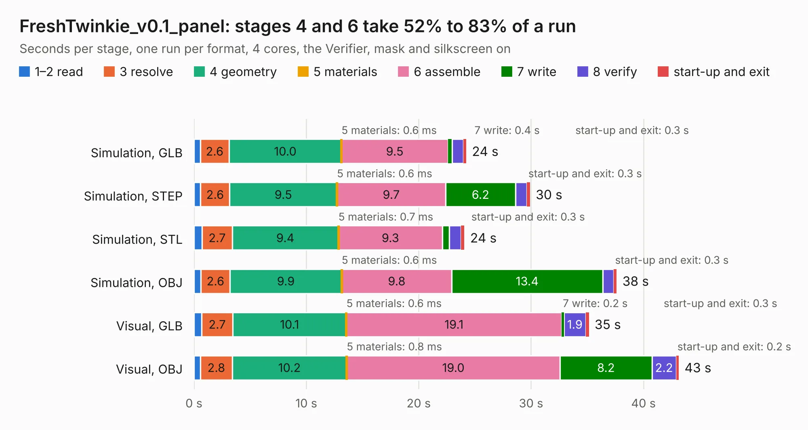

# 1188. FreshTwinkie_v0.1_panel

Board 1,188 of the 3,118 of [Corpus Testing](../Corpus-Testing.md), on [Corpus Page 11](../CorpusTestingPages/Corpus-Testing-11.md#1188-freshtwinkie_v01_panel).

| Mode and format | 1–2 read | 3 resolve | 4 geometry | 5 materials | 6 assemble | 7 write | 8 verify | start-up and exit | Total |
|---|---:|---:|---:|---:|---:|---:|---:|---:|---:|
| Simulation, GLB | 0.6 | 2.6 | 10.0 | 0.6&nbsp;ms | 9.5 | 0.4 | 1.0 | 0.3 | 24.2 |
| Simulation, STEP | 0.6 | 2.6 | 9.5 | 0.6&nbsp;ms | 9.7 | 6.2 | 1.0 | 0.3 | 29.9 |
| Simulation, STL | 0.7 | 2.7 | 9.4 | 0.7&nbsp;ms | 9.3 | 0.6 | 1.0 | 0.3 | 24.1 |
| Simulation, OBJ | 0.6 | 2.6 | 9.9 | 0.6&nbsp;ms | 9.8 | 13.4 | 1.0 | 0.3 | 37.6 |
| Visual, GLB | 0.7 | 2.7 | 10.1 | 0.6&nbsp;ms | 19.1 | 0.2 | 1.9 | 0.3 | 35.1 |
| Visual, OBJ | 0.6 | 2.8 | 10.2 | 0.8&nbsp;ms | 19.0 | 8.2 | 2.2 | 0.2 | 43.1 |

<table align="center"><tr><td valign="top">

| Board | Repo: [gregdavill/PD-sniffer](https://github.com/gregdavill/PD-sniffer) Board: `FreshTwinkie_v0.1_panel.kicad_pcb` |
|---|---|
| Folder | hw / FreshTwinkie_v0.1_panel |
| Complexity | 361&nbsp;/&nbsp;1000 (size&nbsp;261, features&nbsp;100) |
| KESE&nbsp;features | through vias, slotted holes, custom pads, rounded, trapezoid or chamfered pads, filled zones, copper drawings, copper text, curved board outline |
| Tested | 9th November 2026 |
| Copper&nbsp;layers | 4 |
| File&nbsp;format | KiCad 5 (20171130) |
| Parts,&nbsp;tracks,&nbsp;vias | 100, 2,028, 290 |
| Triangles,&nbsp;simulation | 2,186,448 in 94 parts |
| Note | panel |
| Verifier | PASS in all six runs |

</td><td valign="top">

<table>
<tr><th>File type</th><th>File size</th><th>Peak memory used</th></tr>
<tr><th colspan="3" align="left">Simulation</th></tr>
<tr><td>GLB</td><td align="right">76&nbsp;MB</td><td align="right">752&nbsp;MB</td></tr>
<tr><td>STEP</td><td align="right">323&nbsp;MB</td><td align="right">941&nbsp;MB</td></tr>
<tr><td>STL</td><td align="right">109&nbsp;MB</td><td align="right">750&nbsp;MB</td></tr>
<tr><td>OBJ</td><td align="right">235&nbsp;MB</td><td align="right">1.5&nbsp;GB</td></tr>
<tr><th colspan="3" align="left">Visual</th></tr>
<tr><td>GLB</td><td align="right">46&nbsp;MB</td><td align="right">1.0&nbsp;GB</td></tr>
<tr><td>OBJ</td><td align="right">144&nbsp;MB</td><td align="right">1.0&nbsp;GB</td></tr>
</table>

</td></tr></table>

| Previous | Next |
|:---|---:|
| [1187. FreshTwinkie](b1187b_PD-sniffer_FreshTwinkie.md) | [1189. kimchi_micro](b1189b_kimchi-micro_kimchi-micro.md) |
