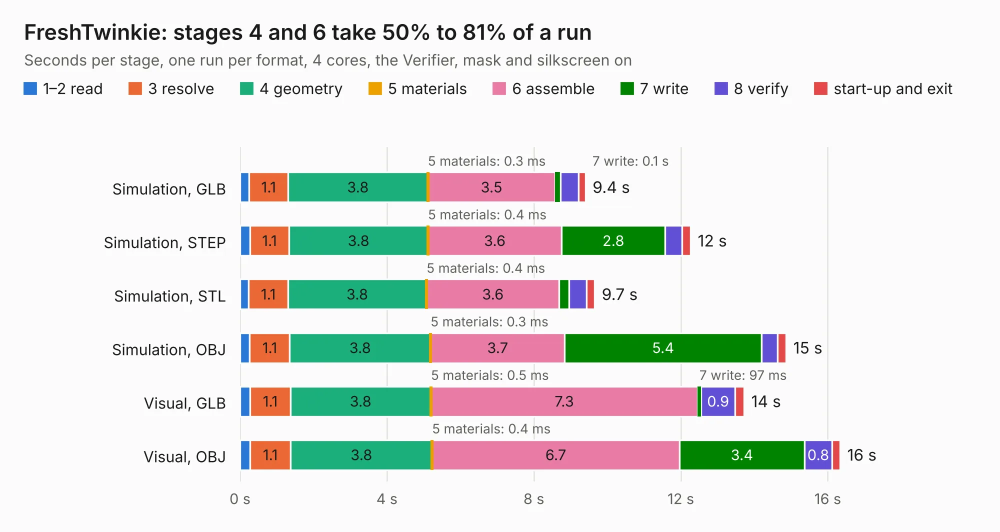

# 1190. FreshTwinkie

Board 1,190 of the 3,124 of [Corpus Testing](../Corpus-Testing.md), on [Corpus Page 12](../CorpusTestingPages/Corpus-Testing-12.md#1190-freshtwinkie).

| Mode and format | 1–2 read | 3 resolve | 4 geometry | 5 materials | 6 assemble | 7 write | 8 verify | start-up and exit | Total |
|---|---:|---:|---:|---:|---:|---:|---:|---:|---:|
| Simulation, GLB | 0.2 | 1.1 | 3.8 | 0.3&nbsp;ms | 3.5 | 0.1 | 0.5 | 0.2 | 9.4 |
| Simulation, STEP | 0.3 | 1.1 | 3.8 | 0.4&nbsp;ms | 3.6 | 2.8 | 0.5 | 0.2 | 12.3 |
| Simulation, STL | 0.2 | 1.1 | 3.8 | 0.4&nbsp;ms | 3.6 | 0.3 | 0.5 | 0.2 | 9.7 |
| Simulation, OBJ | 0.3 | 1.1 | 3.8 | 0.3&nbsp;ms | 3.7 | 5.4 | 0.4 | 0.2 | 14.9 |
| Visual, GLB | 0.3 | 1.1 | 3.8 | 0.5&nbsp;ms | 7.3 | 97&nbsp;ms | 0.9 | 0.2 | 13.7 |
| Visual, OBJ | 0.3 | 1.1 | 3.8 | 0.4&nbsp;ms | 6.7 | 3.4 | 0.8 | 0.2 | 16.3 |

<table align="center"><tr><td valign="top">

| Board | Repo: [gregdavill/PD-sniffer](https://github.com/gregdavill/PD-sniffer) Board: `FreshTwinkie.kicad_pcb` |
|---|---|
| Folder | hw / FreshTwinkie_v0.1 |
| Complexity | 325&nbsp;/&nbsp;1000 (size&nbsp;235, features&nbsp;90) |
| KESE&nbsp;features | through vias, slotted holes, custom pads, rounded, trapezoid or chamfered pads, filled zones, copper drawings, curved board outline |
| Tested | 9th November 2026 |
| Copper&nbsp;layers | 4 |
| File&nbsp;format | KiCad 5 (20171130) |
| Parts,&nbsp;tracks,&nbsp;vias | 50, 1,014, 145 |
| Triangles,&nbsp;simulation | 1,049,192 in 93 parts |
| Verifier | PASS in all six runs |

</td><td valign="top">

<table>
<tr><th>File type</th><th>File size</th><th>Peak memory used</th></tr>
<tr><th colspan="3" align="left">Simulation</th></tr>
<tr><td>GLB</td><td align="right">36&nbsp;MB</td><td align="right">468&nbsp;MB</td></tr>
<tr><td>STEP</td><td align="right">155&nbsp;MB</td><td align="right">555&nbsp;MB</td></tr>
<tr><td>STL</td><td align="right">52&nbsp;MB</td><td align="right">484&nbsp;MB</td></tr>
<tr><td>OBJ</td><td align="right">109&nbsp;MB</td><td align="right">736&nbsp;MB</td></tr>
<tr><th colspan="3" align="left">Visual</th></tr>
<tr><td>GLB</td><td align="right">21&nbsp;MB</td><td align="right">501&nbsp;MB</td></tr>
<tr><td>OBJ</td><td align="right">65&nbsp;MB</td><td align="right">523&nbsp;MB</td></tr>
</table>

</td></tr></table>

| Previous | Next |
|:---|---:|
| [1189. obsidian-boa-r0.1](b1189b_obsidian-boa_obsidian-boa-r0-1.md) | [1191. FreshTwinkie_v0.1_panel](b1191b_PD-sniffer_FreshTwinkie-v0-1-panel.md) |
